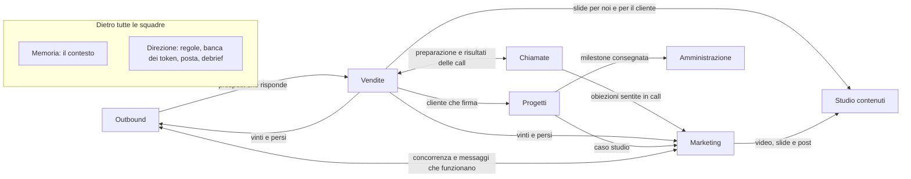
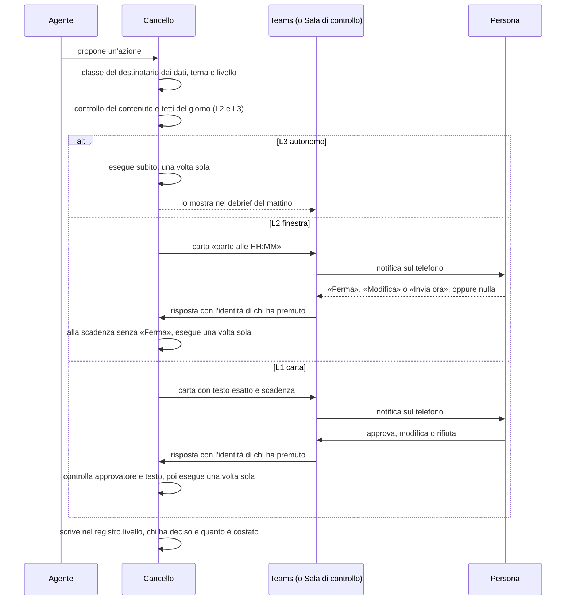

# Design del sistema

> **Aggiornato l'11 novembre 2026 all'architettura v3**, «Cancello a livelli e motore a due corsie» ([ricerca/45](../ricerca/45-architettura-v3.md); [ADR da 0020 a 0028](adr/README.md)). Per chi usa il sistema sono cambiate tre cose:
> - ogni azione ha un livello di autonomia, da L0 a L3: non serve più una carta per ogni azione esterna, e alcune azioni partono da sole dopo una finestra in cui una persona può premere «Ferma» ([ADR-0020](adr/0020-autonomia-a-livelli.md));
> - gli agenti si passano il lavoro su una bacheca e lo mostrano in gruppi di chat per squadra, per cliente e in un gruppo comune «Agenti», subito dopo la milestone 1 ([ADR-0026](adr/0026-bacheca-e-gruppi-degli-agenti.md));
> - quando il sistema ha un dubbio diventa più prudente: la persona riceve una carta con la domanda e le probabilità; un router sceglie dove far girare ogni lavoro, anche sui posti Claude Team per lo sviluppo in codice ([ADR-0027](adr/0027-decisore.md); [ADR-0028](adr/0028-instradamento-a-piu-motori.md)).
>
> **Il 12 novembre 2026** il gruppo di progetto ha fissato le scelte della milestone 2 ([ADR-0029](adr/0029-corsia-s-sessioni-a-giri.md); [ADR-0030](adr/0030-bacheca-gruppi-specchi.md)): nella milestone 2 i gruppi degli agenti si vedono nella Sala di controllo, e passano in Teams o in Buzz quando quella chat c'è; i passaggi fra agenti non sono azioni del Cancello; il router entra nella milestone 2 ([ADR-0028](adr/0028-instradamento-a-piu-motori.md)).

SerSan Agent OS visto da chi lo usa e da chi lo costruisce: le nove squadre di agenti e chi ne risponde, come si passano il lavoro, come si approva dal telefono, com'è una giornata con il sistema, le regole che valgono sempre e le cose che restano alle persone. L'ultima sezione spiega come sono fatti i documenti del progetto.

Il 10 novembre 2026 i CEO hanno approvato il progetto e hanno lasciato al gruppo di progetto le scelte e l'avvio ([ricerca/45, «Decisione del gruppo di progetto»](../ricerca/45-architettura-v3.md)). Livelli, regole del Cancello, motore e chat degli agenti sono quelli della v3: la sintesi del terzo giro ([ricerca/45](../ricerca/45-architettura-v3.md)) e le [ADR](adr/README.md). Squadre, agenti, fasi e cifre che la v3 non cambia restano quelli della proposta per i CEO, versione 2.1 dell'8 novembre 2026 ([proposta, intestazione](../PRESENTAZIONE-CEO.md)). Dove la v3 supera la proposta, la citazione della proposta resta come storia e accanto c'è la regola di oggi con la sua fonte. Quando un dettaglio tecnico non è in queste fonti, il rimando porta all'architettura del 25 ottobre 2026 ([ricerca/36, intestazione](../ricerca/36-architettura-v2.md)): quei dettagli sono proposte da confermare durante lo sviluppo.

Le "milestone" sono i passi dello sviluppo. Il codice, con il PRD (il documento dei requisiti), lo spec e i piani, sta in una repo privata dell'organizzazione, «sersan-agent-os-codice». Le milestone del PRD sono sette: 1) Cancello a livelli e corsia N, con la Sala di controllo; 2) corsia S, bacheca e gruppi degli agenti, prova di Buzz, primo modello open-weight e, dal 12 novembre, il router a più motori ([ADR-0028](adr/0028-instradamento-a-piu-motori.md)); 3) prove con Microsoft e LiteLLM; 4) telefono e posta; 5) dalla call al riassunto; 6) tre agenti sul banco; 7) collaudo della settimana 8. Questa numerazione sostituisce quella di [ricerca/45 §6.4 e §12](../ricerca/45-architettura-v3.md), perché la corsia S è stata anticipata; il contenuto di ogni milestone è in [architettura §4.4](03-architettura.md). Lo sviluppo è partito il 10 novembre 2026 sulle macchine di sviluppo, con dati di prova e un modello a copione, cioè un modello finto che dà risposte scritte prima, senza chiave API.

## 1. Le parole che usiamo

| Parola | Cosa vuol dire | Fonte |
|---|---|---|
| Agente | Un programma che lavora con un modello di AI su un compito preciso, dentro una squadra con un responsabile umano. Il disegno ne conta 57 | [proposta §1, §4](../PRESENTAZIONE-CEO.md) |
| Motore | Il programma sul nostro server che fa girare gli agenti, scritto da noi in TypeScript. Ha due corsie: la **corsia N** fa girare catene a schema, dove il codice sceglie i passi e i destinatari e il modello scrive senza strumenti; la **corsia S** fa girare sessioni dell'Agent SDK di Claude, cioè Claude Code usato come libreria, per gli agenti che ragionano a più passi. Ogni lavoro ha il profilo dell'agente e un tetto di spesa | [ADR-0021](adr/0021-motore-a-due-corsie.md) |
| Corsia T | Una sessione di Claude Code sul posto Claude Team della persona responsabile, che il motore avvia con un compito programmato per lo sviluppo di progetti in codice e per i lavori lunghi di quattro agenti. Consegna una pull request, cioè una proposta di modifica al codice, che entra solo con il sì di una persona. Il motore non usa mai il login di un posto: tiene solo il token che avvia quel compito. Entra dopo la prova e la conferma scritta di Anthropic | [ADR-0028](adr/0028-instradamento-a-piu-motori.md) |
| Router | La parte del motore che sceglie dove far girare ogni lavoro, fra sei destinazioni: una regola nel codice, una catena N su un modello del nostro server, una catena N su Claude via API, una sessione S, la corsia T, una persona | [ADR-0028](adr/0028-instradamento-a-piu-motori.md) |
| Decisore | La parte del motore che risponde a domande chiuse (sì o no, una scelta, un punteggio) con una probabilità per ogni risposta. Le soglie stanno in un file. Una sua risposta può solo rendere il sistema più prudente. Il motore di partenza è Jev, un modello «System One» fatto per decidere, sui testi non riservati; entra nella milestone 3, con LiteLLM, e fino ad allora decidono il copione, un modello a schema e un modello in casa | [ADR-0027](adr/0027-decisore.md) |
| Cancello | Il nostro programma che esegue le azioni verso l'esterno. È l'unico che può mandare una mail, scrivere al cliente, toccare il CRM (l'archivio di contatti e trattative) o telefonare. Dà a ogni azione il suo livello, esegue una volta sola e registra tutto | [proposta §5.1](../PRESENTAZIONE-CEO.md), [ADR-0020](adr/0020-autonomia-a-livelli.md) |
| Livello | Quanto un'azione parte da sola: L0 a mano, L1 con una carta, L2 dopo una finestra, L3 da sola. Vale per una terna: agente, tipo d'azione, classe di destinatari (sezione 5.5) | [ADR-0020](adr/0020-autonomia-a-livelli.md) |
| Carta | La richiesta di approvazione che arriva in Teams per un'azione a L1: il testo esatto dell'azione, una scadenza e i pulsanti per rispondere | [proposta §5.4](../PRESENTAZIONE-CEO.md), [ADR-0023](adr/0023-protezioni-essenziali.md) |
| Finestra | Il tempo, in orario di lavoro, dopo cui un'azione a L2 parte da sola se nessuno preme «Ferma». La carta dice «parte alle HH:MM» | [ADR-0020](adr/0020-autonomia-a-livelli.md) |
| Regola "Sempre" | Nella proposta, un'approvazione ripetuta uguale che una persona rendeva automatica per 30 giorni, solo per un agente, un tipo di azione e una destinazione. Dal 10 novembre non c'è più: la sostituiscono i livelli e la promozione | [proposta §5.4](../PRESENTAZIONE-CEO.md), [ADR-0003, revisione del 10 novembre](adr/0003-cancello-approvazioni.md) |
| Bacheca | Il posto, nel motore, dove gli agenti si passano il lavoro, con un freno che ferma le catene troppo lunghe. I passaggi si vedono nei gruppi degli agenti: nella milestone 2 nella Sala di controllo, poi nelle chat | [ADR-0026](adr/0026-bacheca-e-gruppi-degli-agenti.md), [ADR-0030](adr/0030-bacheca-gruppi-specchi.md) |
| Sala di controllo | La pagina web della milestone 1 dove si vedono e si decidono carte, finestre, promozioni, «sbagliato», «Annulla», «Rettifica», tetti e stop di emergenza; fa da Porta di prova finché non c'è quella di Teams, e si apre anche dal telefono, sulla rete dell'ufficio | [architettura §1.3](03-architettura.md) |
| Porta chat | Il nostro programma che porta gli agenti in Teams e poi in Telegram, Slack e WhatsApp | [proposta §5.2](../PRESENTAZIONE-CEO.md), [ricerca/28, in breve](../ricerca/28-chat-di-gruppo-self-hosted.md) |
| Server MCP | Una presa standard a cui un agente si collega per usare uno strumento, per esempio il CRM o la memoria | [proposta §7.3](../PRESENTAZIONE-CEO.md) |
| LiteLLM | L'unica porta verso i modelli: Claude via API, i modelli open-weight (i modelli con i pesi pubblici, che possono girare sul nostro server) e Jev. Dà a ogni agente, squadra e persona il suo budget, cioè quanto può spendere in token, le unità di testo che i modelli contano e fanno pagare. La corsia T non passa da qui: usa l'uso del posto | [proposta §5.1](../PRESENTAZIONE-CEO.md), [ADR-0004, revisioni](adr/0004-litellm-banca-token.md) |
| n8n | Il servizio del board che tiene alcune integrazioni. Dalla v3 è facoltativo: gli orari stanno nella sveglia del motore e gli eventi entrano nel motore da un ingresso unico | [proposta §5.3](../PRESENTAZIONE-CEO.md), [ADR-0022](adr/0022-eventi-e-sveglia-nel-motore.md) |
| SersanOutreach | La nostra piattaforma outbound, cioè per contattare nuovi potenziali clienti, su LinkedIn e per email; diventa il CRM degli agenti, con contatti, deal (le trattative) e meeting | [proposta §1, §7.1](../PRESENTAZIONE-CEO.md) |
| Microsoft 365 (M365) | La suite di Microsoft che usiamo già: Teams per la chat, Outlook per posta e calendario, SharePoint e OneDrive per i documenti | [proposta §1, §5.5](../PRESENTAZIONE-CEO.md), [ricerca/29, in breve](../ricerca/29-conoscenza-task-e-documenti.md) |
| Jira | Il servizio in cloud dove stanno i to-do e i progetti | [proposta §5.5](../PRESENTAZIONE-CEO.md) |
| BookStack, PostgreSQL, Qdrant | Le tre memorie sul nostro server: BookStack per i testi (regole di lavoro, processi, catalogo), PostgreSQL per i dati con campi fissi (registro degli agenti, obiettivi, prezzi, meeting), Qdrant per la ricerca per significato in trascrizioni, mail e documenti. Dove stanno i testi, la «casa dei testi», si decide prima della fase 2: BookStack oppure una cartella di file Markdown in git sul server | [proposta §5.5](../PRESENTAZIONE-CEO.md), [ADR-0005, revisione del 10 novembre](adr/0005-memoria-postgres-qdrant-bookstack.md) |
| Claude Team | Il piano di Claude che usiamo tutti e quattro: chat, skill, progetti per squadra e ricerca nella memoria aziendale, ognuno con i propri permessi. Sul posto di chi segue lo sviluppo gira anche la corsia T | [proposta §1, §4.11](../PRESENTAZIONE-CEO.md), [ADR-0028](adr/0028-instradamento-a-piu-motori.md) |
| Skill | Un lavoro che si ripete, scritto come istruzione riutilizzabile per Claude; quando funziona può diventare un agente | [proposta §4.12](../PRESENTAZIONE-CEO.md) |
| Haiku, Sonnet, Opus | I modelli di Claude usati dagli agenti: Haiku per i lavori semplici, Sonnet per quasi tutto, Opus per offerte e analisi. Dalla v3 ogni agente dichiara il suo modello, che può essere anche un modello open-weight sul nostro server o di un fornitore | [proposta §5.1](../PRESENTAZIONE-CEO.md), [ADR-0025](adr/0025-un-modello-per-agente.md) |
| Registro degli agenti | L'elenco degli agenti, una riga per agente, che si vede come organigramma | [proposta §4.12](../PRESENTAZIONE-CEO.md) |
| Registro delle azioni | L'elenco di ogni azione di ogni agente: chi, cosa, perché, a quale livello, con quale approvazione e quanto è costato | [proposta §4.8, §5.4](../PRESENTAZIONE-CEO.md), [ADR-0023](adr/0023-protezioni-essenziali.md) |
| Debrief | Il punto della giornata che ognuno riceve alle 7:00, in Teams e per mail. Dalla v3 elenca anche ciò che è partito da solo e le promozioni da confermare | [proposta §4.8 e appendice A (C1)](../PRESENTAZIONE-CEO.md), [ricerca/45 §4.1](../ricerca/45-architettura-v3.md) |
| Banco di prova | La macchina di prova nella rete del laboratorio del server: ci gira il pilota e ci si prova Buzz, una chat per persone e agenti; nello stesso laboratorio si prova anche Paperclip, un piano di controllo per "aziende di agenti" | [proposta §4.11, §4.12, §5.2, §11](../PRESENTAZIONE-CEO.md) |
| Chiave FIDO2 | Una chiave di sicurezza fisica, due per persona. La proposta la chiedeva per le approvazioni più delicate; dalla v3 non serve più sulle carte e resta per l'accesso al board con NetBird | [proposta §4.11, §12.2](../PRESENTAZIONE-CEO.md), [ADR-0023](adr/0023-protezioni-essenziali.md) |

## 2. I principi del disegno

1. **Un solo sistema.** SersanOutreach, marketing, contenuti, task, progetti e chiamate con i clienti diventano un sistema solo: una memoria aziendale e 57 agenti, in nove squadre, che ci lavorano sopra insieme a noi ([proposta §1](../PRESENTAZIONE-CEO.md), [ricerca/00, J1](../ricerca/00-visione-funzionalita.md)).
2. **Ogni squadra ha un responsabile umano.** Un agente senza un responsabile è un agente senza controllo ([proposta §4](../PRESENTAZIONE-CEO.md)).
3. **Gli agenti propongono, il codice esegue.** Nessun agente ha in mano un bottone che invia, pubblica, paga o cancella: passa sempre dal Cancello ([proposta §1, §9.2](../PRESENTAZIONE-CEO.md)). La proposta voleva il sì di una persona, o una regola "Sempre" dei CEO, per ogni messaggio a un cliente, con la sola eccezione di "Andrea". Dalla v3 il Cancello dà a ogni azione un livello: alcune partono da sole, altre dopo una finestra in cui una persona può fermarle, altre solo con una carta. Una persona resta sempre per ogni impegno, ogni primo contatto e ogni destinatario nuovo ([ADR-0020](adr/0020-autonomia-a-livelli.md); [ricerca/45 §8](../ricerca/45-architettura-v3.md)).
4. **Tutto si vede.** Ogni passaggio fra agenti si vede nei gruppi di chat degli agenti ([ADR-0026](adr/0026-bacheca-e-gruppi-degli-agenti.md)). Ogni cosa che esce verso il cliente passa dal Cancello al suo livello e finisce nel registro; ciò che è partito da solo si legge nel debrief del mattino e porta una riga che dichiara l'assistente AI ([proposta §4.10](../PRESENTAZIONE-CEO.md); [ricerca/45 §2.6 e §4.1](../ricerca/45-architettura-v3.md)).
5. **Agenti veri, non strumenti da aprire a mano.** Tutte le 57 figure sono agenti veri su un solo motore, con una bacheca, i gruppi di chat degli agenti e nove bot di squadra in Teams. Anche le figure che una persona potrebbe usare a mano, come il Copywriter o l'Agente video, ricevono lavoro dalla bacheca; le loro skill sono anche in Claude Team, per chi vuole usarle da sé ([proposta, appendice B](../PRESENTAZIONE-CEO.md), [ricerca/36 §1.2, §5.2](../ricerca/36-architettura-v2.md), [ricerca/45 §3.2](../ricerca/45-architettura-v3.md)).
6. **Ognuno vede il suo e decide come lavorare.** Quando un agente lavora per una persona, la memoria gli mostra solo ciò che quella persona può vedere; ognuno scrive le sue regole di lavoro e gli agenti le leggono prima di ogni lavoro ([proposta §5.3, §10](../PRESENTAZIONE-CEO.md); [ricerca/45 §3.2](../ricerca/45-architettura-v3.md)).
7. **Il giudizio resta umano.** È il claim di SerSan, «The intelligence is artificial. The judgement stays human»: alcune cose restano alle persone per scelta (sezione 8) ([proposta §9.3](../PRESENTAZIONE-CEO.md), [profilo aziendale §1](../allegati/sersanoutreach/sersan_company_profile.md)).
8. **Nel dubbio, più prudenza.** Quando il sistema non è sicuro, non va avanti da solo: scende di livello, manda una carta a una persona, tratta il dato come riservato o passa il lavoro a una corsia più capace. Un dubbio non alza mai un livello e non sceglie mai un destinatario ([ADR-0027](adr/0027-decisore.md)).
9. **L'autonomia si guadagna.** Un'azione sale di livello solo quando ha funzionato bene più volte e il responsabile della squadra lo conferma; scende da sola al primo segnale che qualcosa non va ([ADR-0020](adr/0020-autonomia-a-livelli.md)).

## 3. Le nove squadre

### 3.1 Il quadro

| Squadra | Agenti | Responsabile | Chi approva le carte | Modello prevalente | Cosa fa, in una riga |
|---|---|---|---|---|---|
| Outbound | 5 | Alessandro; tecnico: Alberto | Alessandro | Sonnet; Haiku per smistare | Trova le aziende giuste e le contatta, facendo girare SersanOutreach |
| Chiamate | 5 | Alessandro | Alessandro | Sonnet | Entra nelle call e le trasforma in riassunti, appuntamenti e follow-up |
| Vendite | 8 | Alessandro | Alessandro; Michele per offerte e affermazioni tecniche | Sonnet; Opus per le offerte | Prepara incontri, proposte e contratti, pesa la pipeline (le trattative aperte), allena chi vende; qui lavora "Andrea" |
| Marketing | 8 | Alberto | Alberto; ogni founder per i suoi post | Sonnet; Haiku per le metriche | Temi, concorrenza, metriche, pubblicazione, newsletter, commenti, sito ed eventi |
| Studio contenuti | 4 | Alberto | Alberto | Sonnet | Testi, slide, video e grafiche con la voce e i template SerSan |
| Progetti | 8 | Michele, con Mattia | Michele | Sonnet | Dalla firma alla consegna: piano, task, report, assistenza, rinnovi, casi studio |
| Memoria | 5 | Michele | Michele | Haiku e lavori a regole fisse | Porta tutto nella memoria, la pulisce, la tiene, risponde alle domande e sorveglia il server |
| Direzione | 10 | Alessandro e Michele | i CEO | Sonnet; Opus per la mappa dei processi | Regole, budget, registro delle azioni, posta, debrief, processi e formazione |
| Amministrazione | 4 | Alessandro e Michele | Alessandro o Michele | Sonnet | Dal contratto all'incasso: fatture, acquisti, controllo di gestione, bandi |
| **Totale** | **57** | | | | |

Fonte: squadre, agenti e responsabili dalla [proposta §4.1-4.9 e §4.12](../PRESENTAZIONE-CEO.md); chi approva e modelli dalla proposta tecnica di [ricerca/36 §5.3](../ricerca/36-architettura-v2.md), che segue la regola dei modelli della [proposta §5.1](../PRESENTAZIONE-CEO.md).

- **Chi approva le carte.** La colonna dà l'approvatore di partenza. Dalla v3 approvatore e sostituto stanno nella configurazione, classe per classe ([ADR-0003, revisione del 10 novembre](adr/0003-cancello-approvazioni.md); [ricerca/45 §6.2, AC-011](../ricerca/45-architettura-v3.md)). Lo stesso responsabile conferma le promozioni delle terne della sua squadra (sezione 5.5).
- **Il modello.** La colonna dà il modello di partenza. Ogni agente dichiara nel registro il suo modello: Claude via API, un modello open-weight servito sul nostro server o un modello open-weight di un fornitore via API, sempre attraverso LiteLLM. I modelli del nostro server entrano prima nella corsia N, dove non servono strumenti; nelle sessioni dell'Agent SDK resta Claude finché una prova non dimostra che un modello locale regge. I fornitori terzi ricevono solo dati verdi e gialli (sezione 7.3). Cambiare il modello di un agente senza una valutazione riporta le sue terne a L1 ([ADR-0025](adr/0025-un-modello-per-agente.md)). Il primo modello open-weight arriva con la milestone 2.

Le tabelle che seguono elencano tutti gli agenti di ogni squadra con la fase in cui arrivano; il piano a fasi è nella [proposta §11](../PRESENTAZIONE-CEO.md). Le descrizioni vengono dalla proposta: dove dicono «da approvare» o «dopo il sì», oggi vale il livello della terna, e la sezione 8 dà per ogni funzione il livello di partenza e quello a regime ([ricerca/45 §4](../ricerca/45-architettura-v3.md)).

### 3.2 Outbound

Trova le aziende giuste e le contatta. Responsabile Alessandro, tecnico Alberto.

| Agente | Cosa fa | Fase |
|---|---|---|
| Agente email | Fa girare le sequenze email su Instantly (il servizio delle campagne email), legge e classifica le risposte e propone la risposta da approvare; quando un prospect, cioè un potenziale cliente, è interessato passa il contatto all'Agente brief e all'Agente proposte | 3 |
| Agente LinkedIn | Prepara inviti e messaggi su LinkedIn, sempre con l'approvazione di una persona, e segue le conversazioni | 3 |
| Sentinella segnali | Guarda assunzioni, finanziamenti, cambi di ruolo, post pubblicati e commenti qualificati ai nostri post, e propone il contatto giusto al momento giusto | 3 |
| Operatore outbound | Fa girare SersanOutreach: import, qualificazione, coda di approvazione, campagne | 3 |
| Agente clienti simili | Dai clienti vinti e da ciò che ha capito l'Analista vinto/perso cerca aziende simili e le passa all'Operatore: si replica ciò che funziona | 5 |

Fonte: [proposta §4.1](../PRESENTAZIONE-CEO.md).

**Come tocca SersanOutreach.** SersanOutreach ha due server MCP: uno di lettura con 19 strumenti, che mostrano per esempio gli indicatori chiave (KPI), la coda delle azioni, la pipeline, il funnel (quanti contatti arrivano a ogni passo, fino al cliente), le risposte positive e i meeting, e uno operatore con 14 operazioni. L'operatore genera bozze ma non le approva mai: l'operazione che approva un messaggio, e solo se il testo è quello letto, la chiama soltanto il Cancello, dopo il sì di una persona su una carta. Invii in blocco, lanci e cancellazioni non esistono: restano a una persona ([proposta §7.3](../PRESENTAZIONE-CEO.md)). Su LinkedIn gli agenti lavorano solo con l'approvazione di ogni messaggio, senza l'autopilot dei messaggi diretti e senza automazione del browser lato server ([proposta §7.4](../PRESENTAZIONE-CEO.md)).

Strumenti principali proposti: il server MCP di SersanOutreach, Firecrawl (che trasforma le pagine web in testo per gli agenti) e la ricerca nella memoria ([ricerca/36 §5.3, §4.1](../ricerca/36-architettura-v2.md)).

### 3.3 Chiamate

Entra nelle call e trasforma ogni incontro in riassunti, appuntamenti e follow-up. Responsabile Alessandro.

| Agente | Cosa fa | Fase |
|---|---|---|
| Agente chiamate | Entra in ogni call del calendario dichiarandolo, anche al posto di chi manca. Nelle nostre call Teams prende la trascrizione di Microsoft; in quelle dei clienti (Teams di altri, Meet, Zoom) entra un bot sul nostro server che trascrive tutto in casa. Registra anche le riunioni dal vivo dal telefono | 3; nella fase 1 le trascrizioni delle call Teams le legge già il Post-call |
| Analista chiamate | Scrive il riassunto secondo le regole di ciascuno, lo mette nel registro di tutti i meeting, consultabile da tutti, e ne estrae la pipeline: chi è caldo entro quando | 1 |
| Post-call | Punti e prossimi passi nel canale del cliente, meeting e opportunità nel CRM, bozza della mail di follow-up, task alla squadra Progetti | 1 per riassunto e bozza della mail; 2 per CRM e task in Jira |
| Agente agenda | Fissa gli appuntamenti che emergono da call, mail e chat: propone gli orari liberi di chi deve esserci, dopo il sì manda l'invito con l'avviso di registrazione, sposta e ricorda | 3 |
| Dettatura | Trascrive la voce in italiano e in inglese, dal telefono e dal PC | 2 |

Fonte: [proposta §4.2](../PRESENTAZIONE-CEO.md).

Il bot nelle call dei clienti è Vexa, sul nostro server: il cliente deve ammetterlo nella call, e la riserva è la registrazione sul PC ([proposta §5.2 e appendice A (J5)](../PRESENTAZIONE-CEO.md)). Strumenti principali proposti: trascrizioni, calendario in lettura, memoria ([ricerca/36 §5.3](../ricerca/36-architettura-v2.md)).

### 3.4 Vendite

Prepara gli incontri, scrive proposte e contratti, pesa la pipeline e allena chi vende. Responsabile Alessandro; offerte e affermazioni tecniche le firma Michele.

| Agente | Cosa fa | Fase |
|---|---|---|
| Agente brief | Prima della call, dall'email della persona: l'azienda, i dati pubblici, chi c'è in call, lo storico della relazione, le ultime mail, i post LinkedIn recenti (con una via consentita), i segnali, i concorrenti (dalla squadra Marketing), le opportunità comuni. Dopo la call: il brief con tutto il contesto, decisioni, obiezioni e prossimi passi. Chiede allo Studio le slide per noi e per il cliente, che raccontano anche la storia della relazione con noi | 3 |
| Agente proposte | Dopo l'incontro unisce catalogo SerSan, trascrizione e brief in una bozza di proposta a fasi, con scope e prezzo da confermare; la firma tecnica è di Michele | 3 |
| Pipeline | Calcola la probabilità di chiusura pesata sullo storico di call e deal, con un intervallo onesto; un portale clienti costruito con Claude Code sopra SersanOutreach mostra pipeline, pipeline pesata e storico di ogni cliente | 5 |
| Coach vendite | Dopo ogni call di vendita: fit del prospect, punti di forza, cosa migliorare, consigli pratici. Lo vede chi ha fatto la call; al responsabile vanno i dati aggregati. Ogni mese un piano di allenamento sui temi che tornano | 5 |
| "Andrea" | Agente vocale: richiama entro 90 secondi, 24 ore su 24, chi nel modulo ha chiesto la richiamata di un assistente AI; si dichiara AI, qualifica e fissa l'appuntamento con uno di noi; risponde alle chiamate in entrata quando nessuno può; scrive l'esito nel canale delle vendite e nel CRM; impara dai rifiuti e prova aperture nuove | 5 |
| Analista vinto/perso | Capisce perché un deal si chiude o si perde e manda il risultato al Marketing, che migliora le campagne, e all'Agente clienti simili | 3 |
| Agente intake | Per ogni richiesta che arriva dal sito, dalla posta o da un contatto: chi è, cosa chiede, se rientra nel nostro cliente ideale, il brief di intake e il primo passo consigliato; prepara l'onboarding del potenziale cliente | 3 |
| Agente contratti | Dall'offerta approvata prepara il contratto sul nostro modello, lo manda in firma elettronica dopo il sì, ricorda le firme mancanti e, a firma avvenuta, avvisa il Project manager | 6 |

Fonte: [proposta §4.3](../PRESENTAZIONE-CEO.md).

"Andrea" è un'eccezione alla regola del piano marketing che vieta voci sintetiche nelle call: vale solo per chi chiede di essere richiamato, con voce dichiarata, parere legale e lead vere, cioè contatti commerciali reali; la voce clonata di un collega solo con il suo contratto separato e revocabile ([proposta §14, decisione 10](../PRESENTAZIONE-CEO.md)). La fase 5 parte solo con il parere legale e con lead reali ([proposta §11](../PRESENTAZIONE-CEO.md)). Strumenti principali proposti: ricerca nella memoria, catalogo, SersanOutreach, SharePoint in lettura ([ricerca/36 §5.3](../ricerca/36-architettura-v2.md)).

### 3.5 Marketing

Fa il lavoro che le direttive del piano marketing chiedono a un nuovo addetto ai contenuti ([proposta §8.1](../PRESENTAZIONE-CEO.md)). Responsabile Alberto; ogni founder approva i post del suo profilo ([ricerca/36 §5.3, §5.8](../ricerca/36-architettura-v2.md)).

| Agente | Cosa fa | Fase |
|---|---|---|
| Editoriale | Propone i temi dal piano marketing, dalle call, dalle obiezioni dei prospect e da ciò che ha funzionato nelle vendite | 2 |
| Ricerca concorrenza | Sorveglia siti, prezzi, annunci e contenuti dei concorrenti; manda un riepilogo settimanale e dà il contesto ai brief di vendita | 2 |
| Analista metriche | Il lunedì compila i dieci numeri del piano con i dati grezzi allegati; dice all'Outbound quali messaggi e temi funzionano | 2 |
| Pubblicatore | Prepara la lista da approvare (data, ora, rete, testo esatto, file); dopo il sì Alberto la programma su Postiz, il programma dei post sul nostro server (finché Postiz non è pronto, su Metricool, un servizio esterno), in una sessione presidiata, cioè seguita da una persona; poi l'agente controlla che i post siano usciti e aggiorna calendario e registro | 2 |
| Agente newsletter | Prepara la newsletter dai post, dai casi studio e dalle novità e la manda dopo il sì; registra chi la apre, così il brief sa chi ci legge | 4 |
| Community manager | Legge commenti e messaggi della pagina aziendale e prepara le risposte da approvare; sui profili dei founder segnala soltanto, perché lì rispondono loro; passa all'Outbound chi può diventare cliente | 4 |
| Agente sito e SEO | Trasforma post e casi studio in articoli e pagine del sito, controlla il posizionamento sui motori di ricerca (SEO) e la velocità, propone le correzioni | 6 |
| Agente eventi e webinar | Organizza webinar ed eventi: inviti, iscrizioni, promemoria e follow-up dei partecipanti, che entrano in SersanOutreach come lead | 6 |

Fonte: [proposta §4.4](../PRESENTAZIONE-CEO.md).

**Le regole di casa restano.** Niente esce senza un sì scritto; sulle piattaforme si scrive solo da una sessione presidiata; volti e voci solo dei founder, con il loro consenso; numeri solo dalla banca delle storie («se un numero manca, togli la frase»); commenti su LinkedIn solo con regole approvate e tetti; inviti e messaggi solo da SersanOutreach ([proposta §8.2](../PRESENTAZIONE-CEO.md)). Il sistema non sostituisce i founder davanti alla camera né il sì prima di ogni pubblicazione ([proposta §8.1](../PRESENTAZIONE-CEO.md)).

**Cosa cambia con i livelli.** I post dei founder restano sempre a L1, con la carta, e i loro commenti a L0. I post della pagina aziendale partono a L1 e possono passare a L2, con una finestra di 24 ore, solo dopo che la direttiva «niente esce senza un sì scritto» del piano marketing cambia per quella pagina. La newsletter passa a L2 dalla fase 4, dopo 3 numeri puliti, con un invio di prova alla persona e una finestra di 48 ore ([ricerca/45 §2.2, §2.6 e §4.1](../ricerca/45-architettura-v3.md); [ADR-0013, revisione del 10 novembre](adr/0013-postiz-listmonk-docuseal.md)). Postiz entra prima della fase F4 del board solo con il sì di Michele; fino ad allora i post della pagina aziendale li programma l'esecutore Metricool del Cancello, con l'abbonamento già nel kit (59,86 €/mese) ([ADR-0013](adr/0013-postiz-listmonk-docuseal.md); [ricerca/45 §3.1](../ricerca/45-architettura-v3.md)). Strumenti principali proposti: Firecrawl, Postiz, listmonk (la newsletter sul nostro server), BookStack ([ricerca/36 §5.3](../ricerca/36-architettura-v2.md), [proposta §8.2](../PRESENTAZIONE-CEO.md)).

### 3.6 Studio contenuti

Produce i contenuti che gli chiedono Marketing e Vendite. Responsabile Alberto.

| Agente | Cosa fa | Fase |
|---|---|---|
| Copywriter | Post, caroselli, newsletter e testi delle campagne email, con la nostra voce e le regole di brand | 2 |
| Agente slide | Slide per noi (il brief prima dell'incontro) e per il cliente (recap dopo la call, proposta), con i nostri template | 3 |
| Agente video | Clip, reel, riprese di contorno, grafiche animate e varianti di formato, con gli strumenti video Higgsfield, HyperFrames e After Effects | 4 |
| Agente grafiche | Immagini, caroselli e copertine con i nostri template | 4 |

Fonte: [proposta §4.5](../PRESENTAZIONE-CEO.md).

Slide e documenti escono con lo stile SerSan, non con il formato standard che usano tutti: template SerSan in SharePoint e skill di brand in Claude Team e sul motore; i template sono ancora da preparare ([proposta, appendice A (K7)](../PRESENTAZIONE-CEO.md)). Strumenti principali proposti: template SerSan, skill per slide e documenti ([ricerca/36 §5.3](../ricerca/36-architettura-v2.md)).

### 3.7 Progetti

Prende il cliente quando firma e lo segue fino al caso studio. Responsabile Michele, con Mattia.

| Agente | Cosa fa | Fase |
|---|---|---|
| Project manager | Apre il progetto quando il cliente firma: piano a fasi, milestone (le tappe del progetto), responsabili, stato settimanale; segnala ritardi e rischi | 4 |
| Agente task | Crea i task dalle call, dalle chat e dalle mail, li assegna, ricorda le scadenze e chiude quelli già fatti | 2 |
| Report cliente | Il report settimanale per il cliente, con avanzamento e decisioni, da approvare prima dell'invio | 4 |
| Onboarding cliente | Dopo la riunione di avvio: canale, cartelle, registro delle decisioni | 4 |
| Sviluppatori | Controllo qualità, analisi degli errori, pull request (proposte di modifica al codice), documentazione, tutto in Claude Code e con revisione | 4 |
| Assistenza clienti | Legge le richieste dei clienti nella loro stanza e nella posta, prepara la risposta da approvare e apre i task | 6 |
| Agente rinnovi | Legge call, report e task dei clienti attivi: propone la fase successiva, segnala nuove opportunità e i clienti a rischio | 6 |
| Agente casi studio | A fine progetto scrive il caso studio con i numeri, chiede al cliente la testimonianza dopo il nostro sì e lo passa al Marketing | 6 |

Fonte: [proposta §4.6](../PRESENTAZIONE-CEO.md).

Nel disegno tecnico ogni progetto cliente ha un progetto Jira nato da un modello, e i to-do di SerSan stanno in un progetto "Interno"; ogni issue, cioè la scheda di un compito, creata da un agente porta l'etichetta `da-agente` e il collegamento alla fonte, per esempio la call ([ricerca/29 §4.2](../ricerca/29-conoscenza-task-e-documenti.md)). Strumenti principali proposti: Jira, SharePoint, ricerca nella memoria ([ricerca/36 §5.3](../ricerca/36-architettura-v2.md)).

Gli Sviluppatori sono uno dei quattro agenti che possono usare la corsia T: il motore avvia una sessione di Claude Code sul posto Claude Team della persona responsabile, che consegna un branch e una pull request in bozza. La pull request è la proposta; farla entrare nel codice principale è una carta L1, approvata da una persona diversa da chi ha fatto l'ultima modifica. In T vanno solo dati verdi e gialli, mai rossi, e solo le repo di SerSan che Michele ammette. La corsia T sui progetti veri parte solo dopo la prova e la conferma scritta di Anthropic; se l'uso del posto è finito, il lavoro torna in coda o passa alla corsia S con un tetto di spesa ([ADR-0028](adr/0028-instradamento-a-piu-motori.md)).

### 3.8 Memoria

Porta tutto nella memoria aziendale, la tiene pulita e risponde alle domande; sorveglia anche il server. Responsabile Michele.

| Agente | Cosa fa | Fase |
|---|---|---|
| Raccoglitore | Legge in continuo posta, calendario, documenti di M365, chat, BookStack, Jira, trascrizioni e CRM e li porta nella memoria | 3 |
| Pulitore | Deduplica, classifica, toglie i dati personali che non servono, separa il testo di terzi, che non è mai un'istruzione | 3 |
| Bibliotecario | Tiene la memoria: la casa dei testi e PostgreSQL per ciò che è fisso, Qdrant per ciò che collega i momenti, con i modelli di embedding (trasformano i testi in numeri per cercarli per significato) sulla nostra GPU, la scheda di calcolo del server. Risponde alle domande libere di tutti: «cosa si è detto con quel cliente?», «cosa gli abbiamo promesso?» | 3 |
| Archivista | Applica le scadenze di conservazione e tiene aggiornato il registro dei trattamenti, l'elenco dei trattamenti di dati personali | 3 |
| Sistemista | Sorveglia il server: salute delle macchine, backup, spazio, temperature, aggiornamenti dell'Agent SDK, dei servizi e dei modelli; avvisa Michele e prepara gli aggiornamenti da approvare | 3 |

Fonte: [proposta §4.7](../PRESENTAZIONE-CEO.md).

Il Sistemista lavora in sola lettura sul monitoraggio del server e su NetBox, l'inventario dei servizi, e propone le patch (gli aggiornamenti che correggono i difetti) come carte ([proposta, appendice A (L11)](../PRESENTAZIONE-CEO.md)): la lettura è L3, le patch sono L1 ([ricerca/45 §4.2](../ricerca/45-architettura-v3.md)). Le pull request di aggiornamento può prepararle in corsia T, dopo la prova ([ADR-0028](adr/0028-instradamento-a-piu-motori.md)). Strumenti principali proposti: la pipeline del board che rende ricercabili i documenti, il monitoraggio in lettura, NetBox ([ricerca/36 §5.3](../ricerca/36-architettura-v2.md), [proposta §6.2](../PRESENTAZIONE-CEO.md)).

### 3.9 Direzione

Tiene regole, budget, registro delle azioni e posta, e dà a ciascuno il punto della giornata. Responsabili Alessandro e Michele.

| Agente | Cosa fa | Fase |
|---|---|---|
| Capo di gabinetto | L'unico a cui scriviamo se non sappiamo a chi chiedere: capisce, smista alle squadre, riporta. Da computer e telefono | 2 |
| Report del mattino | Alle 7:00 per ciascuno: cosa è successo ieri, scadenze, task, pipeline, cosa aspettano gli agenti da noi | 1 |
| Banca dei token | Budget per agente, per catena di lavoro e per persona; avviso all'80%, stop al 100%; rendiconto mensile | 2 |
| Registro e audit | Traccia ogni azione di ogni agente: chi, cosa, perché, con quale approvazione | 2 |
| Guardiano | Tiene i livelli: blocca ciò che esce fuori dal livello della sua terna, chiede il sì sul telefono, prepara le proposte di promozione; ha lo stop di emergenza, che dalla fase 2 ferma anche gli invii di SersanOutreach (interruttore generale e pausa delle campagne Instantly). Pagamenti, cancellazioni e credenziali restano bloccati sempre | 2 |
| Mappatore processi | Ricostruisce i processi dalle interviste e da ciò che ciascuno dichiara, e usa i metadati di M365 solo con l'accordo di ognuno, perché in quattro un dato aggregato resta riconoscibile. Restituisce la mappa con le ore implicite e le automazioni consigliate: prima per noi, poi come servizio per i clienti | 4 |
| Intervistatore | Fa le interviste di assessment per ruolo, in chat | 4 |
| Smistatore posta | Legge tutta la posta in arrivo, non solo quella dell'outreach: smista, archivia, prepara le risposte da approvare, passa fatture e richieste alle squadre giuste | 3 |
| Allenatore AI | Un consiglio alla settimana a ciascuno su come usare meglio gli agenti, una guida per ogni agente nuovo, formazione e policy AI sempre aggiornate | 6 |
| Assistente personale (facoltativo) | Per chi lo vuole: calendario personale, preferenze di viaggio, famiglia. I dati di salute restano nell'account privato di chi li usa e non entrano mai nella memoria aziendale | 6 |

Fonte: [proposta §4.8](../PRESENTAZIONE-CEO.md); per il Guardiano con i livelli, [ADR-0020](adr/0020-autonomia-a-livelli.md), [ADR-0023](adr/0023-protezioni-essenziali.md) e [ricerca/42, proposta A §3.2](../ricerca/42-proposta-A-motore-a-livelli.md).

Strumenti principali proposti: memoria, Grafana (i cruscotti sul server), LiteLLM e posta in lettura ([ricerca/36 §5.3](../ricerca/36-architettura-v2.md)).

### 3.10 Amministrazione

Chiude il giro che parte dall'outreach: dal contratto all'incasso. Si collega allo strumento di fatturazione e contabilità scelto con la decisione 22, e ogni fattura e ogni pagamento passano dal sì di una persona ([proposta §4.9](../PRESENTAZIONE-CEO.md)). Responsabili Alessandro e Michele.

| Agente | Cosa fa | Fase |
|---|---|---|
| Agente fatture e incassi | Prepara la fattura quando una milestone è consegnata o quando il contratto lo prevede, la manda dopo il sì, segue gli incassi e prepara i solleciti | 6 |
| Agente acquisti e abbonamenti | Registra le fatture dei fornitori, tiene l'elenco di abbonamenti e rinnovi, segnala i posti che non usiamo e le scadenze in arrivo | 6 |
| Controllo di gestione | Porta nella memoria dati finanziari e obiettivi; ogni mese ricavi, costi, margine per cliente e per progetto, cassa e confronto con gli obiettivi | 6 |
| Agente bandi e finanziamenti | Cerca bandi, crediti d'imposta e finanziamenti per startup e AI, per noi e per i clienti; prepara scadenze, requisiti e documenti da raccogliere | 3 |

Fonte: [proposta §4.9](../PRESENTAZIONE-CEO.md).

Strumenti principali proposti: PostgreSQL con i dati di finanza, una raccolta «finanza» separata nella memoria, che a Claude Team si toglie con una regola, lo strumento di fatturazione e DocuSeal, la firma elettronica sul nostro server ([ricerca/36 §5.3, §5.5](../ricerca/36-architettura-v2.md), [proposta, appendice A (L1)](../PRESENTAZIONE-CEO.md)).

## 4. Organigramma, registro e crescita

Ogni agente ha una riga nel registro degli agenti: nome, squadra, responsabile umano, modello che usa, cosa può toccare, tetto di spesa e costo del mese ([proposta §4.12](../PRESENTAZIONE-CEO.md)). Dalla v3 la riga dice anche le classi di destinatari ammesse e le destinazioni che l'agente può usare fra le sei del router ([ricerca/45 §6.1](../ricerca/45-architettura-v3.md); [ADR-0025, revisione dell'11 novembre](adr/0025-un-modello-per-agente.md)). Il registro si vede come organigramma in una pagina della casa dei testi e in un cruscotto ([proposta §4.12](../PRESENTAZIONE-CEO.md)); nel disegno tecnico i profili stanno in git, l'archivio che tiene tutte le versioni dei file, e pagina e cruscotto si rigenerano ogni notte ([ricerca/36 §5.3](../ricerca/36-architettura-v2.md)).

- **Chi risponde di chi.** Alessandro ha a riporto Outbound, Chiamate e Vendite; Michele Memoria e Progetti; Alberto Marketing e Studio; Direzione e Amministrazione sono di entrambi i CEO ([proposta §4.12](../PRESENTAZIONE-CEO.md)).
- **Un agente nuovo nasce solo con un'approvazione**, che porta con sé la sua riga nel registro dei trattamenti ([proposta §4.12](../PRESENTAZIONE-CEO.md)). Un agente che non serve si spegne dal registro degli agenti ([proposta §13](../PRESENTAZIONE-CEO.md)).
- **Come cresce.** Ogni processo che si ripete diventa una skill, ogni skill che funziona diventa un agente: cento agenti sono la traiettoria ([proposta §4.12](../PRESENTAZIONE-CEO.md)). Nella proposta gli agenti proponevano skill nuove dalla fase 4, e una persona le approvava con una pull request ([proposta §11 e appendice A (A6)](../PRESENTAZIONE-CEO.md)). Dalla v3 le skill interne proposte dagli agenti, con una valutazione automatica, arrivano già nella fase 2 a L2, con una finestra di 48 ore, e a regime a L3; le skill che cambiano i testi verso l'esterno restano a L1, e le skill curate a mano si possono bloccare ([ricerca/45 §1.3, §2.6 e §4.1](../ricerca/45-architettura-v3.md); [ricerca/42, proposta A §3.4](../ricerca/42-proposta-A-motore-a-livelli.md)).
- **Paperclip**, un piano di controllo open source fatto apposta per "aziende di agenti", si prova nella fase 6 ([proposta §4.12](../PRESENTAZIONE-CEO.md)).

Gli agenti entrano al lavoro fase per fase:

| Fase | Settimane | Agenti nuovi | Agenti al lavoro alla fine della fase |
|---|---|---|---|
| 0. Valore subito e prove | 1-4 | Nessuno: si lavora con skill, template SerSan e progetti per squadra in Claude Team | 0 |
| 1. Pilota su banco di prova | 5-8 | Post-call, Analista chiamate, Report del mattino | 3 |
| 2. Pilota sul server e squadre che si parlano | 9-21 | 11 | 14 |
| 3. Memoria, call, vendite preparate e canali | 22-35 | 18 | 32 |
| 4. Organizzazione, newsletter e Buzz | 36-40 | 10 | 42 |
| 5. Vendite e voce (solo con parere legale e lead reali) | 41-48 | "Andrea", Pipeline, Coach vendite, Agente clienti simili | 46 |
| 6. Le altre automazioni | 49-53 | 11 | 57 |

Fonte: [proposta §11, §4.1-4.9 e §4.12](../PRESENTAZIONE-CEO.md). La proposta impegnava solo le fasi 0 e 1 e finanziava le altre una per volta, sui risultati ([proposta §11](../PRESENTAZIONE-CEO.md)); il 10 novembre i CEO hanno approvato il progetto e hanno lasciato al gruppo di progetto le scelte e l'avvio ([ricerca/45, «Decisione del gruppo di progetto»](../ricerca/45-architettura-v3.md)).

**Cosa cambia nei tempi con la v3.** Gli agenti arrivano nelle fasi della tabella, ognuno con il livello della sezione 8. Tre cose però arrivano prima:

- la corsia S, cioè le sessioni dell'Agent SDK per gli agenti che ragionano a più passi, si costruisce subito dopo la milestone 1, non alla settimana 9 ([ADR-0021](adr/0021-motore-a-due-corsie.md));
- la bacheca e i gruppi di chat degli agenti arrivano insieme alla corsia S, nella milestone 2, non all'inizio della fase 2 ([ADR-0026](adr/0026-bacheca-e-gruppi-degli-agenti.md));
- Buzz si prova sul banco appena c'è la bacheca, non nella fase 4 ([ADR-0026](adr/0026-bacheca-e-gruppi-degli-agenti.md)). Dal 12 novembre la prova aspetta il sì di Michele e una macchina Linux con Docker ([ADR-0030](adr/0030-bacheca-gruppi-specchi.md)).

La milestone 1 comprende anche il decisore, il registro dei modelli e i testi letti da file, lavoro che la stima di [ricerca/45 §12.1](../ricerca/45-architettura-v3.md) non prevedeva: la stima dei giorni di sviluppo va rifatta ([ADR-0027](adr/0027-decisore.md); [ADR-0005, revisione del 10 novembre](adr/0005-memoria-postgres-qdrant-bookstack.md)).

**Le corsie: dove lavora un agente, nessuno declassato.** Nella v2 ogni agente lavorava in uno di tre modi: chiamata a schema, sessione con strumenti o servizio ([ricerca/36 §5.2](../ricerca/36-architettura-v2.md)). Nella v3 i modi diventano corsie del motore, scelte dal router ([ADR-0021](adr/0021-motore-a-due-corsie.md); [ADR-0028](adr/0028-instradamento-a-piu-motori.md)):

| Corsia | Come lavora | Chi ci lavora |
|---|---|---|
| N, catene a schema | Il codice sceglie i passi e i destinatari, presi dai dati; il modello riassume, classifica, estrae o scrive da un modello fisso, senza strumenti e con una risposta in campi fissi. È il disegno più robusto contro le iniezioni di prompt, cioè il testo scritto in una mail o in una pagina per dare ordini all'agente. Il modello può essere Claude via API o un modello del nostro server | Circa 30-35 figure [stima]: Analista chiamate, Post-call, Report del mattino, Agente task, Report cliente, Smistatore posta, risposte standard dell'Agente email, Raccoglitore, Pulitore, Bibliotecario, Analista metriche, bozze del Copywriter e della newsletter, fatture e solleciti, Controllo di gestione, Banca dei token, intake, bandi e altre |
| S, sessioni con strumenti | Una sessione dell'Agent SDK con la chiave API: l'agente decide il passo dopo, legge il web o usa più strumenti. Un solo runner, al massimo 6 sessioni insieme | Circa 15-20 figure [stima]: Agente brief, Agente proposte, Agente slide, Agente agenda, Agente LinkedIn, Sentinella segnali, Agente clienti simili, Capo di gabinetto, Mappatore, Intervistatore, Ricerca concorrenza, Video e grafiche, Project manager, Sviluppatori, Agente sito, Sistemista, Assistente personale, Allenatore AI, Agente contratti, Agente rinnovi, Agente casi studio, Agente eventi |
| T, posti Claude Team | Una sessione di Claude Code sul posto della persona responsabile, che consegna una pull request | Solo lo sviluppo in codice e i lavori lunghi di quattro agenti: Sviluppatori, Agente sito e SEO, Pipeline per il portale clienti, Sistemista per le pull request di aggiornamento |
| Servizi | Un componente che fa il lavoro da sé | "Andrea", il bot delle call (Vexa), la trascrizione, listmonk, DocuSeal |

Fonte: [ricerca/45 §3.2](../ricerca/45-architettura-v3.md) per le corsie N e S e per i servizi; [ADR-0028](adr/0028-instradamento-a-piu-motori.md) per la corsia T.

La corsia dice come lavora l'agente in quel momento, non quanto vale. Passare dalla corsia N alla S è una promozione dentro lo stesso codice, non una riscrittura ([ADR-0021](adr/0021-motore-a-due-corsie.md)). Copywriter, Agente video, Agente grafiche, Pubblicatore, Sviluppatori, Intervistatore e Assistente personale restano agenti del registro che ricevono lavoro dalla bacheca, e le loro skill sono anche in Claude Team. Per ogni agente il registro scrive la corsia, se legge testo di terzi e quali strumenti ha ([ricerca/36 §5.2](../ricerca/36-architettura-v2.md); [ricerca/45 §3.2](../ricerca/45-architettura-v3.md)).

## 5. Come lavorano insieme

### 5.1 Le squadre si parlano

Le squadre si passano il lavoro come farebbe un team di persone ([proposta §2.1](../PRESENTAZIONE-CEO.md)):

- l'Outbound passa alle Vendite i prospect che rispondono, e le Vendite lavorano con le Chiamate;
- le Vendite chiedono allo Studio le slide: per noi prima dell'incontro, per il cliente dopo;
- il Marketing lavora con l'Outbound: ricerca la concorrenza, misura cosa funziona, trasforma le obiezioni sentite in call in contenuti, e chiede allo Studio video, slide e post;
- i Progetti prendono il cliente quando firma e, a fine progetto, danno il caso studio al Marketing;
- l'Amministrazione chiude il giro: fattura alla consegna, incassi, acquisti e abbonamenti, numeri confrontati con gli obiettivi, bandi e finanziamenti;
- dietro tutte, la Memoria tiene il contesto e la Direzione tiene le regole, la banca dei token, la posta in arrivo e il debrief di ogni mattina.



Fonte del diagramma: [proposta §2.1, §4.3 e §4.10](../PRESENTAZIONE-CEO.md).

### 5.2 Il percorso di un cliente

| Passo | Chi lavora | Cosa succede | Livello di ciò che esce |
|---|---|---|---|
| 1 | Sentinella segnali, Agente email | La Sentinella trova un'azienda che assume uno sviluppatore e ha un progetto AI fermo; l'Agente email prepara il primo messaggio | Destinatario nuovo: L1 per sempre. Alessandro approva il primo messaggio con una carta |
| 2 | Agente email, Agente agenda, Agente brief, Ricerca concorrenza, Agente slide | Il prospect risponde. L'Agente email lo scrive nella stanza dell'Outbound, l'Agente agenda fissa la call e l'Agente brief riceve il contatto: chiede alla Ricerca concorrenza il quadro del settore e all'Agente slide le slide per noi | Chi ci ha scritto è un contatto in conversazione: risposte e invito partono a L1, poi a L2 con una finestra di 60 minuti; L3 solo dopo il parere. Il brief e le slide per noi sono lavoro interno, L3 |
| 3 | Agente chiamate | Il giorno della call entra da solo, si presenta e trascrive | L3: il prospect sa dall'invito che la call è registrata |
| 4 | Analista chiamate, Post-call, Agente brief, Agente slide, Agente proposte, Agente task | Dieci minuti dopo la call: il riassunto, il CRM aggiornato, il brief post-chiamata con tutto il contesto, il recap per il cliente, la bozza dell'offerta, i task | Riassunto, CRM, brief e task sono interni, L3. Follow-up e recap vanno all'indirizzo esatto di chi era in call: L2 con una finestra di 30 minuti. L'offerta è un impegno: L1, con la firma di Michele |
| 5 | Editoriale, Copywriter, Agente video, Analista metriche | Le obiezioni sentite in call diventano un post; l'Analista metriche dice all'Agente email quali messaggi funzionano | Post dei founder L1; post della pagina aziendale L1, poi L2 |
| 6 | Agente contratti, Project manager, Onboarding cliente, Report cliente, Assistenza clienti | Michele approva l'offerta e il contratto va in firma. Il cliente firma: si apre il progetto, si preparano canale e cartelle, il report parte dal primo venerdì, l'assistenza risponde alle domande nella stanza del cliente | Contratto L1. Report e risposte al cliente con un progetto attivo partono a L1; le risposte standard passano poi a L2 |
| 7 | Agente fatture e incassi, Agente casi studio, Agente rinnovi, Agente clienti simili | A ogni milestone consegnata, la fattura. A fine progetto il caso studio per il Marketing, la proposta della fase successiva e la ricerca di aziende simili: il giro riparte dal passo 1 | Fattura L1; sollecito L2 con una finestra di 24 ore; caso studio interno L3; richiesta di testimonianza L1 |

Fonte: passi e agenti dalla [proposta §4.10](../PRESENTAZIONE-CEO.md) e dalla [proposta §4.2-4.9](../PRESENTAZIONE-CEO.md); livelli dalle classi e dalle tabelle di [ricerca/45 §2.2, §2.6, §4.1 e §4.2](../ricerca/45-architettura-v3.md), con la partenza a L2 della persona appena incontrata decisa dal gruppo di progetto ([ADR-0020](adr/0020-autonomia-a-livelli.md)). Il livello del report al cliente viene dalla sua classe, «contatto in conversazione», perché le tabelle della sintesi non lo nominano.

Nella proposta ogni cosa che esce verso il cliente passava da una carta e dal sì di una persona ([proposta §4.10](../PRESENTAZIONE-CEO.md)). Oggi ogni passaggio si vede nei gruppi di chat degli agenti, e ogni cosa che esce verso il cliente passa dal Cancello al livello della sua terna; ciò che parte a L2 o L3 porta la riga che dichiara l'assistente AI e si ritrova nel debrief ([ADR-0020](adr/0020-autonomia-a-livelli.md); [ADR-0026](adr/0026-bacheca-e-gruppi-degli-agenti.md)). Il percorso intero funziona dalla fine della fase 6: i passi 1-4 arrivano con gli agenti della fase 3, mentre contratti, assistenza, rinnovi e casi studio arrivano nella fase 6 ([proposta §4.1-4.9 e §11](../PRESENTAZIONE-CEO.md)).

### 5.3 Come nasce un lavoro e come passa da un agente all'altro

Un lavoro segue questi passi:

1. **Nasce** da un evento. La sveglia del motore, una tabella di orari nel nostro codice, lo fa partire a un orario; oppure arriva dall'ingresso unico del motore, `POST /eventi`: lo chiamano il lettore delle trascrizioni di Teams, la Porta quando una persona scrive a un agente, la bacheca quando un agente passa un compito a un altro, e i servizi esterni come il modulo del sito e Instantly. n8n è facoltativo: se un collegamento passa da lì, chiama lo stesso ingresso. Il registro degli eventi tiene ogni evento con una chiave, così lo stesso evento ricevuto due volte non fa partire due lavori, e un compito fisso riprende quelli rimasti fermi ([ADR-0022](adr/0022-eventi-e-sveglia-nel-motore.md)).
2. **Il router sceglie dove va** ([ADR-0028](adr/0028-instradamento-a-piu-motori.md)). Prima valgono le regole fisse nel codice: lo stop, il tipo di evento già noto, le corsie ammesse per l'agente, il colore del dato, i tetti di spesa. Per gli eventi a testo libero il decisore risponde a domande chiuse, per esempio «serve usare strumenti?» o «tocca prezzi o contratti?». Una tabella in git sceglie fra le sei destinazioni: una regola, una catena N su un modello del nostro server, una catena N su Claude via API, una sessione S, la corsia T, una persona. Nel dubbio si sale di un gradino verso una corsia più capace o verso una persona, mai verso una più economica; un dubbio non manda mai un lavoro in corsia T.
3. **Entra nella coda** dei lavori, in PostgreSQL (il database dei dati con campi fissi), con il profilo dell'agente, la persona per cui si lavora, un tetto di spesa e una scadenza ([ricerca/36 §5.1](../ricerca/36-architettura-v2.md); [ricerca/45 §6.1](../ricerca/45-architettura-v3.md)).
4. **Il motore lo fa girare** nella corsia scelta: una catena N, dove il codice sceglie passi e destinatari e il modello scrive a schema; una sessione S con le istruzioni della squadra, le skill ammesse e un elenco chiuso di strumenti; oppure un lavoro T sul posto della persona responsabile. Le chiamate ai modelli delle corsie N e S passano da LiteLLM, con la chiave dell'agente ([ADR-0021](adr/0021-motore-a-due-corsie.md); [ADR-0025](adr/0025-un-modello-per-agente.md)). Fino alla milestone 3, quella di LiteLLM, le due corsie chiamano l'API direttamente ([ADR-0021, nota del 12 novembre 2026](adr/0021-motore-a-due-corsie.md)).
5. **L'agente legge il contesto**: le regole "Come lavoro" della persona, i dati fissi della memoria e i passaggi utili della ricerca nella memoria, con i permessi di quella persona ([ricerca/36 §5.1](../ricerca/36-architettura-v2.md); [ricerca/45 §3.2](../ricerca/45-architettura-v3.md)).
6. **Il testo di terzi** (mail, trascrizioni, pagine web, risposte dei prospect) entra solo come dati: nella corsia N come campi, mai come comandi, e non porta mai ad azioni ([proposta §9.2](../PRESENTAZIONE-CEO.md); [ADR-0023](adr/0023-protezioni-essenziali.md)).
7. **Se serve far uscire qualcosa**, l'agente lo propone e il Cancello decide il livello (sezione 5.5). Se il Cancello non risponde, non succede nulla e la catena ritenta con la stessa chiave ([ricerca/45 §6.2, AC-004](../ricerca/45-architettura-v3.md)).

**La bacheca e i gruppi degli agenti.** La bacheca è il posto dove gli agenti si passano il lavoro. Nella proposta arrivava nella fase 2 insieme al canale "Agenti" ([proposta §11](../PRESENTAZIONE-CEO.md)); dalla v3 arriva subito dopo la milestone 1, insieme alla corsia S. Fino ad allora i passaggi del pilota, per esempio dall'Analista chiamate al Post-call, stanno nel registro degli eventi ([ADR-0026](adr/0026-bacheca-e-gruppi-degli-agenti.md)).

- **La bacheca sta nel motore**, in PostgreSQL: ogni passaggio è una riga che dice chi passa, a chi, che cosa e per quale catena. Un agente che scrive sulla bacheca fa partire il lavoro di un altro attraverso il registro degli eventi ([ADR-0026](adr/0026-bacheca-e-gruppi-degli-agenti.md)). Dal disegno della v2 restano il server MCP per creare, prendere, passare e chiudere un compito, una corsia di revisione fra agenti prima della carta, il blocco "serve un umano" che si sblocca dalla chat, il blocco dopo due fallimenti di fila, il rifiuto dei cicli e un servizio che riprende i compiti fermi ([ricerca/36 §5.4](../ricerca/36-architettura-v2.md)).
- **I gruppi di chat** mostrano la bacheca e accolgono le persone: un gruppo per squadra, con gli agenti e le persone che la seguono; un gruppo per ogni cliente, interno, dove gli agenti che lavorano su quel cliente si passano il lavoro, e che non è il canale condiviso con il cliente; un gruppo comune, «Agenti», dove si vedono tutti i passaggi e lo stand-up. ADR-0026 metteva i gruppi all'inizio in Teams, con la Porta e i nove bot di squadra ([ADR-0026](adr/0026-bacheca-e-gruppi-degli-agenti.md)). Dal 12 novembre nella milestone 2 i gruppi si vedono nella Sala di controllo, in una vista nuova che mostra anche gli esiti del Cancello per le proposte del compito; passano in Teams quando c'è il bot, o in Buzz se supera la prova ([ADR-0030](adr/0030-bacheca-gruppi-specchi.md)).
- **Una persona può scrivere in un gruppo** per correggere, fermare o rilanciare un passaggio; il suo messaggio azzera il conteggio dei passaggi. In un gruppo si sveglia un solo agente, quello a cui il decisore attribuisce la domanda; se il decisore è incerto non si sveglia nessuno, e la domanda va al Capo di gabinetto o resta alla persona ([ADR-0026](adr/0026-bacheca-e-gruppi-degli-agenti.md); [ricerca/47, Parte 2, «Altri punti»](../ricerca/47-modelli-system-one.md)). Nella milestone 2 la persona interviene su un compito o su un passaggio con tre tasti, «Ferma», «Correggi» con un testo e «Rilancia»; lo smistamento dei messaggi a testo libero non c'è, ed è un limite dichiarato di quella milestone ([ADR-0030](adr/0030-bacheca-gruppi-specchi.md)).
- **I passaggi fra agenti non passano dal Cancello.** ADR-0026 li faceva azioni interne a L3; dal 12 novembre un passaggio è una riga della bacheca più un evento, scritti insieme dal motore, e non si può più abbassare la terna dei passaggi di un agente: al suo posto ci sono «Ferma» sul passaggio, il freno e lo stop. Ciò che esce verso l'esterno passa dal Cancello al livello della sua terna ([ADR-0026](adr/0026-bacheca-e-gruppi-degli-agenti.md); [ADR-0030](adr/0030-bacheca-gruppi-specchi.md)).
- **Lo stand-up degli agenti.** Ogni mattina, prima del debrief, gli agenti fanno il loro momento di scambio nel gruppo «Agenti», come farebbe un team di persone: si dicono cosa hanno chiuso e cosa aspetta, e uno fa notare all'altro i to-do già fatti da chiudere. Arriva con la bacheca, insieme al freno; dal 12 novembre, nella milestone 2, è una catena N a orario senza modello, che per ogni agente scrive nel gruppo «Agenti» che cosa ha chiuso e che cosa aspetta, letto dalla bacheca e dal registro, prima dei nove bot ([ADR-0030](adr/0030-bacheca-gruppi-specchi.md); [ricerca/45 §1.3, §4.1 e §6.4](../ricerca/45-architettura-v3.md); [ADR-0026](adr/0026-bacheca-e-gruppi-degli-agenti.md); [ricerca/42, proposta A §3.4](../ricerca/42-proposta-A-motore-a-livelli.md); [ricerca/38, AU-09](../ricerca/38-autonomia-nella-trascrizione.md)).
- **Il freno nuovo** impedisce le catene infinite ([ricerca/45 §2.7](../ricerca/45-architettura-v3.md); [ADR-0026](adr/0026-bacheca-e-gruppi-degli-agenti.md)):
  - al massimo 8 passaggi per le catene dichiarate: il post-call, per esempio, coinvolge sei agenti;
  - la stessa coppia di agenti non può rimbalzarsi il lavoro più di due volte;
  - il conteggio riparte dall'ultimo messaggio di una persona;
  - c'è un tetto in dollari per catena;
  - oltre il tetto la catena si ferma e arriva una carta «Continua?».

  Nella proposta il freno era di tre passaggi per catena e otto messaggi per thread, cioè per filo di messaggi ([proposta §4.11](../PRESENTAZIONE-CEO.md)).
- **I to-do delle persone** stanno in Jira ([ricerca/29 §4.2](../ricerca/29-conoscenza-task-e-documenti.md)). Un agente chiude da solo i compiti fra agenti, a L3. Per i to-do di una persona, nella v2 chiedeva il sì al titolare; dalla v3 la chiusura parte a L2, con una finestra di 24 ore e la prova che il lavoro è fatto, e diventa L3 per chi lo sceglie ([ricerca/45 §2.6 e §4.1](../ricerca/45-architettura-v3.md); [ricerca/42, proposta A §3.4](../ricerca/42-proposta-A-motore-a-livelli.md)).

Un esempio: quando un agente trova nuove call da fissare («ho trovato tre nuove call») lo annuncia nella bacheca e nel gruppo della squadra ([proposta, appendice A (K2)](../PRESENTAZIONE-CEO.md)). L'Agente agenda manda gli inviti al livello della terna: con una carta all'inizio, poi con una finestra di 60 minuti per i contatti in conversazione ([ricerca/45 §2.6 e §4.1](../ricerca/45-architettura-v3.md)).

### 5.4 La chat di gruppo

La casa comune è Microsoft Teams, che abbiamo già con M365: un team "SerSan Agent OS" in cui stanno tutti gli agenti e tutti noi, dal computer o dal telefono ([proposta §4.11](../PRESENTAZIONE-CEO.md)).

| Canale in Teams | A cosa serve |
|---|---|
| Un gruppo per squadra | Il lavoro della squadra, con il suo bot: i passaggi fra i suoi agenti e le persone che la seguono; le persone chiedono agli agenti con una @menzione |
| Approvazioni | Le carte L1 e le finestre L2; una carta o una finestra può arrivare anche in chat privata a chi deve decidere |
| Agenti | Il gruppo comune, la sala macchine: tutti i passaggi di lavoro fra agenti e lo stand-up del mattino, che chiunque può leggere |
| Ingresso | Il testo che arriva da fuori, trattato come input non fidato |
| Call di vendita | Le call di vendita, portate dal Post-call |
| Bandi | I bandi migliori del giorno, pubblicati ogni mattina dall'Agente bandi |
| Un gruppo privato per ogni cliente | Riassunto, punti e prossimi passi del cliente, e i passaggi fra gli agenti che lavorano su quel cliente, per uso interno; verso il cliente scrive solo il Cancello, al livello della classe |

Fonte: [proposta §3, §4.11 e appendice A (B1, G1)](../PRESENTAZIONE-CEO.md), [ricerca/28 §2.3, §8.1, §8.2](../ricerca/28-chat-di-gruppo-self-hosted.md); gruppi per squadra, per cliente e «Agenti» da [ADR-0026](adr/0026-bacheca-e-gruppi-degli-agenti.md); bandi da [ricerca/45 §3.2 e §4.2](../ricerca/45-architettura-v3.md).

- **Gli agenti hanno un nome.** Ogni squadra ha un bot con il nome dei suoi agenti, e ogni messaggio è firmato dall'agente che lo scrive. Noi scriviamo al Capo di gabinetto, che risponde in chat privata, oppure direttamente a un agente ([proposta §4.11](../PRESENTAZIONE-CEO.md), [ricerca/36 §5.3](../ricerca/36-architettura-v2.md)). Per esempio Alessandro scrive «@Outreach prepara il follow-up per X» nel gruppo della squadra: la Porta passa il messaggio al motore e la risposta arriva nel thread ([ricerca/28 §8.2](../ricerca/28-chat-di-gruppo-self-hosted.md)).
- **Gli scambi fra agenti stanno nella bacheca del motore**, dove c'è il freno; i gruppi di chat li mostrano. La bacheca non dipende dalla chat: Teams, Buzz o un canale futuro sono adattatori ([ADR-0026](adr/0026-bacheca-e-gruppi-degli-agenti.md)).
- **Teams resta il posto delle persone** e delle approvazioni dal telefono, perché lì il Cancello riconosce con certezza chi preme ([ADR-0026](adr/0026-bacheca-e-gruppi-degli-agenti.md)).
- **Nessun bot entra nei canali condivisi con i clienti**: lì scrive solo il Cancello ([proposta §4.11](../PRESENTAZIONE-CEO.md)). Nella proposta lo faceva sempre dopo una carta; dalla v3 scrive al livello della classe del destinatario. I canali condivisi fra organizzazioni sono ancora da provare ([ADR-0006, revisione del 10 novembre](adr/0006-teams-chat-di-gruppo.md); [ricerca/45 §4.1](../ricerca/45-architettura-v3.md)).
- **n8n, se c'è, non serve per le approvazioni**: il suo nodo di Teams registra quando qualcuno risponde ma non chi ([ricerca/28 §2.4](../ricerca/28-chat-di-gruppo-self-hosted.md)). Dalla v3 gli orari, compresi gli avvisi del mattino, stanno nella sveglia del motore ([ADR-0022](adr/0022-eventi-e-sveglia-nel-motore.md)).

Gli stessi agenti arrivano anche su altri canali:

| Canale | Per cosa | Da quando | Regole |
|---|---|---|---|
| Telegram | Avvisi | Fase 3 | Solo dati verdi (sezione 7.3); nel disegno tecnico solo l'avviso che c'è una carta o una finestra in attesa, mai il testo; scrive solo il Cancello, al livello della classe del destinatario. Costo: 0 € |
| WhatsApp | Soprattutto i clienti | Fase 3; la richiesta a Meta parte nella fase 2 | API ufficiale di Meta, cioè il collegamento previsto per i programmi, e numero dedicato, sempre dal Cancello, al livello della classe del destinatario; mai soluzioni non ufficiali, che portano al blocco del numero. Servono la verifica di Meta Business e il sì di Michele alle eccezioni. Costo: circa 7-12 €/mese |
| Slack | I clienti che lavorano lì | Fase 3 | Stessi agenti e stesso codice della Porta; scrive solo il Cancello, al livello della classe del destinatario. Costo: 0-27 €/mese |
| Buzz, la chat open source di Block fatta per persone e agenti | La casa degli agenti, in prova | Con dati verdi, quando Michele lo ammette e c'è una macchina Linux con Docker (dal 12 novembre); la v3 lo metteva sul banco appena c'è la bacheca, la proposta nella fase 4 | Collegato alla stessa bacheca, come specchio. Oggi perde alcune risposte senza segnalarlo e le sue approvazioni non sono pronte: se non perde risposte e ha le approvazioni collegate, i gruppi degli agenti passano lì; altrimenti restano nella Sala di controllo, o in Teams quando c'è il bot, e Buzz resta in prova. Costo: 0 € di licenza, circa 6 giorni di sviluppo [stima] |
| Claude Team | La finestra di lavoro di ognuno | Fase 0 | Chat, skill, progetti per squadra e, dalla fase 3, ricerca nella memoria con i propri permessi. I compiti programmati di Claude restano per l'uso personale; nessun processo aziendale a orario gira qui, perché gli orari stanno nella sveglia del motore. L'eccezione è la corsia T: il motore avvia sul posto della persona responsabile lo sviluppo in codice e i lavori lunghi di quattro agenti |

Fonte: [proposta §4.11, §11 e §13](../PRESENTAZIONE-CEO.md), [ricerca/28 §8.1](../ricerca/28-chat-di-gruppo-self-hosted.md), [ricerca/36 §5.6](../ricerca/36-architettura-v2.md); livelli, costi e tempi da [ricerca/45 §3.1](../ricerca/45-architettura-v3.md), [ADR-0006, revisione del 10 novembre](adr/0006-teams-chat-di-gruppo.md), [ADR-0026](adr/0026-bacheca-e-gruppi-degli-agenti.md), [ADR-0030](adr/0030-bacheca-gruppi-specchi.md), [ADR-0022](adr/0022-eventi-e-sveglia-nel-motore.md) e [ADR-0028](adr/0028-instradamento-a-piu-motori.md).

Le approvazioni restano in Teams, dove il Cancello riconosce chi preme. Per approvare anche da Telegram o WhatsApp bisogna legare quegli account all'identità Microsoft di ciascuno, e si può aggiungere in una fase successiva ([proposta §2.1, §4.11](../PRESENTAZIONE-CEO.md)). Nel disegno tecnico Buzz esce dal laboratorio quando la sua issue #7375, quella delle risposte perse, è chiusa, quando non concede più approvazioni automatiche dei permessi, quando le pull request delle approvazioni (#8057 e #7616) sono unite e quando un aggiornamento passa i dieci scenari di prova con le patch entro 14 giorni; fino ad allora resta in laboratorio senza dati dei clienti ([ricerca/36 §5.6](../ricerca/36-architettura-v2.md)).

### 5.5 Livelli, carte e approvazioni dal telefono

L'obiettivo è che il post-call avvenga in modo autonomo, e ci si arriva per gradi ([proposta §5.4](../PRESENTAZIONE-CEO.md)). Nella proposta ogni azione delicata diventava una carta, e solo dopo 20 sì uguali una persona poteva creare una regola "Sempre" per una sola destinazione ([proposta §5.4](../PRESENTAZIONE-CEO.md)). Dal 10 novembre vale l'autonomia a livelli, decisa dal Cancello; le regole "Sempre" escono ([ADR-0020](adr/0020-autonomia-a-livelli.md); [ADR-0003, revisione del 10 novembre](adr/0003-cancello-approvazioni.md)).

**I quattro livelli** ([ADR-0020](adr/0020-autonomia-a-livelli.md)):

| Livello | Cosa vuol dire | Cosa vede la persona |
|---|---|---|
| L0 a mano | L'agente prepara, una persona esegue | Il lavoro pronto, da fare lei: per esempio un pagamento da disporre |
| L1 carta | L'agente propone, una persona approva ogni singola azione | Una carta sul telefono: finché nessuno preme «Approva», non parte nulla |
| L2 finestra | L'azione parte da sola dopo una finestra in cui una persona può fermarla | Una carta che dice «parte alle 12:25»: se nessuno preme «Ferma», alle 12:25 parte |
| L3 autonomo | L'azione parte subito, dentro regole, tetti e registro; le persone vedono dopo e possono revocare | L'azione nel debrief del mattino e nel registro, con «Annulla» o «Rettifica» a portata di tocco |

**La terna.** Il livello non vale per un agente intero, ma per una terna: agente, tipo d'azione, classe di destinatari. Per esempio «Post-call, mail di follow-up, persona appena incontrata». Per un singolo destinatario si può fissare un'eccezione, per esempio «solo con revisione». La classe la calcola il Cancello dai dati, cioè calendario, partecipanti registrati e CRM, e mai da ciò che dice l'agente o il testo di una mail ([ADR-0020](adr/0020-autonomia-a-livelli.md)).

**Le classi, con il livello di partenza e il tetto.** Il tetto è il livello più alto che una classe può raggiungere.

| Classe | Chi ne fa parte | Partenza | Tetto |
|---|---|---|---|
| Interno | Canali interni, CRM, Jira, calendario, libro delle proposte, la persona stessa | L3 | L3 |
| Persona appena incontrata | L'indirizzo esatto di chi era in una call registrata e avvisata negli ultimi 14 giorni; il dominio da solo non basta mai | L2, con una finestra di 30 minuti, per decisione del gruppo di progetto | L3 dopo il parere |
| Contatto in conversazione | Chi ci ha scritto per primo, o un cliente con un progetto attivo, negli ultimi 90 giorni; chi è entrato da una campagna a freddo resta fuori | L1 | L3 dopo il parere |
| Lead che ha chiesto la richiamata | Chi chiede nel modulo di essere richiamato da "Andrea" | L3 dopo il parere e le chiamate di prova | L3 |
| Pubblico aziendale | Pagina aziendale, iscritti alla newsletter, invitati agli eventi | L1 | L2 |
| Voce dei founder | Post e commenti sui profili personali | L1; i commenti L0 | L1 |
| Destinatario nuovo | Primo contatto, dominio mai visto | L1 | L1 |
| Impegni | Offerte, contratti, fatture, prezzi, affermazioni tecniche | L1 | L1 |
| Codice e infrastruttura | Pull request, patch | L1 | L1 |
| Pagamenti | — | L0 | L0 |
| Cancellazioni e credenziali | — | vietate | vietate |

Fonte: [ricerca/45 §2.2 e «Decisione del gruppo di progetto»](../ricerca/45-architettura-v3.md); [ADR-0020](adr/0020-autonomia-a-livelli.md). Partenze, tetti e motivi li ha scritti il gruppo di progetto in un file di configurazione nella repo del codice; il livello di oggi di ogni terna sta nel database del Cancello; i limiti fissi stanno nel codice ([ADR-0020](adr/0020-autonomia-a-livelli.md)). Chi approva le carte di una classe, con il suo sostituto, sta nella configurazione: di partenza è chi approva le carte della squadra nella tabella della sezione 3.1 ([ADR-0003, revisione del 10 novembre](adr/0003-cancello-approvazioni.md)).

**Una persona per ogni impegno, ogni primo contatto e ogni destinatario nuovo.** È la regola che dalla v3 prende il posto della regola 10 della proposta (sezione 7.1) ([ricerca/45 §8](../ricerca/45-architettura-v3.md)). Offerte, contratti, fatture, prezzi e affermazioni tecniche, primi contatti e destinatari mai visti restano a L1 per sempre; i pagamenti restano a L0. L'eccezione l'ha decisa il gruppo di progetto: la classe «persona appena incontrata» parte a L2, con una finestra di 30 minuti. Gli invii veri ai clienti cominciano con la milestone «telefono e posta», la quarta del PRD; se prima di allora il parere legale lo esclude, la classe torna a L1 cambiando una riga di configurazione ([ricerca/45, «Decisione del gruppo di progetto»](../ricerca/45-architettura-v3.md); [ADR-0020](adr/0020-autonomia-a-livelli.md)).

**Come si sale.** I contatori del Cancello propongono la promozione, ma la conferma sempre il responsabile della squadra, con un tocco sulla proposta che arriva nel suo debrief: così le promozioni non diventano una coda di carte ([ADR-0020](adr/0020-autonomia-a-livelli.md); [ricerca/45 §2.4](../ricerca/45-architettura-v3.md)).

| Passaggio | Condizione |
|---|---|
| Da L1 a L2 | 5 sì di fila senza modifiche di sostanza sulla stessa terna, e nessun segnale negativo negli ultimi 30 giorni. È di sostanza una modifica al destinatario, all'oggetto o a più del 10% del testo |
| Da L2 a L3 | 15 finestre di fila senza «Ferma» e senza segnali negativi negli ultimi 60 giorni |
| Oltre il tetto della classe | Mai |

**Come si scende, da soli.** La discesa è automatica e immediata ([ricerca/45 §2.4](../ricerca/45-architettura-v3.md); [ADR-0020](adr/0020-autonomia-a-livelli.md)):

- un «Ferma» con motivo «errore», o una «Rettifica» dopo un invio, fa scendere la terna di un livello;
- una modifica a una carta fa ripartire da zero il contatore della terna;
- una risposta dell'esterno letta come correzione, lamentela o «non scrivetemi» fa scendere la terna di un livello, e l'indirizzo entra nella lista unica di chi non vuole essere contattato;
- una risposta dubbia va in carta a una persona, e la terna resta ferma finché qualcuno decide;
- «sbagliato», premuto sul riepilogo del debrief, fa scendere la terna di un livello;
- un rimbalzo, o un destinatario fuori dalla classe, blocca l'invio e fa scendere la terna di un livello;
- due segnali in 30 giorni riportano la terna a L1;
- un incidente serio, come un destinatario sbagliato o i dati di un altro cliente, riporta a L1 tutte le classi esterne dell'agente;
- un cambio di modello o di istruzioni senza valutazione riporta la terna a L1;
- lo stop di emergenza porta tutto a L0; dopo lo sblocco la classe che l'ha causato riparte da L1;
- la stessa azione verso la stessa destinazione entro 7 giorni diventa una carta.

Abbassare un livello può chiunque dei quattro; alzarlo solo il responsabile. Le classi non scadono da sole: si rivedono ogni mese nel resoconto ([ricerca/45 §2.4](../ricerca/45-architettura-v3.md)). Un dubbio del decisore non abbassa la terna: manda in carta quell'azione, quella volta ([ADR-0027](adr/0027-decisore.md)).

**La finestra L2 e l'orario di lavoro** ([ADR-0020](adr/0020-autonomia-a-livelli.md); [ricerca/45 §2.6](../ricerca/45-architettura-v3.md)):

- la carta dice «parte alle HH:MM» e ha tre tasti: «Ferma», «Modifica», «Invia ora». Alla scadenza l'esecutore ricontrolla che il testo sia quello mostrato ed esegue una volta sola;
- la finestra conta solo in orario di lavoro: dalle 8:30 alle 19:00, dal lunedì al venerdì, oppure l'orario scritto nella pagina "Come lavoro" della persona. Fra le 20:00 e le 8:00 e nel fine settimana non parte nulla verso l'esterno, salvo "Andrea". Un follow-up con una finestra di 30 minuti nato alle 18:50 conta 10 minuti fino alle 19:00 e i 20 che restano dalle 8:30 del giorno lavorativo dopo: parte alle 8:50. La proposta A scriveva 9:20, che torna solo con un orario che comincia alle 9:00 ([ricerca/42, proposta A §3.3](../ricerca/42-proposta-A-motore-a-livelli.md));
- quanto dura la finestra:
  - 30 minuti per il follow-up e il recap dopo una call;
  - 60 minuti per risposte e inviti ai contatti in conversazione;
  - 24 ore per i post aziendali, le slide al cliente, la chiusura dei to-do di una persona e i solleciti;
  - 48 ore per la newsletter, con un invio di prova alla persona, gli inviti agli eventi, le aperture di "Andrea" e le skill interne.

**Quanto dura una carta.** Una carta L1 scade dopo 3 giorni lavorativi, con un promemoria nel debrief; per ciò che dipende dal tempo, come inviti e risposte, scade dopo 24 ore. Tutto si configura per classe ([ADR-0020](adr/0020-autonomia-a-livelli.md); [ricerca/45 §5, D1](../ricerca/45-architettura-v3.md)).

**I tetti del giorno.** In ogni classe esterna a L3 un agente manda al massimo 15 follow-up e 10 inviti al giorno, e un destinatario riceve al massimo 2 messaggi al giorno. Oltre il tetto l'azione diventa una carta L1 e non si perde ([ADR-0020](adr/0020-autonomia-a-livelli.md); [ricerca/45 §2.7](../ricerca/45-architettura-v3.md)).

**Prima di ogni uscita a L2 o L3.**

- Un controllo del contenuto cerca cifre, prezzi, sconti, date di consegna e impegni che non vengono dal CRM. Le cifre e le date le trova il codice; il decisore risponde alle domande di significato: il testo promette qualcosa? il tono è giusto? parla davvero a questa persona? nomina un altro cliente? Se trova qualcosa, o se è incerto, l'azione scende a L1 ([ADR-0020](adr/0020-autonomia-a-livelli.md); [ADR-0027](adr/0027-decisore.md); [ricerca/47, Parte 2, punto b](../ricerca/47-modelli-system-one.md)).
- Ciò che parte a L2 o L3 non lo legge nessuno prima, quindi porta una riga che dichiara l'assistente AI di SerSan. Ciò che esce a L1 esce a nome di chi approva. Il testo definitivo della riga lo fissa il parere ([ADR-0020](adr/0020-autonomia-a-livelli.md)).

**I limiti fissi**, scritti nel codice e non nella configurazione: cancellazioni e credenziali sono sempre negate e non hanno un esecutore; i pagamenti non hanno un esecutore, li fa una persona; un tipo d'azione sconosciuto è negato; lo stop di emergenza è sempre disponibile ([ADR-0023](adr/0023-protezioni-essenziali.md); [ricerca/45 §2.5](../ricerca/45-architettura-v3.md)).

**Il Cancello in cinque passi:**

1. Un agente **propone** un'azione, per esempio «manda questa mail a questo indirizzo».
2. Il Cancello la **classifica**: il tipo d'azione, la classe del destinatario calcolata dai dati e quindi la terna, con il suo livello di oggi. Per le uscite a L2 e L3 fa il controllo del contenuto e guarda i tetti del giorno.
3. Secondo il livello: a **L3** esegue subito; a **L2** apre una finestra nel canale Approvazioni di Teams; a **L1** manda una carta con il testo esatto e una scadenza; a **L0** prepara il lavoro per la persona.
4. L'**esecutore** compie l'azione una volta sola, quando la carta è approvata, la finestra è scaduta senza «Ferma» o la terna è a L3. Prima ricontrolla che il testo sia quello che la persona ha visto: se è cambiato, la carta non vale più. Si registra prima dell'effetto, e un esito incerto va a una persona invece di ripetersi.
5. Tutto finisce nel **registro** delle azioni, a sola aggiunta: chi ha chiesto, a quale livello, chi ha approvato o fermato e quanto è costato.

Fonte dei passi: [proposta §5.4](../PRESENTAZIONE-CEO.md), con i livelli di [ADR-0020](adr/0020-autonomia-a-livelli.md) e le protezioni di [ADR-0023](adr/0023-protezioni-essenziali.md); le tre strade dell'esecutore da [ricerca/45 §6.1](../ricerca/45-architettura-v3.md).



Fonte del diagramma: [proposta §3, §5.3 e §5.4](../PRESENTAZIONE-CEO.md), [ricerca/28 §2.3](../ricerca/28-chat-di-gruppo-self-hosted.md), [ADR-0020](adr/0020-autonomia-a-livelli.md).

**Sul telefono.**

- La carta arriva dentro Teams come Adaptive Card, la carta con i pulsanti di Teams: si risponde con un tocco, e il Cancello controlla chi ha premuto, perché Teams passa al bot l'identità Microsoft di chi agisce, protetta dal secondo fattore. Dopo l'esecuzione la carta si aggiorna per tutti con nome e ora ([proposta §4.11](../PRESENTAZIONE-CEO.md), [ricerca/28 §2.3](../ricerca/28-chat-di-gruppo-self-hosted.md)). Una carta tipica dice: «Bozza di follow-up al cliente. Approva, modifica o rifiuta» ([proposta §3](../PRESENTAZIONE-CEO.md)).
- Nella proposta, che Teams passi davvero l'identità di chi approva era una delle quattro prove tecniche della fase 0 ([proposta §11](../PRESENTAZIONE-CEO.md)). Oggi si prova nella milestone 3, «prove con Microsoft e LiteLLM», con il «Ferma» sulla carta ([ricerca/45 §12.2](../ricerca/45-architettura-v3.md)).
- **I gesti**, tutti registrati a nome di chi li fa ([ricerca/45 §2.4, §2.5, §2.6 e §12.1](../ricerca/45-architettura-v3.md); [ADR-0023](adr/0023-protezioni-essenziali.md)):
  - sulla carta L1: «Approva», «Modifica», «No»;
  - sulla finestra L2: «Ferma» (con il motivo, per esempio «errore»), «Modifica», «Invia ora», che manda subito senza aspettare la fine della finestra;
  - dopo un'azione interna: «Annulla», che non cancella nulla, rimette il valore precedente o segna la voce come annullata, e lo esegue il Cancello a nome della persona;
  - dopo un invio: «Rettifica», che crea una carta L1 con la correzione e fa scendere la terna di un livello;
  - nel debrief: un tocco per confermare una promozione, e «sbagliato» sul riepilogo di ciò che è partito da solo;
  - lo stop di emergenza, con `/stop` in Teams o dal telefono.
- **La Sala di controllo.** Prima che la Porta di Teams sia pronta, le stesse cose si vedono e si fanno dalla Sala di controllo della milestone 1: una pagina web dove si vedono e si decidono carte, finestre, promozioni, «sbagliato», «Annulla», «Rettifica», tetti e stop. Si apre anche dal telefono, sulla rete dell'ufficio ([architettura §1.3](03-architettura.md)).
- **Una carta o una finestra ferma per la notte** deve riprendere al mattino il lavoro giusto, con l'esito giusto: è un criterio della verifica della settimana 8 ([proposta §11](../PRESENTAZIONE-CEO.md); [ricerca/45 §6.2, AC-018](../ricerca/45-architettura-v3.md)).
- **Le fasi.** Nella proposta la prima versione del Cancello era pronta alla fine della fase 1, e la fase 2 portava la chiave FIDO2 e le regole "Sempre" ([proposta §5.4, §11](../PRESENTAZIONE-CEO.md)). Dalla v3 il Cancello a livelli si costruisce nella milestone 1, sulle macchine di sviluppo; le carte e le finestre arrivano sul telefono con le milestone 3 e 4, e alla settimana 8 vale il criterio «nessun effetto fuori dal suo livello» ([ricerca/45 §6.4 e §12](../ricerca/45-architettura-v3.md); [architettura §4.4](03-architettura.md)). La FIDO2 non serve più sulle carte e le regole "Sempre" non ci sono più ([ADR-0023](adr/0023-protezioni-essenziali.md); [ADR-0003, revisione del 10 novembre](adr/0003-cancello-approvazioni.md)).
- **La riserva.** Se il bot di Teams registrato senza Azure, il cloud di Microsoft, dà errori di registrazione, si usa una registrazione Azure Bot gratuita, senza macchine accese, e in ultima istanza la pagina del Cancello con accesso Entra e gli avvisi in Teams ([proposta §13](../PRESENTAZIONE-CEO.md); [ricerca/45 §12.2](../ricerca/45-architettura-v3.md)). Intanto c'è la Sala di controllo.
- **I telefoni che approvano** hanno un sistema supportato, il blocco schermo, il secondo fattore e gli aggiornamenti, anche se sono personali ([ricerca/36 §5.7](../ricerca/36-architettura-v2.md)).

### 5.6 Il contesto comune

Gli agenti lavorano bene se hanno il contesto, e il contesto sta in una memoria divisa per tipo, dove ogni tipo ha una sola fonte di verità ([proposta §5.5](../PRESENTAZIONE-CEO.md)):

| Dove | Cosa contiene |
|---|---|
| La casa dei testi sul server: BookStack nella proposta, oppure una cartella di file Markdown in git | Le regole di lavoro di ciascuno ("Come lavoro"), i processi, il catalogo servizi, il manuale degli agenti, la voce del brand |
| PostgreSQL, sul server | Registro e organigramma degli agenti, obiettivi, prezzi, registro dei meeting, decisioni, la bacheca degli agenti, il registro degli eventi e quello delle decisioni del decisore |
| Qdrant (la memoria vettoriale sul server) | Ciò che "connette i momenti": trascrizioni, mail, documenti, Sirius, bandi, i testi della casa dei testi, issue di Jira |
| Jira | To-do e progetti |
| M365 | Documenti, posta e calendario |

Fonte: [proposta §5.5](../PRESENTAZIONE-CEO.md); casa dei testi da [ADR-0005, revisione del 10 novembre](adr/0005-memoria-postgres-qdrant-bookstack.md); bacheca, eventi e decisioni da [ADR-0026](adr/0026-bacheca-e-gruppi-degli-agenti.md), [ADR-0022](adr/0022-eventi-e-sveglia-nel-motore.md) e [ADR-0027](adr/0027-decisore.md).

- **La casa dei testi** si sceglie prima della fase 2, fra BookStack e una cartella di file Markdown in git sul server; Obsidian resta al massimo un editor facoltativo sul PC. Intanto, nella milestone 1, i testi stanno in file Markdown e YAML nella repo del codice, letti attraverso un'interfaccia unica: cambiare casa non cambia le catene ([ADR-0005, revisione del 10 novembre](adr/0005-memoria-postgres-qdrant-bookstack.md); [ricerca/46, «In breve»](../ricerca/46-obsidian-come-casa-dei-testi.md)).

- **Qdrant è una copia** indicizzata delle fonti e si ricostruisce da loro ([ricerca/29 §2](../ricerca/29-conoscenza-task-e-documenti.md)). Sirius, secondo il board di Michele, contiene dati fiscali, clienti e documenti; cosa sia di preciso è una delle domande aperte ([ricerca/29, in breve](../ricerca/29-conoscenza-task-e-documenti.md), [domande per Michele, n. 25](../DOMANDE-PER-MICHELE.md)).
- **Il contenuto non esce per essere indicizzato**: gli embedding si calcolano sulla nostra GPU. Chiunque può chiedere, anche da Claude Team, «cosa ci siamo detti con X a settembre?» e ottenere la risposta con le fonti, vedendo solo ciò che può vedere ([proposta §5.5](../PRESENTAZIONE-CEO.md)).
- **La persona arriva fino alla memoria.** Quando un agente lavora per Alessandro, la memoria gli mostra solo ciò che Alessandro può vedere: così il coaching resta a chi ha fatto la call e i dati di ciascuno restano suoi ([proposta §5.3](../PRESENTAZIONE-CEO.md)). Nessuna risposta del lavoro di una persona deve finire in un canale aperto a tutti: è un criterio della verifica della settimana 21 ([proposta §11](../PRESENTAZIONE-CEO.md)).
- **I numeri si calcolano, non si cercano.** Pipeline, margini e budget li calcola il codice sui dati, non una ricerca nel testo ([proposta §5.5](../PRESENTAZIONE-CEO.md)).
- **Le regole di ciascuno.** Nelle settimane 1-2 ogni persona scrive come vuole i suoi riassunti, i prossimi passi, i report e gli orari di non disturbo, e gli agenti le leggono prima di ogni lavoro ([proposta §10](../PRESENTAZIONE-CEO.md)). Ogni catena N e ogni sessione S carica le regole "Come lavoro" della persona per cui lavora: nella milestone 1 come file letti dal codice, poi nella casa dei testi ([ricerca/45 §3.2](../ricerca/45-architettura-v3.md); [ADR-0005, revisione del 10 novembre](adr/0005-memoria-postgres-qdrant-bookstack.md)). Nella pagina "Come lavoro" c'è anche l'orario di lavoro in cui contano le finestre L2 (sezione 5.5). Nel disegno tecnico la pagina ha un modello fisso (formato dei riassunti, prossimi passi, orari di non disturbo, tono, cose da non fare mai). Gli agenti non modificano le pagine ufficiali: scrivono in un libro di proposte, oppure propongono la modifica al Cancello, che la applica dopo il sì ([ricerca/29 §3.2](../ricerca/29-conoscenza-task-e-documenti.md)).

### 5.7 Quando il sistema ha un dubbio

Prima e dopo il lavoro degli agenti il sistema prende molte decisioni piccole: a chi tocca un evento, se un testo prende un impegno, cosa ha risposto un esterno, quanto è riservato un dato. Le prende il decisore, che per ogni domanda dà una risposta e una probabilità fra 0 e 1. Sotto la soglia scritta nel file la risposta vale «dubbio» ([ADR-0027](adr/0027-decisore.md)).

- **Un dubbio rende il sistema più prudente, mai più autonomo.** Il sistema scende di livello, manda una carta a una persona, tratta il dato come rosso o passa il lavoro a una corsia più capace. Il decisore non sceglie mai un destinatario esterno e non alza mai un livello. Anche un errore del fornitore, un ritardo o un tetto di spesa raggiunto valgono come dubbio ([ADR-0027](adr/0027-decisore.md)).
- **Cosa vede la persona.** Una carta, nel canale Approvazioni o in chat privata, con la domanda che il sistema si è fatto e le probabilità delle risposte in vista: per esempio «Che tipo di risposta è? positiva 0,48, domanda 0,32, lamentela 0,20». La persona sceglie, e la sua scelta finisce nel registro delle decisioni, che serve a tarare le soglie ([ricerca/47, Parte 2, punti a e c](../ricerca/47-modelli-system-one.md); [ADR-0027](adr/0027-decisore.md)).
- **Dove succede** ([ADR-0027](adr/0027-decisore.md); [ricerca/47, Parte 2](../ricerca/47-modelli-system-one.md)):
  - un evento a testo libero di cui non è chiaro chi se ne occupa: sale verso una corsia più capace, e se la probabilità è molto bassa va in carta a una persona;
  - il controllo del contenuto prima di un'uscita a L2 o L3: l'azione va a L1, cioè in carta, solo per quella volta; la terna non scende;
  - la risposta di un esterno che non si capisce se è positiva, una correzione o una lamentela: va in carta, e la terna resta ferma finché qualcuno decide. Per la domanda «chiede di non essere più contattato?» basta poco: nel dubbio l'indirizzo entra nella lista di chi non vuole essere contattato;
  - il colore di un dato: nel dubbio è rosso, e il testo resta sul server o passa dall'oscuramento.
- **Il motore del decisore.** Jev, un modello fatto per decidere, è il motore di partenza sui testi verdi, e sui gialli quando Michele ammette il fornitore. I testi rossi o di colore ignoto restano a un modello in casa o alle regole nel codice. Se un fornitore si ferma, restano le regole e una carta a una persona: il sistema funziona anche così, con più carte ([ADR-0027, revisione dell'11 novembre](adr/0027-decisore.md); [ADR-0028](adr/0028-instradamento-a-piu-motori.md)). Jev entra nella milestone 3, con LiteLLM; fino ad allora il decisore gira sul copione, su un modello a schema e su un decisore in casa che legge la probabilità della prima parola ([ADR-0027, revisione del 12 novembre 2026](adr/0027-decisore.md)).
- **Le soglie** stanno in un file in git, domanda per domanda, e partono alte, fra 0,7 e 0,9. Ogni mese si controlla sul registro se fra le risposte date con probabilità 0,8 circa l'80% era giusto ([ADR-0027](adr/0027-decisore.md)).

## 6. Una giornata con il sistema

Un martedì qualunque, a sistema avviato ([proposta §3](../PRESENTAZIONE-CEO.md)), con i livelli della v3.

| Quando | Cosa succede | Chi lavora | Cosa fanno le persone |
|---|---|---|---|
| Prima delle 7:00 | Lo stand-up degli agenti nel gruppo «Agenti»: ognuno dice cosa ha chiuso ieri e cosa aspetta oggi. Il Post-call fa notare all'Agente task che due to-do della call di lunedì sono già fatti, e l'Agente task li chiude | Gli agenti al lavoro | Nessuno deve intervenire; chi vuole lo legge |
| 7:00 | Ognuno trova in Teams il suo debrief. In cima c'è cosa è partito da solo ieri: due recap a L2 dopo la finestra di 30 minuti, i riassunti e le scritture nel CRM e in Jira a L3. Poi le finestre fermate: Michele ne ha fermata una con motivo «errore», e quella terna è scesa a L1. Poi le promozioni proposte: le risposte dell'Agente email ai contatti in conversazione hanno avuto 5 sì di fila senza modifiche. Il resto del debrief di Alessandro: due risposte positive da SersanOutreach, la call delle 11 con un prospect del settore energia e il brief già pronto, tre carte che aspettano il suo sì, la campagna email al 40% del tetto mensile. Quello di Michele: un'offerta da firmare, un'affermazione tecnica in un post da verificare, lo stato del server. La posta della notte è già smistata: due risposte pronte, la fattura di un fornitore registrata, il resto archiviato | Report del mattino, Smistatore posta, Agente acquisti e abbonamenti | Leggono il debrief; Alberto e Mattia ricevono il loro. Alessandro conferma la promozione con un tocco: da oggi quelle risposte partono a L2, con una finestra di 60 minuti. Michele preme «sbagliato» su un recap partito ieri con un tono che non gli piace, e la terna scende di un livello |
| 8:30 | Il brief del prospect: chi è l'azienda, cosa ha pubblicato negli ultimi mesi, chi sarà in call e con che ruolo, lo storico dei contatti con noi (una mail aperta tre volte a settembre, un commento a un post di Michele), tre segnali e due possibili problemi da cui partire; in allegato le slide con il nostro template | Agente brief, Agente slide | Alessandro legge il brief |
| In mattinata | Una mail di un cliente non è chiara: potrebbe essere una domanda o una lamentela. Il decisore non è sicuro, quindi la terna non si muove e arriva una carta con la domanda e le probabilità | Smistatore posta, decisore | Alessandro sceglie «domanda»: la bozza di risposta torna all'agente e segue il livello della sua terna; la scelta di Alessandro finisce nel registro delle decisioni |
| 11:00-11:45 | La call. Il bot di registrazione entra e si presenta; il prospect sa fin dall'invito che verrà registrata | Agente chiamate | Alessandro fa la call |
| 11:55 | Nel gruppo interno del cliente compare il riassunto nel formato che Alessandro ha scritto nelle sue regole: decisioni, prossimi passi con un nome e una data, rischi. In Jira ci sono i to-do; nel CRM il meeting è registrato e il deal ha un valore stimato: tutto a L3. Sul telefono arriva la finestra della mail di follow-up al prospect, all'indirizzo esatto con cui era in call: «parte alle 12:25» | Analista chiamate, Post-call, Agente task, Cancello | Alessandro la legge e la lascia andare: alle 12:25 la mail parte, una volta sola, con la riga che dichiara l'assistente AI di SerSan. Se avesse voluto cambiarla, avrebbe premuto «Modifica»; se fosse partita con un errore, «Rettifica» |
| 12:10 | Nel gruppo del cliente l'Agente proposte scrive che ha una bozza di proposta in due fasi per il cliente energia, costruita sul nostro catalogo e su ciò che il cliente ha detto in call, e la passa a Michele | Agente proposte | L'offerta è un impegno: resta a L1, con la firma tecnica di Michele |
| 12:20 | Tre orari per la seconda call, presi dai calendari di Alessandro e Michele; l'invito porta già l'avviso di registrazione | Agente agenda | L'invito parte al livello della sua terna; oggi è ancora a L1, quindi con una carta |
| 15:00 | Tre temi per i post di giovedì; uno nasce da un'obiezione del prospect in call: «a volte la risposta onesta è costruire meno». Le bozze, in inglese e in italiano, sono già controllate contro le regole di brand | Editoriale, Copywriter | Alessandro sceglie e approva: i post dei founder restano a L1 |
| 16:30 | Il progetto di un cliente chiude una milestone: la fattura è pronta, c'è la bozza del caso studio e la segnalazione che in call il cliente ha parlato di un secondo reparto, un'opportunità per la fase successiva. Caso studio e segnalazione sono lavoro interno e stanno nel gruppo del cliente | Agente fatture e incassi, Agente casi studio, Agente rinnovi | Una carta per Michele: la fattura, che è un impegno |
| 17:30 | Una lead compila il modulo sul sito e chiede di essere richiamata. Alle 17:31 "Andrea" la chiama, dice subito di essere un assistente virtuale di SerSan, capisce il problema e fissa una call con Alessandro per giovedì. Alle 21:10 risponde a un'altra lead che chiama il numero aziendale e fissa la call per venerdì: fuori orario parte solo lui. Gli esiti sono nel CRM e nel canale delle vendite | "Andrea" | Le call le fanno le persone: "Andrea" fissa l'appuntamento e non vende |
| Venerdì | Il report settimanale dice quante ore hanno lavorato gli agenti, quanto sono costati, quante carte abbiamo approvato senza modifiche e quante finestre abbiamo fermato | Cancello e registro delle azioni | Nel punto del venerdì ognuno racconta cosa ha automatizzato. Nel resoconto del mese si rivedono le classi |

Fonte: [proposta §3](../PRESENTAZIONE-CEO.md); gli agenti di ogni momento dalla [proposta §4.2-4.9](../PRESENTAZIONE-CEO.md); la relazione che resta alle persone dalla [proposta §9.3](../PRESENTAZIONE-CEO.md); il punto del venerdì dalla [proposta §10](../PRESENTAZIONE-CEO.md). I livelli, le finestre, le promozioni, «sbagliato» e il debrief con ciò che è partito da solo vengono da [ADR-0020](adr/0020-autonomia-a-livelli.md) e da [ricerca/45 §2.4, §2.6 e §4.1](../ricerca/45-architettura-v3.md); lo stand-up da [ricerca/42, proposta A §3.4](../ricerca/42-proposta-A-motore-a-livelli.md); la carta del dubbio da [ADR-0027](adr/0027-decisore.md). Nella proposta Alessandro correggeva il follow-up e lo approvava con una carta, e il venerdì attivava una regola "Sempre" per gli inviti della seconda call ([proposta §3](../PRESENTAZIONE-CEO.md)): oggi il follow-up parte con una finestra, e al posto della regola "Sempre" c'è la promozione confermata nel debrief.

La giornata descrive il sistema completo: "Andrea" arriva nella fase 5, gli agenti di fatture, acquisti e casi studio nella fase 6 ([proposta §4.3, §4.6, §4.9](../PRESENTAZIONE-CEO.md)). "Andrea" chiama solo dopo il parere, il consenso registrato e 50 chiamate di prova, e prima delle sue chiamate fuori orario serve la linea internet di riserva, 77-200 € più 10-11 €/mese ([ricerca/45 §4.2 e §11](../ricerca/45-architettura-v3.md); [ADR-0019](adr/0019-linea-di-riserva.md)). Alla verifica della settimana 8, cioè alla fine della fase 1, le promesse sicure sono tre: dopo una call Teams nostra il sistema entra da solo nella trascrizione, il riassunto arriva a L3 nel canale interno con il registro dei meeting, e alle 7:00 tutti ricevono il debrief a L3. Il follow-up parte a L2, con la finestra di 30 minuti, salvo che il parere lo escluda; to-do in Jira ed evento in calendario arrivano se c'è margine ([ricerca/45 §4.1](../ricerca/45-architettura-v3.md); [ADR-0020](adr/0020-autonomia-a-livelli.md)).

**Il primo posto dove si vede tutto: la Sala di controllo.** Prima che le carte arrivino in Teams, carte, finestre e livelli si vedono nella Sala di controllo della milestone 1, una pagina web che si apre dal PC e anche dal telefono, sulla rete dell'ufficio. Lì una persona vede le carte in attesa e le approva o le rifiuta, vede le finestre aperte con l'ora in cui partono e le può fermare o mandare subito, conferma le promozioni, preme «sbagliato», «Annulla» o «Rettifica», vede i tetti e ha lo stop di emergenza ([architettura §1.3 e §4.4](03-architettura.md)). Quando la Porta di Teams è pronta, le stesse cose arrivano sul telefono dentro Teams (sezione 5.5).

## 7. Regole e controlli

### 7.1 Le dieci regole del sistema

| # | Regola | Dove vive nel disegno |
|---|---|---|
| 1 | Ogni agente che parla o scrive **da solo** a un esterno, come "Andrea", **si dichiara AI** dalla prima frase (AI Act, il regolamento europeo sull'AI, art. 50, in vigore dal 2 agosto 2026); mail, offerte e post che una persona rivede e approva escono a nome di quella persona | "Andrea" si presenta come assistente virtuale di SerSan. Nella proposta gli altri agenti non scrivevano da soli all'esterno; dalla v3 ciò che parte a L2 o L3 non lo legge nessuno prima, quindi porta una riga che dichiara l'assistente AI di SerSan, con il testo fissato dal parere. Ciò che esce a L1 esce a nome di chi approva ([ADR-0020](adr/0020-autonomia-a-livelli.md)) |
| 2 | **Nessuna registrazione senza avviso**: nell'invito, a voce, con la possibilità di dire no | L'Agente chiamate entra dichiarandolo; l'Agente agenda mette l'avviso di registrazione nell'invito; l'avviso è su tre livelli; nelle call dei clienti il bot entra solo se il cliente lo ammette |
| 3 | **Nessun giudizio sulle persone senza revisione umana**: il coaching va solo all'interessato, al responsabile vanno dati aggregati, nessuna emozione inferita | Il Coach vendite manda il report solo a chi ha fatto la call, senza stima delle emozioni, vietata dall'AI Act; il Mappatore usa i metadati di M365 solo con l'accordo di ognuno |
| 4 | **Chiamate automatiche solo con consenso documentato** e numeri verificati sul Registro delle opposizioni, l'elenco di chi non vuole chiamate commerciali | "Andrea" richiama solo chi l'ha chiesto nel modulo; il Registro delle opposizioni è nel costo mensile di "Andrea" |
| 5 | **Un "no" vale per tutti i canali e tutti gli agenti**: una sola lista di soppressione | Una sola lista di chi ha chiesto di non essere contattato, per tutto il sistema, non una per canale. Una risposta letta come «non scrivetemi» fa entrare l'indirizzo nella lista e fa scendere la terna; nel dubbio il decisore la fa entrare comunque ([ADR-0020](adr/0020-autonomia-a-livelli.md); [ADR-0027](adr/0027-decisore.md)) |
| 6 | **Nessuna voce o volto di una persona reale** senza un contratto separato, facoltativo e revocabile | La voce clonata di un collega solo con il suo contratto; volti e voci solo dei founder, con il loro consenso |
| 7 | **Minimizzazione prima del cloud**: si oscura ciò che non serve; solo fornitori con contratto commerciale e DPA (l'accordo sul trattamento dei dati) | La regola dei tre colori, scritta nel codice del Cancello (sezione 7.3), e l'oscuramento locale, costruito e misurato nella fase 1; gli embedding si calcolano sulla nostra GPU. Se il colore di un testo non è noto vale rosso, e il router lo controlla prima di chiamare qualsiasi modello ([ADR-0027](adr/0027-decisore.md); [ADR-0028](adr/0028-instradamento-a-piu-motori.md)) |
| 8 | **Conservazione con scadenze automatiche**: audio fino a 30 giorni, trascrizioni e CRM 24 mesi dall'ultimo contatto, log degli agenti 90 giorni | L'Archivista applica le scadenze |
| 9 | **Registro dei trattamenti e valutazione d'impatto** aggiornati a ogni nuovo agente, compresi i brief pre-meeting, che sono profilazione | Un agente nuovo nasce con la sua riga nel registro dei trattamenti; l'Archivista lo tiene aggiornato. La valutazione d'impatto è l'analisi scritta dei rischi per i dati personali |
| 10 | **Una persona per ogni impegno, ogni primo contatto e ogni destinatario nuovo**, e formazione AI documentata per tutti e quattro. Nella proposta la regola era «una persona nel giro per ogni azione esterna irreversibile» | Il Cancello a livelli: impegni, primi contatti e destinatari nuovi restano a L1 per sempre, i pagamenti a L0; l'unica classe esterna che parte oltre L1 prima del parere è la «persona appena incontrata», a L2 con una finestra di 30 minuti, per decisione del gruppo di progetto (sezione 5.5). La formazione documentata (AI Act, art. 4) e l'Allenatore AI |

Fonte: le regole sono della [proposta §9.1](../PRESENTAZIONE-CEO.md); la regola 10 di oggi viene da [ricerca/45 §8](../ricerca/45-architettura-v3.md) e da [ADR-0020](adr/0020-autonomia-a-livelli.md). La colonna "Dove vive nel disegno" viene dalla [proposta §3, §4.2, §4.3, §4.7, §4.8, §4.12, §5.4, §5.5, §5.6, §8.2, §10, §12.1, §14 (decisione 10) e appendice A (A1, G3, G4, J5)](../PRESENTAZIONE-CEO.md), con i livelli della v3 dove sono indicati.

### 7.2 I cinque meccanismi di controllo

| Meccanismo | Come funziona | Chi o cosa lo applica |
|---|---|---|
| 1. Gli agenti propongono, il codice esegue | Nessun agente ha in mano un bottone che invia, pubblica, paga o cancella: passa sempre dal Cancello, che dà a ogni azione il livello della sua terna e la esegue una volta sola. La classe del destinatario la calcola il Cancello dai dati, mai l'agente. La macchina degli agenti raggiunge solo i servizi in lista, e nessun bot entra nei canali condivisi con i clienti | Il Cancello e il Guardiano. La macchina degli agenti non ha accesso a internet e parla solo con LiteLLM, con i server MCP e con il Cancello ([ADR-0020](adr/0020-autonomia-a-livelli.md); [ADR-0023](adr/0023-protezioni-essenziali.md)). Le sessioni della corsia T non fanno nessun effetto verso l'esterno: consegnano solo una pull request ([ADR-0028](adr/0028-instradamento-a-piu-motori.md)) |
| 2. Le automazioni nascono spente | Ogni automazione parte in prova a secco: per una o due settimane mostra cosa avrebbe fatto, senza farlo | Ogni automazione nuova, prima di agire davvero |
| 3. Il testo di terzi non è mai un'istruzione | Email, trascrizioni, pagine web e risposte dei prospect entrano da una corsia senza strumenti: gli agenti li leggono come dati, non come comandi. È la difesa contro le iniezioni di prompt, il rischio numero uno di qualunque agente che legge la posta | Il Pulitore separa il testo di terzi; nella corsia N il testo entra solo come campi e il codice sceglie i destinatari; nessuno strumento invia senza il Cancello. Il decisore, che legge testo di terzi, può solo rendere il sistema più prudente ([ADR-0021](adr/0021-motore-a-due-corsie.md); [ADR-0027](adr/0027-decisore.md)) |
| 4. Tetti che fermano davvero | Ogni agente e ogni catena di lavoro ha un budget; all'80% arriva un avviso, al 100% si ferma. Dalla v3 c'è anche un tetto di quantità per classe al giorno: 15 follow-up e 10 inviti per agente, al massimo 2 messaggi per destinatario | La Banca dei token, in LiteLLM, che entra davanti alle catene con la milestone 3 e per persona dalla fase 4; i tetti del giorno nel Cancello; il freno della bacheca; per la corsia T, che non passa da LiteLLM, un conto per posto nel motore ([ADR-0004, revisioni](adr/0004-litellm-banca-token.md); [ADR-0020](adr/0020-autonomia-a-livelli.md); [ADR-0028](adr/0028-instradamento-a-piu-motori.md)) |
| 5. Tutto è registrato e revocabile | Registro delle azioni a sola aggiunta, segreti oscurati prima di qualsiasi log, stop di emergenza dal telefono. Dalla v3 anche «Annulla» per le scritture interne e «Rettifica» dopo un invio | Registro e audit; il Guardiano, con lo stop di emergenza: lo preme chiunque dei quattro, lo tolgono Alessandro o Michele; annulla carte e finestre aperte, e dopo lo sblocco ripartono solo i nuovi eventi ([ADR-0023](adr/0023-protezioni-essenziali.md)) |

Fonte: i meccanismi sono della [proposta §9.2](../PRESENTAZIONE-CEO.md); la terza colonna viene dalla [proposta §4.7, §4.8, §4.11, §5.4, §11 e §13](../PRESENTAZIONE-CEO.md), con le ADR della v3 indicate nelle celle.

### 7.3 I tre colori dei dati

Una regola semplice, scritta nel codice del Cancello, decide cosa può uscire dal server e verso chi ([proposta §5.6](../PRESENTAZIONE-CEO.md)):

| Colore | Cosa | Dove può andare |
|---|---|---|
| Verde | Pubblico o interno non personale | Qualunque fornitore ammesso, anche Claude Team, la corsia T e Jev per il decisore |
| Giallo | Contatti di lavoro, campi del CRM, riassunti | Solo i fornitori del board di Michele e quelli che Michele ammette, con contratto commerciale e DPA; la corsia T; Jev solo quando Michele ammette il fornitore |
| Rosso | Audio, trascrizioni integrali, mail intere, documenti dei clienti, giudizi sulle persone, finanza | Resta sul server, oppure va all'API di Anthropic dopo aver oscurato in locale i dati non necessari |

- L'audio delle call e la voce di "Andrea" restano in casa e si trascrivono in casa ([proposta §5.6](../PRESENTAZIONE-CEO.md)).
- Claude Team riceve verde e giallo, e il rosso solo oscurato, finché il parere legale e la valutazione d'impatto non decidono diversamente, entro la settimana 3 ([proposta §5.6](../PRESENTAZIONE-CEO.md)).
- Su Telegram, WhatsApp e Slack passano solo dati verdi ([proposta §4.11](../PRESENTAZIONE-CEO.md)).
- Sul banco di prova si salvano solo dati verdi e gialli finché la fase di sicurezza del board (F3) non è validata ([proposta §11](../PRESENTAZIONE-CEO.md)).
- I modelli open-weight di un fornitore esterno ricevono solo dati verdi e gialli ([ADR-0025](adr/0025-un-modello-per-agente.md)). Verso la corsia T non va mai un dato rosso, neanche oscurato ([ADR-0028](adr/0028-instradamento-a-piu-motori.md)).
- Se il colore di un testo non è noto, vale rosso: il decisore del colore gira in casa, e nel dubbio sceglie rosso ([ADR-0027](adr/0027-decisore.md)).

## 8. Cosa resta umano

Alcune cose restano fuori dall'AI per scelta ([proposta §9.3](../PRESENTAZIONE-CEO.md)). Nella proposta restava a una persona il sì a ogni messaggio verso un cliente o un prospect, a ogni pubblicazione, a ogni proposta, contratto e fattura e a ogni prezzo, salvo le regole "Sempre" e le telefonate di "Andrea". Dalla v3 molte uscite hanno un livello più alto (sezione 5.5), e ciò che resta umano per scelta è questo ([ricerca/45 §2.8](../ricerca/45-architettura-v3.md)):

- **offerte, contratti, fatture e prezzi**, a L1, e la **firma tecnica** di Michele sulle affermazioni tecniche, che stanno nella stessa classe «Impegni»;
- i **primi contatti a freddo** e i destinatari nuovi, a L1;
- la **voce dei founder**: i post a L1, i commenti a L0; i loro messaggi privati; voce e volto solo con il loro consenso;
- **codice e patch**, a L1; il deploy del sito, cioè la sua pubblicazione, lo fa una persona (L0);
- gli **agenti nuovi**, con la loro approvazione e la riga nel registro dei trattamenti;
- i **pagamenti**, compresi quelli degli acquisti, a L0;
- la **domanda di bando**;
- la scelta di **quali automazioni costruire** fra quelle consigliate dalla mappa dei processi, a L0.

Restano umane anche le cose che la proposta già teneva alle persone e che la v3 non tocca ([proposta §9.3](../PRESENTAZIONE-CEO.md)):

- le **decisioni** di scope, di "non costruire", di accettare o rifiutare un cliente;
- la **valutazione delle persone**;
- la **relazione**: le call le facciamo noi, "Andrea" fissa l'appuntamento e non vende;
- la **promozione** di ogni terna, che conferma sempre il responsabile della squadra ([ADR-0020](adr/0020-autonomia-a-livelli.md)).

**Cosa dipende dal parere legale.** Il tetto di spesa è 2.500 €, e i punti del pilota vanno chiusi entro la settimana 3. Le domande sono sette ([ricerca/45 §2.8](../ricerca/45-architettura-v3.md)):

1. se il follow-up e il recap alla persona incontrata possono partire a L2 e a L3, e con quale riga AI;
2. se un messaggio a L2, che una persona poteva fermare, vale come approvato o come scritto da solo;
3. l'email B2B a freddo verso l'Italia, e se si può approvare una campagna intera con una sola carta;
4. le domande su "Andrea": se la richiamata chiesta dalla lead è una «chiamata automatizzata», il testo del consenso, il Registro delle opposizioni, la marcatura dell'audio, la voce clonata di un collega;
5. il report di ogni call al responsabile e l'art. 4 dello Statuto dei lavoratori, che vale anche per i metadati di M365 e per l'intervista guidata;
6. i dati rossi verso l'API e verso Claude Team, compresa la domanda alla memoria su una call altrui, e i trasferimenti verso gli USA;
7. la registrazione delle call con clienti britannici, il valore della firma elettronica semplice, la via consentita per LinkedIn, i metadati di M365.

Se il parere chiude una porta, la funzione resta e la sua classe rimane a L1 ([ricerca/45 §2.8](../ricerca/45-architettura-v3.md)).

### 8.1 Il livello di ogni funzione: pilota e fase 2

La tabella dà i livelli probabili con i volumi di oggi. «Settimana 8» è la fine della fase 1, sul banco di prova; «settimana 21» la fine della fase 2, sul server; «a regime» è circa la settimana 53.

| Flusso e azione | Settimana 8 | Settimana 21 | A regime |
|---|---|---|---|
| **Ingresso nelle call:** call Teams organizzate da noi | L3: trascrizione letta dal nostro lettore delle trascrizioni di Teams | L3 | L3 |
| call Teams di altri, Meet e Zoom, anche senza nessuno di SerSan (Vexa) | — | — | L3 dalla fase 3, con l'avviso dichiarato. Il cliente deve ammettere il bot, serve la RAM per Vexa e la registrazione sul PC fa da riserva |
| riunioni dal vivo (telefono, vivavoce) | — | — | L0 dalla fase 3: la registrazione la avvia la persona, con il permesso dei presenti |
| **Dopo una call:** riassunto nel canale interno, registro dei meeting | L3, entro 10-20 minuti dalla trascrizione | L3 | L3 |
| to-do | L3 dentro il riassunto; in Jira se la fase 1 ha margine | L3 in Jira | L3 |
| meeting e deal nel CRM | L0: i campi sono già pronti nel riassunto | L3 | L3 |
| follow-up alla persona incontrata | L2 a 30 minuti, per decisione del gruppo di progetto; L1 se il parere lo esclude | L2; L3 dopo 15 finestre pulite e il parere | L3 |
| messaggio nel canale condiviso con il cliente | — | — | L2-L3 dalla fase 3; i canali fra organizzazioni sono da provare |
| **Debrief** alle 7:00 o all'ora di ciascuno, con «cosa è partito da solo ieri» e le promozioni | L3 (calendario, registro, carte) | L3, più CRM, Jira ed evento in calendario | L3, più memoria e pipeline |
| **Brief** la sera prima di ogni incontro con esterni | skill in Claude Team (L0) | L3 leggero (web, CRM, calendario), se la capacità regge | L3, con memoria e storico |
| slide per noi; slide al cliente | L0 | L3; L1 | L3; L2 |
| **Offerta:** bozza entro un'ora | skill (L0) | L3, se il catalogo è nella casa dei testi | L3 |
| invio dell'offerta | L1 | L1 | L1, per scelta |
| **Marketing:** ricerca, temi, bozze, numeri del lunedì | skill | L3 | L3 |
| post della pagina aziendale | L1, con sessione presidiata | L1, poi L2 (Metricool o Postiz, più il cambio della direttiva) | L2 |
| post dei founder | L1 | L1, programmati dal Cancello | L1 |
| newsletter | — | — | L2 dalla fase 4, dopo 3 numeri puliti |
| commenti sulla pagina; commenti sui profili dei founder | — | — | dalla fase 4: L2 per le risposte standard; L0 sui profili dei founder |
| **Posta:** smistamento | — | L3 (Smistatore minimo) | L3 |
| risposte ai contatti in conversazione | — | L1, poi L2 | L3 |
| risposte ai destinatari nuovi | — | L1 | L1 |
| **Agenti che si parlano:** passaggi | da Analista a Post-call, nel registro degli eventi; bacheca, gruppi e stand-up appena c'è la bacheca, subito dopo la milestone 1 | bacheca, gruppi di chat, stand-up, nove bot | L3 entro il freno |
| chiusura dei to-do delle persone | — | L2 a 24 ore, con la prova | L3 per chi lo sceglie |
| inviti a una seconda call | — | L1, poi L2 | L3 per i contatti in conversazione |
| **Imparare:** correzioni che diventano esempi | L3 | L3 | L3 |
| skill interne con valutazione | — | L2 a 48 ore | L3 |

Fonte: [ricerca/45 §4.1](../ricerca/45-architettura-v3.md), che prende le fasi dalla [proposta §11 e dall'appendice A](../PRESENTAZIONE-CEO.md); il follow-up a L2 dalla precisazione D11 di [ricerca/45, «Decisione del gruppo di progetto»](../ricerca/45-architettura-v3.md); bacheca e gruppi da [ADR-0026](adr/0026-bacheca-e-gruppi-degli-agenti.md). La corsia S arriva subito dopo la milestone 1 ([ADR-0021](adr/0021-motore-a-due-corsie.md)): ciò che nella tabella aspetta la corsia S, come brief e bozza d'offerta, non aspetta più la settimana 9 per avere il motore, ma il livello resta quello scritto finché la capacità non è misurata.

Alla verifica della settimana 8 le promesse sicure sono tre: l'ingresso nelle call Teams nostre, il riassunto a L3 con il registro, il debrief a L3. To-do in Jira ed evento in calendario dipendono dal margine. Il criterio della verifica diventa «nessun effetto fuori dal suo livello» ([ricerca/45 §4.1](../ricerca/45-architettura-v3.md)).

### 8.2 Il livello di ogni funzione: dalla fase 3 in poi

Fra parentesi c'è la voce dell'appendice A della proposta.

| Funzione (voce) | Livello | Fase |
|---|---|---|
| **Domande alla memoria** su una call a cui non eravamo (K4), da Claude Team o dal Capo di gabinetto in Teams | L0: chiede la persona; la risposta interna è L3. Resta il vincolo dei dati rossi verso Claude Team | 3 |
| **Memoria di fondo:** testi nella casa dei testi e dati in PostgreSQL (A2) | L3 interno | 2 |
| raccolta, pulizia e indicizzazione (A3, A5) | L3 interno | 3 |
| obiettivi e numeri di Sirius nella memoria (K14) | L3 interno; serve l'esportazione da Sirius (fase F4 del board) | 3-6 |
| **Processi:** lettura dei metadati di M365 (F1) | L3 interno, solo dati aggregati e al massimo 21 giorni, con l'accordo di ciascuno | 4 |
| intervista guidata (F2), condotta dall'Intervistatore in chat privata di Teams | L3 interno | 4 |
| mappa dei processi, ore implicite e automazioni consigliate (F3, F4) | L3 interno; la scelta di cosa costruire è L0 | 4 |
| suggerimento privato alla singola persona | L3 interno, visibile solo a lei; è una proposta della sintesi, non una voce dell'appendice A | 4 |
| mappa e assessment per i clienti (K13) | come sopra, in un'istanza separata per cliente | 4-6 |
| **Vendite:** canale «Call di vendita» (G1) | L3 interno | 3 |
| fit score del prospect (G2) | L3 interno, quando ci sono i volumi | 5 |
| analisi vinto/perso passata all'Editoriale (G8, K11) | L3 interno; il cambio delle campagne lo decide il marketing (L0 o L1) | 3-5 |
| pipeline pesata sul portale SersanOutreach (D1, K8) | L3 interno, con i pesi dichiarati da Alessandro fino a 30-50 chiusure | 5 |
| **Outbound:** sequenze email a freddo dell'Agente email su SersanOutreach e Instantly (J3) | L1 per singolo contatto, oppure una carta per campagna dopo il parere. L'email va attivata dopo la decisione con il legale | 0 la casella, 3 l'agente |
| Agente LinkedIn: inviti e messaggi, tramite l'estensione nel browser di chi lavora | L1, sempre con l'approvazione di una persona | 3 |
| **Chat di gruppo:** Telegram, Slack e WhatsApp | stesso livello della classe del destinatario; scrive solo il Cancello | 3 |
| pilota di Buzz | interno al banco, sulla stessa bacheca | quando Michele lo ammette e c'è una macchina Linux con Docker (dal 12 novembre); la v3 lo metteva appena c'è la bacheca, la proposta nella fase 4 |
| pilota di Paperclip | interno al laboratorio | 6 |
| **Andrea:** richiamata entro 90 secondi, appuntamento, esito, chiamate in entrata (G5, K10) | L3 solo dopo il parere, il consenso registrato e 50 chiamate di prova. Parte dalla fase 5; con lead vere si può anticipare alla fase 3 | 5 |
| voce di Andrea | prima una voce sintetica; poi la voce clonata di un collega, con Qwen3-TTS sulla seconda GPU, il contratto separato e revocabile del collega e il via del parere | 5 |
| aperture di Andrea | L2, poi L3 dentro una banca di frasi approvate; si torna indietro da soli se gli appuntamenti calano | 5 |
| **Coaching:** al venditore (G3, G4) | L3 | 5 |
| coaching al responsabile | L3, solo dati aggregati; il report individuale solo con il parere | 5 |
| **Assistente personale** (K16) | L3 sulle azioni private della persona (calendario, promemoria); L1 verso terzi. Niente memoria aziendale; i dati di salute restano nell'account personale; serve il consenso della persona | 6 |
| **Amministrazione:** acquisti (K15) | L3 interno fino alla preparazione; il pagamento è L0 | 6 |
| contratto dall'offerta approvata, con DocuSeal (L1) | L1 (classe «Impegni») | 6 |
| fattura alla consegna; sollecito (L2) | fattura L1; sollecito L2 a 24 ore, al cliente con un progetto attivo | 6 |
| margini, cassa, distanza dagli obiettivi (L3) | L3 interno | 6 |
| bandi ogni mattina (L4) | L3 interno; la domanda è L0 | 3 |
| assistenza ai clienti nella loro stanza (L5) | risposte standard L1, poi L2 per i contatti in conversazione | 6 |
| rinnovi, nuove fasi, clienti a rischio (L6) | L3 interno | 6 |
| caso studio; richiesta di testimonianza (L7) | caso studio L3 interno; testimonianza L1 | 6 |
| sito, articoli e SEO (L9) | pull request L1, anche dalla corsia T; deploy L0 | 6 |
| webinar ed eventi, inviti con listmonk (L10) | L2 come la newsletter | 6 |
| Sistemista (L11) | sola lettura L3; patch L1 | 3 |
| Allenatore AI (L12) | L3 privato, visibile solo all'interessato | 6 |

Fonte: [ricerca/45 §4.2](../ricerca/45-architettura-v3.md), che cita voce per voce l'[appendice A della proposta](../PRESENTAZIONE-CEO.md); Buzz anticipato da [ADR-0026](adr/0026-bacheca-e-gruppi-degli-agenti.md) e legato al sì di Michele da [ADR-0030](adr/0030-bacheca-gruppi-specchi.md); la corsia T per il sito da [ADR-0028](adr/0028-instradamento-a-piu-motori.md).

**Cosa serve per avere alcune funzioni, e quanto costa.** Alcune funzioni aspettano un componente che oggi non c'è ([ricerca/45 §3.1 e §11](../ricerca/45-architettura-v3.md)):

- **Vexa nelle call di altri** e più sessioni della corsia S: altri 192 GB di RAM, fino a 384, all'inizio della fase 3 o prima se il margine scende sotto i 5 GB; 690-830 €, più 6-10 €/mese di corrente;
- **la voce clonata di "Andrea"**, la trascrizione in casa senza code e la prova dei modelli locali: la seconda GPU, una RTX PRO 2000 Blackwell da 16 GB. La proposta a Michele è comprarla per la prova dei modelli locali, anche a 1.100 €, più 3-8 €/mese di corrente; serve il suo sì ([ADR-0014, seconda revisione del 10 novembre](adr/0014-seconda-gpu-blackwell.md));
- **le riunioni dal vivo**: un vivavoce da sala, nella fase 3; 100-250 €;
- **"Andrea" e ogni lavoro L3 esterno fuori orario**: la linea internet di riserva 4G/5G, prima del primo lavoro L3 esterno fuori orario e prima di "Andrea"; 77-200 €, più 10-11 €/mese ([ADR-0019](adr/0019-linea-di-riserva.md));
- **i lavori L3 di notte**: la riaccensione automatica del server dopo un blackout, a 0 €, e il test delle batterie dell'UPS, 140-550 € se il test va male;
- **WhatsApp e Slack**: circa 7-12 €/mese e 0-27 €/mese, dalla fase 3;
- **i post della pagina aziendale a L2** prima che Postiz entri: l'esecutore Metricool, con l'abbonamento già nel kit, 59,86 €/mese;
- **Buzz e Paperclip**: 0 € di licenza; circa 6 e 2 giorni di sviluppo [stima].

### 8.3 Le figure che le tabelle della sintesi non nominano

Per queste figure le tabelle di [ricerca/45 §4](../ricerca/45-architettura-v3.md) non danno un livello. Lo dà la classe dei loro destinatari, dalla tabella della sezione 5.5: il lavoro interno è L3, ciò che esce segue la classe di chi lo riceve ([ADR-0020](adr/0020-autonomia-a-livelli.md)). Le fasi sono quelle della sezione 3.

| Figura | Cosa fa | Livello | Fase |
|---|---|---|---|
| Sentinella segnali | Propone il contatto giusto al momento giusto | L3 interno; il primo messaggio parte dall'Agente email o LinkedIn, a L1 (destinatario nuovo) | 3 |
| Operatore outbound | Import, qualificazione, coda di approvazione e campagne in SersanOutreach | L3 interno; l'approvazione dei messaggi passa dal Cancello; invii in blocco, lanci e cancellazioni restano a una persona (L0) | 3 |
| Agente clienti simili | Cerca aziende simili ai clienti vinti e le passa all'Operatore | L3 interno | 5 |
| Agente intake | Brief di intake e primo passo consigliato | L3 interno; ciò che esce segue la classe del destinatario | 3 |
| Agente chiamate | Entra nelle call | come l'ingresso nelle call, sezione 8.1 | 3; le call Teams nostre dalla fase 1 |
| Dettatura | Trascrive la voce della persona | L3, per la persona stessa | 2 |
| Copywriter, Agente video, Agente grafiche | Testi, clip e grafiche | L3 interno; la pubblicazione segue i livelli dei post e della newsletter | 2-4 |
| Pubblicatore | Programma i post e controlla che siano usciti | come i post, sezione 8.1 | 2 |
| Project manager, Onboarding cliente | Piano, milestone, stato; canale, cartelle e registro delle decisioni | L3 interno; i messaggi nel canale condiviso con il cliente seguono la classe | 4 |
| Agente task | Crea e assegna i task, ricorda le scadenze | L3 interno; la chiusura dei to-do di una persona come in sezione 8.1 | 2 |
| Report cliente | Il report settimanale per il cliente | L1 all'inizio, come ogni messaggio a un cliente con un progetto attivo (contatto in conversazione), fino a L3 dopo il parere | 4 |
| Sviluppatori | Controllo qualità, errori, pull request, documentazione | pull request L1 (classe «Codice e infrastruttura»), anche dalla corsia T | 4 |
| Archivista | Scadenze di conservazione e registro dei trattamenti | L3 interno per il registro dei trattamenti; per le scadenze vedi la sezione 9 | 3 |
| Capo di gabinetto | Smista e risponde | L3 interno; ciò che esce segue la classe | 2 |
| Banca dei token, Registro e audit, Guardiano | Budget, registro, livelli e stop | L3 interno; lo stop lo preme una persona | 2 |
| Agente newsletter, Community manager, Agente eventi | Newsletter, commenti, eventi | come in sezione 8.1 e 8.2 | 4-6 |

### 8.4 Il ruolo di ciascuno

Il sistema funziona solo se lo usiamo tutti, ogni giorno, e il cambio di lavoro non si delega ([proposta §10](../PRESENTAZIONE-CEO.md)). Per questo il disegno dà a ogni persona un ruolo preciso:

- **i CEO** approvano dal telefono e leggono il debrief ogni mattina ([proposta, appendice A (H2)](../PRESENTAZIONE-CEO.md)); dalla v3, nel debrief confermano anche le promozioni delle terne delle loro squadre e premono «sbagliato» su ciò che non va ([ADR-0020](adr/0020-autonomia-a-livelli.md));
- **ognuno** scrive le sue regole di lavoro, possiede almeno un agente nel proprio ambito, con il Cancello e la banca dei token come limiti, e il venerdì racconta in un breve punto cosa ha automatizzato; chiunque può abbassare un livello o premere lo stop ([ADR-0020](adr/0020-autonomia-a-livelli.md); [ADR-0023](adr/0023-protezioni-essenziali.md));
- **Alberto e Michele** guidano la costruzione; **Mattia** diventa il secondo amministratore e l'ambassador interno, con un tetto di token più alto, e rivede il codice ([ADR-0023](adr/0023-protezioni-essenziali.md)); chi segue lo sviluppo prepara sul suo posto Claude Team il compito e le regole della repo per la corsia T ([ADR-0028](adr/0028-instradamento-a-piu-motori.md));
- **tutti e quattro** hanno una formazione documentata, come chiede l'AI Act (art. 4), aggiornata a ogni nuovo agente;
- **ogni mese** si misurano tempo restituito, meeting fissati, proposte uscite, post pubblicati e costo per persona, e un premio (proposta: un voucher di 50-100 €) va a chi ha costruito con l'AI la cosa che ha cambiato di più il nostro lavoro. Nello stesso resoconto si rivedono le classi dei destinatari ([ricerca/45 §2.4](../ricerca/45-architettura-v3.md)).

Fonte dell'elenco: [proposta §10](../PRESENTAZIONE-CEO.md), dove non indicato diversamente.

## 9. Punti aperti del design

- **Il bot di Teams senza Azure.** La proposta lo provava nella fase 0; oggi si prova nella milestone 3, «prove con Microsoft e LiteLLM», con l'identità di chi preme e il «Ferma» sulla carta. Se dà errori, si passa a una registrazione Azure Bot gratuita e, in ultima istanza, alla pagina del Cancello con accesso Entra e gli avvisi in Teams; intanto c'è la Sala di controllo ([proposta §13](../PRESENTAZIONE-CEO.md), [domande per Michele, n. 5](../DOMANDE-PER-MICHELE.md), [ricerca/45 §12.2](../ricerca/45-architettura-v3.md)).
- **Quanto sale ogni classe verso l'esterno** dipende dal parere legale: le sette domande sono nella sezione 8. Nella proposta i CEO dovevano scegliere dopo il parere quali messaggi ai clienti potevano diventare "Sempre" ([proposta, appendice A (B5)](../PRESENTAZIONE-CEO.md)); dalla v3 le partenze le decide il gruppo di progetto, scrivendo il motivo ([ADR-0020](adr/0020-autonomia-a-livelli.md)). Se il parere esclude la partenza a L2 della persona appena incontrata, la classe torna a L1 prima della milestone «telefono e posta».
- **Il testo della riga AI** sulle uscite a L2 e L3: oggi c'è una bozza, il testo definitivo lo fissa il parere ([ricerca/45 §5, D8](../ricerca/45-architettura-v3.md)).
- **Le scadenze di conservazione.** L'Archivista le deve applicare, ma per gli agenti le cancellazioni sono un tipo d'azione vietato e senza esecutore: va deciso come si applicano, per esempio con un compito del sistema fuori dalle azioni degli agenti ([proposta §4.7, §9.1](../PRESENTAZIONE-CEO.md); [ADR-0023](adr/0023-protezioni-essenziali.md)).
- **La casa dei testi**, BookStack o una cartella di file Markdown in git, si sceglie prima della fase 2 ([ADR-0005, revisione del 10 novembre](adr/0005-memoria-postgres-qdrant-bookstack.md)).
- **Buzz** si prova quando Michele lo ammette e c'è una macchina Linux con Docker, e diventa la casa degli agenti solo se non perde risposte e ha le approvazioni collegate; altrimenti i gruppi restano nella Sala di controllo, o in Teams quando c'è il bot ([ADR-0026](adr/0026-bacheca-e-gruppi-degli-agenti.md); [ADR-0030](adr/0030-bacheca-gruppi-specchi.md)).
- **Il decisore.** Le soglie si tarano con la prova in italiano; se Jev può ricevere i dati gialli lo decide Michele, ammettendo il fornitore ([ADR-0027](adr/0027-decisore.md)).
- **La corsia T** sui progetti veri aspetta la prova tecnica e la conferma scritta di Anthropic; quali altri agenti possono mandarci i lavori lunghi non di codice lo decide Alberto dopo la prova; le repo ammesse le decide Michele ([ADR-0028](adr/0028-instradamento-a-piu-motori.md)).
- **La stima dei giorni di sviluppo** va rifatta: la milestone 1 comprende anche il decisore, il registro dei modelli e i testi letti da file, che la stima di [ricerca/45 §12.1](../ricerca/45-architettura-v3.md) non prevedeva ([ADR-0027](adr/0027-decisore.md)).
- **I canali dei clienti.** Va chiarito se i clienti usano Teams, Slack o WhatsApp, per quali casi serve WhatsApp e chi approva i modelli di messaggio di Meta ([domande per Michele, n. 30](../DOMANDE-PER-MICHELE.md)); i canali condivisi fra organizzazioni in Teams sono ancora da provare ([proposta, appendice A (B1)](../PRESENTAZIONE-CEO.md)). In quei canali, come su Telegram, Slack e WhatsApp, scrive solo il Cancello, al livello della classe del destinatario ([ADR-0006, revisione del 10 novembre](adr/0006-teams-chat-di-gruppo.md)).
- **Approvare da Telegram o WhatsApp** richiede di legare quegli account all'identità Microsoft di ciascuno; si può aggiungere più avanti ([proposta §4.11](../PRESENTAZIONE-CEO.md)).
- **Il coaching** manda al responsabile solo dati aggregati finché non c'è il parere legale ([proposta, appendice A (G4)](../PRESENTAZIONE-CEO.md)).
- **Mappa dei processi e assessment per i clienti** chiedono un'istanza e dati separati per cliente, ancora da progettare ([proposta, appendice A (K13)](../PRESENTAZIONE-CEO.md)).
- **I template SerSan** per slide e documenti sono ancora da preparare ([proposta, appendice A (K7)](../PRESENTAZIONE-CEO.md)).

## 10. Il design dei documenti

I documenti per i CEO si scrivono in Markdown e diventano DOCX e PDF con il marchio SerSan, grazie agli strumenti della cartella [strumenti/](../strumenti/).

### 10.1 Il marchio


Il marchio è un segno a due toni: la metà alta in blu notte (#132741), la metà bassa in blu (#2280DC), con la stessa geometria del favicon del sito ([strumenti/brand/favicon.svg](../strumenti/brand/favicon.svg)). Accanto c'è la scritta SERSAN in Sersan Display 340, il font del logotipo del sito, derivato da Jost e distribuito con la licenza SIL Open Font License, con la spaziatura del sito di 0,3 em ([strumenti/marchio.py](../strumenti/marchio.py), [licenza del font](../strumenti/brand/LICENSE-Jost.txt)).

`marchio.py` disegna il lockup, cioè marchio e scritta insieme. Converte le lettere in tracciati, così il PDF non ha bisogno del font installato, e scrive `brand/sersan-lockup.svg` e `brand/sersan-lockup.png`, largo circa 2400 pixel e con lo sfondo trasparente, nitido anche in stampa ([strumenti/marchio.py](../strumenti/marchio.py)).

### 10.2 Lo stile

`md_to_docx.py` trasforma un Markdown in un DOCX con lo stile SerSan, usando come modello il DOCX del piano marketing dei 90 giorni ([strumenti/md_to_docx.py](../strumenti/md_to_docx.py)). Il modello, [modello-stile-sersan.docx](../strumenti/modello-stile-sersan.docx), ha pagine A4 con margini di 2 cm ai lati e di 1,8 cm sopra e sotto, testo in Calibri da 10,5 punti, titoli di capitolo e di sezione in Georgia da 22 e 15 punti, sottosezioni in Calibri grassetto da 12 punti. Con il lockup lo script:

- mette il marchio grande in copertina (6,5 cm di larghezza) e piccolo nell'intestazione dalla seconda pagina (0,5 cm di altezza), e porta il margine alto a 2,3 cm per fargli spazio;
- colora i titoli con il blu notte del marchio;
- scrive la copertina con titolo, sottotitolo e stato, poi l'indice di capitoli e sezioni;
- fa partire ogni capitolo su una pagina nuova;
- nelle tabelle non spezza mai una riga fra due pagine, ripete la riga d'intestazione in ogni pagina e non fa mai una colonna più stretta della sua parola più lunga;
- mostra il codice in Consolas da 8,5 punti su fondo grigio chiaro e le note in grigio corsivo;
- scrive nel piè di pagina «SERSAN · testo scelto · pagina N».

Fonte: [strumenti/md_to_docx.py](../strumenti/md_to_docx.py).

Lo script capisce un sottoinsieme di Markdown: le righe «% Titolo», «% Sottotitolo» e «% Stato» in cima; titoli fino al quarto livello; paragrafi; elenchi puntati su due livelli; elenchi numerati; note che iniziano con «> »; blocchi di codice; tabelle con le barre verticali; grassetto, codice e link ([strumenti/md_to_docx.py](../strumenti/md_to_docx.py)). Per questo la proposta per i CEO è scritta in quel sottoinsieme e comincia con le tre righe «%» ([PRESENTAZIONE-CEO.md](../PRESENTAZIONE-CEO.md)). Un diagramma mermaid (scritto come testo, che GitHub mostra come disegno), come quelli di questo documento, nel DOCX esce come blocco di codice e non come disegno.

**Le regole di scrittura.** Nei rapporti di ricerca ogni fatto porta un'etichetta: [verificato: fonte] oppure [non verificato], e in alcuni rapporti [stima] per i numeri calcolati ([ricerca/36, intestazione](../ricerca/36-architettura-v2.md), [ricerca/28, legenda](../ricerca/28-chat-di-gruppo-self-hosted.md)). I prezzi sono IVA esclusa, con il cambio dichiarato: 1 $ = 0,8934 € e 1 £ = 1,1872 € ([proposta §12.1](../PRESENTAZIONE-CEO.md)). Nella proposta per i CEO le decisioni chieste sono solo di budget, abbonamenti, acquisti e integrazioni ([proposta §14](../PRESENTAZIONE-CEO.md)), e la stima dei giorni di sviluppo sta solo nella sezione 15 ([proposta §15](../PRESENTAZIONE-CEO.md)).

### 10.3 Come si rigenerano DOCX e PDF

Dalla cartella principale della repo, con Python, le librerie che i due script importano (python-docx, PyMuPDF e fontTools: [strumenti/md_to_docx.py](../strumenti/md_to_docx.py), [strumenti/marchio.py](../strumenti/marchio.py)) e LibreOffice per il PDF ([LEGGIMI, «Rigenerare il documento»](../LEGGIMI.md)):

```
python -I -X utf8 strumenti/marchio.py
python -I -X utf8 strumenti/md_to_docx.py strumenti/modello-stile-sersan.docx PRESENTAZIONE-CEO.md PRESENTAZIONE-CEO.docx "SerSan Agent OS · Proposta di progetto · Documento interno" strumenti/brand/sersan-lockup.png
soffice --headless --convert-to pdf PRESENTAZIONE-CEO.docx
```

`-I` fa girare Python in modo isolato e `-X utf8` legge e scrive in UTF-8. Su Windows `soffice` si trova in `C:\Program Files\LibreOffice\program\soffice.exe` ([LEGGIMI](../LEGGIMI.md)). Il PDF della proposta in questa repo è uscito da LibreOffice Writer ([PRESENTAZIONE-CEO.pdf](../PRESENTAZIONE-CEO.pdf), proprietà del file).
