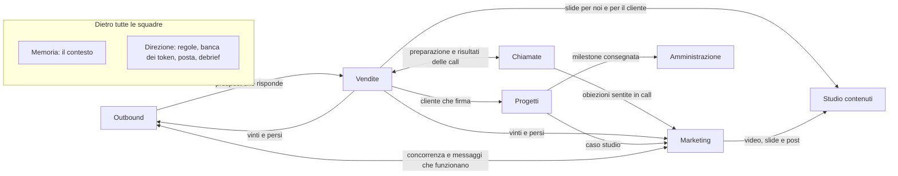
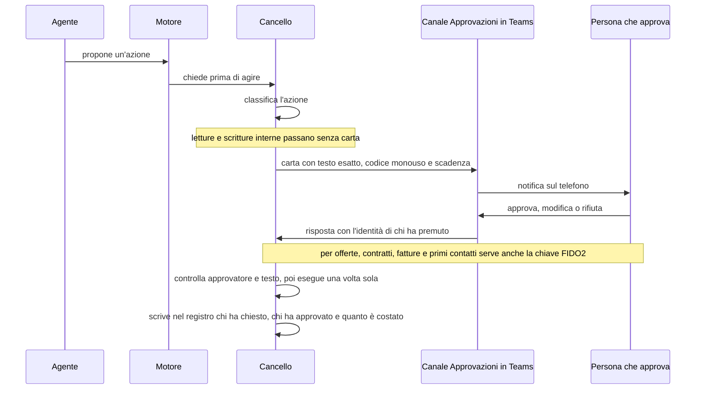
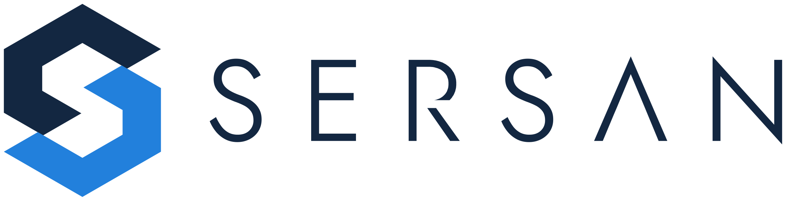

# Design del sistema

> **Nota del 10 novembre 2026.** Questo documento descrive ancora la versione 2 dell'architettura. Dal 10 novembre vale la versione 3, «Cancello a livelli e motore a due corsie»: la decisione è in [ricerca/45](../ricerca/45-architettura-v3.md) e nelle [ADR da 0020 a 0027](adr/README.md). Dove questo documento e le ADR dicono cose diverse, valgono le ADR. L'allineamento è in corso.

SerSan Agent OS visto da chi lo usa e da chi lo costruisce: le nove squadre di agenti e chi ne risponde, come si passano il lavoro, come si approva dal telefono, com'è una giornata con il sistema, le regole che valgono sempre e le cose che restano alle persone. L'ultima sezione spiega come sono fatti i documenti del progetto.

Cifre, fasi, decisioni e date sono quelle della proposta per i CEO, versione 2.1 dell'8 novembre 2026 ([proposta, intestazione](../PRESENTAZIONE-CEO.md)). Quando un dettaglio tecnico non è nella proposta, il rimando porta al rapporto di ricerca da cui viene, quasi sempre l'architettura scelta il 25 ottobre 2026 ([ricerca/36, intestazione](../ricerca/36-architettura-v2.md)): quei dettagli sono proposte da confermare durante lo sviluppo.

## 1. Le parole che usiamo

| Parola | Cosa vuol dire | Fonte |
|---|---|---|
| Agente | Un programma che lavora con Claude su un compito preciso, dentro una squadra con un responsabile umano. Il disegno ne conta 57 | [proposta §1, §4](../PRESENTAZIONE-CEO.md) |
| Motore | Il programma sul nostro server che fa girare gli agenti. È costruito con l'Agent SDK di Claude, cioè Claude Code usato come libreria: ogni lavoro gira in un processo suo, con il profilo dell'agente, i suoi strumenti e un tetto di spesa | [proposta §5.1](../PRESENTAZIONE-CEO.md) |
| Cancello | Il nostro programma che esegue le azioni verso l'esterno. È l'unico che può mandare una mail, scrivere al cliente, toccare il CRM (l'archivio di contatti e trattative) o telefonare, e registra tutto | [proposta §5.1](../PRESENTAZIONE-CEO.md) |
| Carta | La richiesta di approvazione che arriva in Teams: il testo esatto dell'azione, un codice che vale una volta, una scadenza e i pulsanti per rispondere | [proposta §5.4](../PRESENTAZIONE-CEO.md) |
| Regola "Sempre" | Un'approvazione che si è ripetuta uguale e che una persona rende automatica, solo per quell'agente, quel tipo di azione e quella destinazione, per 30 giorni | [proposta §5.4](../PRESENTAZIONE-CEO.md) |
| Bacheca | La lista dei compiti che gli agenti si passano, con un freno che ferma le catene troppo lunghe | [proposta §4.11 e appendice A (J4)](../PRESENTAZIONE-CEO.md), [ricerca/36 §5.4](../ricerca/36-architettura-v2.md) |
| Porta chat | Il nostro programma che porta gli agenti in Teams e poi in Telegram, Slack e WhatsApp | [proposta §5.2](../PRESENTAZIONE-CEO.md), [ricerca/28, in breve](../ricerca/28-chat-di-gruppo-self-hosted.md) |
| Server MCP | Una presa standard a cui un agente si collega per usare uno strumento, per esempio il CRM o la memoria | [proposta §7.3](../PRESENTAZIONE-CEO.md) |
| LiteLLM | La porta verso i modelli di Claude: dà a ogni agente, squadra e persona il suo budget, cioè quanto può spendere in token, le unità di testo che i modelli contano e fanno pagare | [proposta §5.1](../PRESENTAZIONE-CEO.md) |
| n8n | Il servizio del server che fa partire i lavori a orario e tiene le integrazioni | [proposta §5.3](../PRESENTAZIONE-CEO.md) |
| SersanOutreach | La nostra piattaforma outbound, cioè per contattare nuovi potenziali clienti, su LinkedIn e per email; diventa il CRM degli agenti, con contatti, deal (le trattative) e meeting | [proposta §1, §7.1](../PRESENTAZIONE-CEO.md) |
| Microsoft 365 (M365) | La suite di Microsoft che usiamo già: Teams per la chat, Outlook per posta e calendario, SharePoint e OneDrive per i documenti | [proposta §1, §5.5](../PRESENTAZIONE-CEO.md), [ricerca/29, in breve](../ricerca/29-conoscenza-task-e-documenti.md) |
| Jira | Il servizio in cloud dove stanno i to-do e i progetti | [proposta §5.5](../PRESENTAZIONE-CEO.md) |
| BookStack, PostgreSQL, Qdrant | Le tre memorie sul nostro server: BookStack per i testi (regole di lavoro, processi, catalogo), PostgreSQL per i dati con campi fissi (registro degli agenti, obiettivi, prezzi, meeting), Qdrant per la ricerca per significato in trascrizioni, mail e documenti | [proposta §5.5](../PRESENTAZIONE-CEO.md) |
| Claude Team | Il piano di Claude che usiamo tutti e quattro: chat, skill, progetti per squadra e ricerca nella memoria aziendale, ognuno con i propri permessi | [proposta §1, §4.11](../PRESENTAZIONE-CEO.md) |
| Skill | Un lavoro che si ripete, scritto come istruzione riutilizzabile per Claude; quando funziona può diventare un agente | [proposta §4.12](../PRESENTAZIONE-CEO.md) |
| Haiku, Sonnet, Opus | I modelli di Claude usati dagli agenti: Haiku per i lavori semplici, Sonnet per quasi tutto, Opus per offerte e analisi | [proposta §5.1](../PRESENTAZIONE-CEO.md) |
| Registro degli agenti | L'elenco degli agenti, una riga per agente, che si vede come organigramma | [proposta §4.12](../PRESENTAZIONE-CEO.md) |
| Registro delle azioni | L'elenco di ogni azione di ogni agente: chi, cosa, perché, con quale approvazione e quanto è costato | [proposta §4.8, §5.4](../PRESENTAZIONE-CEO.md) |
| Debrief | Il punto della giornata che ognuno riceve alle 7:00, in Teams e per mail | [proposta §4.8 e appendice A (C1)](../PRESENTAZIONE-CEO.md) |
| Banco di prova | La macchina di prova nella rete del laboratorio del server: ci gira il pilota e ci si prova Buzz, una chat per persone e agenti; nello stesso laboratorio si prova anche Paperclip, un piano di controllo per "aziende di agenti" | [proposta §4.11, §4.12, §5.2, §11](../PRESENTAZIONE-CEO.md) |
| Chiave FIDO2 | Una chiave di sicurezza fisica, due per persona, chiesta per le approvazioni più delicate | [proposta §4.11, §12.2](../PRESENTAZIONE-CEO.md) |

## 2. I principi del disegno

1. **Un solo sistema.** SersanOutreach, marketing, contenuti, task, progetti e chiamate con i clienti diventano un sistema solo: una memoria aziendale e 57 agenti, in nove squadre, che ci lavorano sopra insieme a noi ([proposta §1](../PRESENTAZIONE-CEO.md), [ricerca/00, J1](../ricerca/00-visione-funzionalita.md)).
2. **Ogni squadra ha un responsabile umano.** Un agente senza un responsabile è un agente senza controllo ([proposta §4](../PRESENTAZIONE-CEO.md)).
3. **Gli agenti propongono, il codice esegue.** Nessun agente ha in mano un bottone che invia, pubblica, paga o cancella: passa sempre dal Cancello. Nessun agente manda niente a un cliente senza il sì di una persona o una regola "Sempre" decisa dai CEO; l'unica eccezione è "Andrea", che richiama da solo soltanto chi lo ha chiesto nel modulo ([proposta §1, §9.2](../PRESENTAZIONE-CEO.md)).
4. **Tutto si vede.** Ogni passaggio fra agenti si vede nella chat di gruppo, e ogni cosa che esce verso il cliente passa da una carta e dal sì di una persona ([proposta §4.10](../PRESENTAZIONE-CEO.md)).
5. **Agenti veri, non strumenti da aprire a mano.** Tutte le 57 figure sono agenti veri su un solo motore, con una bacheca e nove bot di squadra in Teams. Anche le figure che una persona potrebbe usare a mano, come il Copywriter o l'Agente video, ricevono lavoro dalla bacheca; le loro skill sono anche in Claude Team, per chi vuole usarle da sé ([proposta, appendice B](../PRESENTAZIONE-CEO.md), [ricerca/36 §1.2, §5.2](../ricerca/36-architettura-v2.md)).
6. **Ognuno vede il suo e decide come lavorare.** Quando un agente lavora per una persona, la memoria gli mostra solo ciò che quella persona può vedere; ognuno scrive le sue regole di lavoro e gli agenti le leggono prima di ogni lavoro ([proposta §5.3, §10](../PRESENTAZIONE-CEO.md)).
7. **Il giudizio resta umano.** È il claim di SerSan, «The intelligence is artificial. The judgement stays human»: alcune cose restano alle persone per scelta (sezione 8) ([proposta §9.3](../PRESENTAZIONE-CEO.md), [profilo aziendale §1](../allegati/sersanoutreach/sersan_company_profile.md)).

## 3. Le nove squadre

### 3.1 Il quadro

| Squadra | Agenti | Responsabile | Chi approva le carte | Modello prevalente | Cosa fa, in una riga |
|---|---|---|---|---|---|
| Outbound | 5 | Alessandro; tecnico: Alberto | Alessandro | Sonnet; Haiku per smistare | Trova le aziende giuste e le contatta, facendo girare SersanOutreach |
| Chiamate | 5 | Alessandro | Alessandro | Sonnet | Entra nelle call e le trasforma in riassunti, appuntamenti e follow-up |
| Vendite | 8 | Alessandro | Alessandro; Michele per offerte e affermazioni tecniche | Sonnet; Opus per le offerte | Prepara incontri, proposte e contratti, pesa la pipeline (le trattative aperte), allena chi vende; qui lavora "Andrea" |
| Marketing | 8 | Alberto | Alberto; ogni founder per i suoi post | Sonnet; Haiku per le metriche | Temi, concorrenza, metriche, pubblicazione, newsletter, commenti, sito ed eventi |
| Studio contenuti | 4 | Alberto | Alberto | Sonnet | Testi, slide, video e grafiche con la voce e i template SerSan |
| Progetti | 8 | Michele, con Mattia | Michele | Sonnet | Dalla firma alla consegna: piano, task, report, assistenza, rinnovi, casi studio |
| Memoria | 5 | Michele | Michele | Haiku e lavori a regole fisse | Porta tutto nella memoria, la pulisce, la tiene, risponde alle domande e sorveglia il server |
| Direzione | 10 | Alessandro e Michele | i CEO | Sonnet; Opus per la mappa dei processi | Regole, budget, registro delle azioni, posta, debrief, processi e formazione |
| Amministrazione | 4 | Alessandro e Michele | Alessandro o Michele | Sonnet | Dal contratto all'incasso: fatture, acquisti, controllo di gestione, bandi |
| **Totale** | **57** | | | | |

Fonte: squadre, agenti e responsabili dalla [proposta §4.1-4.9 e §4.12](../PRESENTAZIONE-CEO.md); chi approva e modelli dalla proposta tecnica di [ricerca/36 §5.3](../ricerca/36-architettura-v2.md), che segue la regola dei modelli della [proposta §5.1](../PRESENTAZIONE-CEO.md).

Le tabelle che seguono elencano tutti gli agenti di ogni squadra con la fase in cui arrivano; il piano a fasi è nella [proposta §11](../PRESENTAZIONE-CEO.md).

### 3.2 Outbound

Trova le aziende giuste e le contatta. Responsabile Alessandro, tecnico Alberto.

| Agente | Cosa fa | Fase |
|---|---|---|
| Agente email | Fa girare le sequenze email su Instantly (il servizio delle campagne email), legge e classifica le risposte e propone la risposta da approvare; quando un prospect, cioè un potenziale cliente, è interessato passa il contatto all'Agente brief e all'Agente proposte | 3 |
| Agente LinkedIn | Prepara inviti e messaggi su LinkedIn, sempre con l'approvazione di una persona, e segue le conversazioni | 3 |
| Sentinella segnali | Guarda assunzioni, finanziamenti, cambi di ruolo, post pubblicati e commenti qualificati ai nostri post, e propone il contatto giusto al momento giusto | 3 |
| Operatore outbound | Fa girare SersanOutreach: import, qualificazione, coda di approvazione, campagne | 3 |
| Agente clienti simili | Dai clienti vinti e da ciò che ha capito l'Analista vinto/perso cerca aziende simili e le passa all'Operatore: si replica ciò che funziona | 5 |

Fonte: [proposta §4.1](../PRESENTAZIONE-CEO.md).

**Come tocca SersanOutreach.** SersanOutreach ha due server MCP: uno di lettura con 19 strumenti, che mostrano per esempio gli indicatori chiave (KPI), la coda delle azioni, la pipeline, il funnel (quanti contatti arrivano a ogni passo, fino al cliente), le risposte positive e i meeting, e uno operatore con 14 operazioni. L'operatore genera bozze ma non le approva mai: l'operazione che approva un messaggio, e solo se il testo è quello letto, la chiama soltanto il Cancello, dopo il sì di una persona su una carta. Invii in blocco, lanci e cancellazioni non esistono: restano a una persona ([proposta §7.3](../PRESENTAZIONE-CEO.md)). Su LinkedIn gli agenti lavorano solo con l'approvazione di ogni messaggio, senza l'autopilot dei messaggi diretti e senza automazione del browser lato server ([proposta §7.4](../PRESENTAZIONE-CEO.md)).

Strumenti principali proposti: il server MCP di SersanOutreach, Firecrawl (che trasforma le pagine web in testo per gli agenti) e la ricerca nella memoria ([ricerca/36 §5.3, §4.1](../ricerca/36-architettura-v2.md)).

### 3.3 Chiamate

Entra nelle call e trasforma ogni incontro in riassunti, appuntamenti e follow-up. Responsabile Alessandro.

| Agente | Cosa fa | Fase |
|---|---|---|
| Agente chiamate | Entra in ogni call del calendario dichiarandolo, anche al posto di chi manca. Nelle nostre call Teams prende la trascrizione di Microsoft; in quelle dei clienti (Teams di altri, Meet, Zoom) entra un bot sul nostro server che trascrive tutto in casa. Registra anche le riunioni dal vivo dal telefono | 3; nella fase 1 le trascrizioni delle call Teams le legge già il Post-call |
| Analista chiamate | Scrive il riassunto secondo le regole di ciascuno, lo mette nel registro di tutti i meeting, consultabile da tutti, e ne estrae la pipeline: chi è caldo entro quando | 1 |
| Post-call | Punti e prossimi passi nel canale del cliente, meeting e opportunità nel CRM, bozza della mail di follow-up, task alla squadra Progetti | 1 per riassunto e bozza della mail; 2 per CRM e task in Jira |
| Agente agenda | Fissa gli appuntamenti che emergono da call, mail e chat: propone gli orari liberi di chi deve esserci, dopo il sì manda l'invito con l'avviso di registrazione, sposta e ricorda | 3 |
| Dettatura | Trascrive la voce in italiano e in inglese, dal telefono e dal PC | 2 |

Fonte: [proposta §4.2](../PRESENTAZIONE-CEO.md).

Il bot nelle call dei clienti è Vexa, sul nostro server: il cliente deve ammetterlo nella call, e la riserva è la registrazione sul PC ([proposta §5.2 e appendice A (J5)](../PRESENTAZIONE-CEO.md)). Strumenti principali proposti: trascrizioni, calendario in lettura, memoria ([ricerca/36 §5.3](../ricerca/36-architettura-v2.md)).

### 3.4 Vendite

Prepara gli incontri, scrive proposte e contratti, pesa la pipeline e allena chi vende. Responsabile Alessandro; offerte e affermazioni tecniche le firma Michele.

| Agente | Cosa fa | Fase |
|---|---|---|
| Agente brief | Prima della call, dall'email della persona: l'azienda, i dati pubblici, chi c'è in call, lo storico della relazione, le ultime mail, i post LinkedIn recenti (con una via consentita), i segnali, i concorrenti (dalla squadra Marketing), le opportunità comuni. Dopo la call: il brief con tutto il contesto, decisioni, obiezioni e prossimi passi. Chiede allo Studio le slide per noi e per il cliente, che raccontano anche la storia della relazione con noi | 3 |
| Agente proposte | Dopo l'incontro unisce catalogo SerSan, trascrizione e brief in una bozza di proposta a fasi, con scope e prezzo da confermare; la firma tecnica è di Michele | 3 |
| Pipeline | Calcola la probabilità di chiusura pesata sullo storico di call e deal, con un intervallo onesto; un portale clienti costruito con Claude Code sopra SersanOutreach mostra pipeline, pipeline pesata e storico di ogni cliente | 5 |
| Coach vendite | Dopo ogni call di vendita: fit del prospect, punti di forza, cosa migliorare, consigli pratici. Lo vede chi ha fatto la call; al responsabile vanno i dati aggregati. Ogni mese un piano di allenamento sui temi che tornano | 5 |
| "Andrea" | Agente vocale: richiama entro 90 secondi, 24 ore su 24, chi nel modulo ha chiesto la richiamata di un assistente AI; si dichiara AI, qualifica e fissa l'appuntamento con uno di noi; risponde alle chiamate in entrata quando nessuno può; scrive l'esito nel canale delle vendite e nel CRM; impara dai rifiuti e prova aperture nuove | 5 |
| Analista vinto/perso | Capisce perché un deal si chiude o si perde e manda il risultato al Marketing, che migliora le campagne, e all'Agente clienti simili | 3 |
| Agente intake | Per ogni richiesta che arriva dal sito, dalla posta o da un contatto: chi è, cosa chiede, se rientra nel nostro cliente ideale, il brief di intake e il primo passo consigliato; prepara l'onboarding del potenziale cliente | 3 |
| Agente contratti | Dall'offerta approvata prepara il contratto sul nostro modello, lo manda in firma elettronica dopo il sì, ricorda le firme mancanti e, a firma avvenuta, avvisa il Project manager | 6 |

Fonte: [proposta §4.3](../PRESENTAZIONE-CEO.md).

"Andrea" è un'eccezione alla regola del piano marketing che vieta voci sintetiche nelle call: vale solo per chi chiede di essere richiamato, con voce dichiarata, parere legale e lead vere, cioè contatti commerciali reali; la voce clonata di un collega solo con il suo contratto separato e revocabile ([proposta §14, decisione 10](../PRESENTAZIONE-CEO.md)). La fase 5 parte solo con il parere legale e con lead reali ([proposta §11](../PRESENTAZIONE-CEO.md)). Strumenti principali proposti: ricerca nella memoria, catalogo, SersanOutreach, SharePoint in lettura ([ricerca/36 §5.3](../ricerca/36-architettura-v2.md)).

### 3.5 Marketing

Fa il lavoro che le direttive del piano marketing chiedono a un nuovo addetto ai contenuti ([proposta §8.1](../PRESENTAZIONE-CEO.md)). Responsabile Alberto; ogni founder approva i post del suo profilo ([ricerca/36 §5.3, §5.8](../ricerca/36-architettura-v2.md)).

| Agente | Cosa fa | Fase |
|---|---|---|
| Editoriale | Propone i temi dal piano marketing, dalle call, dalle obiezioni dei prospect e da ciò che ha funzionato nelle vendite | 2 |
| Ricerca concorrenza | Sorveglia siti, prezzi, annunci e contenuti dei concorrenti; manda un riepilogo settimanale e dà il contesto ai brief di vendita | 2 |
| Analista metriche | Il lunedì compila i dieci numeri del piano con i dati grezzi allegati; dice all'Outbound quali messaggi e temi funzionano | 2 |
| Pubblicatore | Prepara la lista da approvare (data, ora, rete, testo esatto, file); dopo il sì Alberto la programma su Postiz, il programma dei post sul nostro server (finché Postiz non è pronto, su Metricool, un servizio esterno), in una sessione presidiata, cioè seguita da una persona; poi l'agente controlla che i post siano usciti e aggiorna calendario e registro | 2 |
| Agente newsletter | Prepara la newsletter dai post, dai casi studio e dalle novità e la manda dopo il sì; registra chi la apre, così il brief sa chi ci legge | 4 |
| Community manager | Legge commenti e messaggi della pagina aziendale e prepara le risposte da approvare; sui profili dei founder segnala soltanto, perché lì rispondono loro; passa all'Outbound chi può diventare cliente | 4 |
| Agente sito e SEO | Trasforma post e casi studio in articoli e pagine del sito, controlla il posizionamento sui motori di ricerca (SEO) e la velocità, propone le correzioni | 6 |
| Agente eventi e webinar | Organizza webinar ed eventi: inviti, iscrizioni, promemoria e follow-up dei partecipanti, che entrano in SersanOutreach come lead | 6 |

Fonte: [proposta §4.4](../PRESENTAZIONE-CEO.md).

**Le regole di casa restano.** Niente esce senza un sì scritto; sulle piattaforme si scrive solo da una sessione presidiata; volti e voci solo dei founder, con il loro consenso; numeri solo dalla banca delle storie («se un numero manca, togli la frase»); commenti su LinkedIn solo con regole approvate e tetti; inviti e messaggi solo da SersanOutreach ([proposta §8.2](../PRESENTAZIONE-CEO.md)). Il sistema non sostituisce i founder davanti alla camera né il sì prima di ogni pubblicazione ([proposta §8.1](../PRESENTAZIONE-CEO.md)). Strumenti principali proposti: Firecrawl, Postiz, listmonk (la newsletter sul nostro server), BookStack ([ricerca/36 §5.3](../ricerca/36-architettura-v2.md), [proposta §8.2](../PRESENTAZIONE-CEO.md)).

### 3.6 Studio contenuti

Produce i contenuti che gli chiedono Marketing e Vendite. Responsabile Alberto.

| Agente | Cosa fa | Fase |
|---|---|---|
| Copywriter | Post, caroselli, newsletter e testi delle campagne email, con la nostra voce e le regole di brand | 2 |
| Agente slide | Slide per noi (il brief prima dell'incontro) e per il cliente (recap dopo la call, proposta), con i nostri template | 3 |
| Agente video | Clip, reel, riprese di contorno, grafiche animate e varianti di formato, con gli strumenti video Higgsfield, HyperFrames e After Effects | 4 |
| Agente grafiche | Immagini, caroselli e copertine con i nostri template | 4 |

Fonte: [proposta §4.5](../PRESENTAZIONE-CEO.md).

Slide e documenti escono con lo stile SerSan, non con il formato standard che usano tutti: template SerSan in SharePoint e skill di brand in Claude Team e sul motore; i template sono ancora da preparare ([proposta, appendice A (K7)](../PRESENTAZIONE-CEO.md)). Strumenti principali proposti: template SerSan, skill per slide e documenti ([ricerca/36 §5.3](../ricerca/36-architettura-v2.md)).

### 3.7 Progetti

Prende il cliente quando firma e lo segue fino al caso studio. Responsabile Michele, con Mattia.

| Agente | Cosa fa | Fase |
|---|---|---|
| Project manager | Apre il progetto quando il cliente firma: piano a fasi, milestone (le tappe del progetto), responsabili, stato settimanale; segnala ritardi e rischi | 4 |
| Agente task | Crea i task dalle call, dalle chat e dalle mail, li assegna, ricorda le scadenze e chiude quelli già fatti | 2 |
| Report cliente | Il report settimanale per il cliente, con avanzamento e decisioni, da approvare prima dell'invio | 4 |
| Onboarding cliente | Dopo la riunione di avvio: canale, cartelle, registro delle decisioni | 4 |
| Sviluppatori | Controllo qualità, analisi degli errori, pull request (proposte di modifica al codice), documentazione, tutto in Claude Code e con revisione | 4 |
| Assistenza clienti | Legge le richieste dei clienti nella loro stanza e nella posta, prepara la risposta da approvare e apre i task | 6 |
| Agente rinnovi | Legge call, report e task dei clienti attivi: propone la fase successiva, segnala nuove opportunità e i clienti a rischio | 6 |
| Agente casi studio | A fine progetto scrive il caso studio con i numeri, chiede al cliente la testimonianza dopo il nostro sì e lo passa al Marketing | 6 |

Fonte: [proposta §4.6](../PRESENTAZIONE-CEO.md).

Nel disegno tecnico ogni progetto cliente ha un progetto Jira nato da un modello, e i to-do di SerSan stanno in un progetto "Interno"; ogni issue, cioè la scheda di un compito, creata da un agente porta l'etichetta `da-agente` e il collegamento alla fonte, per esempio la call ([ricerca/29 §4.2](../ricerca/29-conoscenza-task-e-documenti.md)). Strumenti principali proposti: Jira, SharePoint, ricerca nella memoria ([ricerca/36 §5.3](../ricerca/36-architettura-v2.md)).

### 3.8 Memoria

Porta tutto nella memoria aziendale, la tiene pulita e risponde alle domande; sorveglia anche il server. Responsabile Michele.

| Agente | Cosa fa | Fase |
|---|---|---|
| Raccoglitore | Legge in continuo posta, calendario, documenti di M365, chat, BookStack, Jira, trascrizioni e CRM e li porta nella memoria | 3 |
| Pulitore | Deduplica, classifica, toglie i dati personali che non servono, separa il testo di terzi, che non è mai un'istruzione | 3 |
| Bibliotecario | Tiene la memoria: BookStack e PostgreSQL per ciò che è fisso, Qdrant per ciò che collega i momenti, con i modelli di embedding (trasformano i testi in numeri per cercarli per significato) sulla nostra GPU, la scheda di calcolo del server. Risponde alle domande libere di tutti: «cosa si è detto con quel cliente?», «cosa gli abbiamo promesso?» | 3 |
| Archivista | Applica le scadenze di conservazione e tiene aggiornato il registro dei trattamenti, l'elenco dei trattamenti di dati personali | 3 |
| Sistemista | Sorveglia il server: salute delle macchine, backup, spazio, temperature, aggiornamenti dell'Agent SDK, dei servizi e dei modelli; avvisa Michele e prepara gli aggiornamenti da approvare | 3 |

Fonte: [proposta §4.7](../PRESENTAZIONE-CEO.md).

Il Sistemista lavora in sola lettura sul monitoraggio del server e su NetBox, l'inventario dei servizi, e propone le patch (gli aggiornamenti che correggono i difetti) come carte ([proposta, appendice A (L11)](../PRESENTAZIONE-CEO.md)). Strumenti principali proposti: la pipeline del board che rende ricercabili i documenti, il monitoraggio in lettura, NetBox ([ricerca/36 §5.3](../ricerca/36-architettura-v2.md), [proposta §6.2](../PRESENTAZIONE-CEO.md)).

### 3.9 Direzione

Tiene regole, budget, registro delle azioni e posta, e dà a ciascuno il punto della giornata. Responsabili Alessandro e Michele.

| Agente | Cosa fa | Fase |
|---|---|---|
| Capo di gabinetto | L'unico a cui scriviamo se non sappiamo a chi chiedere: capisce, smista alle squadre, riporta. Da computer e telefono | 2 |
| Report del mattino | Alle 7:00 per ciascuno: cosa è successo ieri, scadenze, task, pipeline, cosa aspettano gli agenti da noi | 1 |
| Banca dei token | Budget per agente, per catena di lavoro e per persona; avviso all'80%, stop al 100%; rendiconto mensile | 2 |
| Registro e audit | Traccia ogni azione di ogni agente: chi, cosa, perché, con quale approvazione | 2 |
| Guardiano | Blocca per default ciò che invia, pubblica, paga o cancella; chiede il sì sul telefono; ha lo stop di emergenza, che dalla fase 2 ferma anche gli invii di SersanOutreach (interruttore generale e pausa delle campagne Instantly) | 2 |
| Mappatore processi | Ricostruisce i processi dalle interviste e da ciò che ciascuno dichiara, e usa i metadati di M365 solo con l'accordo di ognuno, perché in quattro un dato aggregato resta riconoscibile. Restituisce la mappa con le ore implicite e le automazioni consigliate: prima per noi, poi come servizio per i clienti | 4 |
| Intervistatore | Fa le interviste di assessment per ruolo, in chat | 4 |
| Smistatore posta | Legge tutta la posta in arrivo, non solo quella dell'outreach: smista, archivia, prepara le risposte da approvare, passa fatture e richieste alle squadre giuste | 3 |
| Allenatore AI | Un consiglio alla settimana a ciascuno su come usare meglio gli agenti, una guida per ogni agente nuovo, formazione e policy AI sempre aggiornate | 6 |
| Assistente personale (facoltativo) | Per chi lo vuole: calendario personale, preferenze di viaggio, famiglia. I dati di salute restano nell'account privato di chi li usa e non entrano mai nella memoria aziendale | 6 |

Fonte: [proposta §4.8](../PRESENTAZIONE-CEO.md).

Strumenti principali proposti: memoria, Grafana (i cruscotti sul server), LiteLLM e posta in lettura ([ricerca/36 §5.3](../ricerca/36-architettura-v2.md)).

### 3.10 Amministrazione

Chiude il giro che parte dall'outreach: dal contratto all'incasso. Si collega allo strumento di fatturazione e contabilità scelto con la decisione 22, e ogni fattura e ogni pagamento passano dal sì di una persona ([proposta §4.9](../PRESENTAZIONE-CEO.md)). Responsabili Alessandro e Michele.

| Agente | Cosa fa | Fase |
|---|---|---|
| Agente fatture e incassi | Prepara la fattura quando una milestone è consegnata o quando il contratto lo prevede, la manda dopo il sì, segue gli incassi e prepara i solleciti | 6 |
| Agente acquisti e abbonamenti | Registra le fatture dei fornitori, tiene l'elenco di abbonamenti e rinnovi, segnala i posti che non usiamo e le scadenze in arrivo | 6 |
| Controllo di gestione | Porta nella memoria dati finanziari e obiettivi; ogni mese ricavi, costi, margine per cliente e per progetto, cassa e confronto con gli obiettivi | 6 |
| Agente bandi e finanziamenti | Cerca bandi, crediti d'imposta e finanziamenti per startup e AI, per noi e per i clienti; prepara scadenze, requisiti e documenti da raccogliere | 3 |

Fonte: [proposta §4.9](../PRESENTAZIONE-CEO.md).

Strumenti principali proposti: PostgreSQL con i dati di finanza, una raccolta «finanza» separata nella memoria, che a Claude Team si toglie con una regola, lo strumento di fatturazione e DocuSeal, la firma elettronica sul nostro server ([ricerca/36 §5.3, §5.5](../ricerca/36-architettura-v2.md), [proposta, appendice A (L1)](../PRESENTAZIONE-CEO.md)).

## 4. Organigramma, registro e crescita

Ogni agente ha una riga nel registro degli agenti: nome, squadra, responsabile umano, modello che usa, cosa può toccare, tetto di spesa e costo del mese. Il registro si vede come organigramma in una pagina di BookStack e in un cruscotto ([proposta §4.12](../PRESENTAZIONE-CEO.md)); nel disegno tecnico i profili stanno in git, l'archivio che tiene tutte le versioni dei file, e pagina e cruscotto si rigenerano ogni notte ([ricerca/36 §5.3](../ricerca/36-architettura-v2.md)).

- **Chi risponde di chi.** Alessandro ha a riporto Outbound, Chiamate e Vendite; Michele Memoria e Progetti; Alberto Marketing e Studio; Direzione e Amministrazione sono di entrambi i CEO ([proposta §4.12](../PRESENTAZIONE-CEO.md)).
- **Un agente nuovo nasce solo con un'approvazione**, che porta con sé la sua riga nel registro dei trattamenti ([proposta §4.12](../PRESENTAZIONE-CEO.md)). Un agente che non serve si spegne dal registro degli agenti ([proposta §13](../PRESENTAZIONE-CEO.md)).
- **Come cresce.** Ogni processo che si ripete diventa una skill, ogni skill che funziona diventa un agente: cento agenti sono la traiettoria ([proposta §4.12](../PRESENTAZIONE-CEO.md)). Dalla fase 4 gli agenti propongono skill nuove in una cartella di proposte, un revisore le guarda ogni settimana e una persona le approva con una pull request ([proposta §11 e appendice A (A6)](../PRESENTAZIONE-CEO.md)).
- **Paperclip**, un piano di controllo open source fatto apposta per "aziende di agenti", si prova nella fase 6 ([proposta §4.12](../PRESENTAZIONE-CEO.md)).

Gli agenti entrano al lavoro fase per fase:

| Fase | Settimane | Agenti nuovi | Agenti al lavoro alla fine della fase |
|---|---|---|---|
| 0. Valore subito e prove | 1-4 | Nessuno: si lavora con skill, template SerSan e progetti per squadra in Claude Team | 0 |
| 1. Pilota su banco di prova | 5-8 | Post-call, Analista chiamate, Report del mattino | 3 |
| 2. Pilota sul server e squadre che si parlano | 9-21 | 11 | 14 |
| 3. Memoria, call, vendite preparate e canali | 22-35 | 18 | 32 |
| 4. Organizzazione, newsletter e Buzz | 36-40 | 10 | 42 |
| 5. Vendite e voce (solo con parere legale e lead reali) | 41-48 | "Andrea", Pipeline, Coach vendite, Agente clienti simili | 46 |
| 6. Le altre automazioni | 49-53 | 11 | 57 |

Fonte: [proposta §11, §4.1-4.9 e §4.12](../PRESENTAZIONE-CEO.md). Oggi si impegnano solo le fasi 0 e 1; le altre si finanziano una per volta, sui risultati ([proposta §11](../PRESENTAZIONE-CEO.md)).

**Tre modi di lavorare, nessun agente declassato.** Nel disegno tecnico ogni agente, in un dato momento, lavora in uno di tre modi ([ricerca/36 §5.2](../ricerca/36-architettura-v2.md)):

- **chiamata a schema**: riassumere, classificare, estrarre, con una sola chiamata al modello, senza strumenti e con una risposta in campi fissi. È il disegno più robusto contro le iniezioni di prompt, cioè il testo scritto in una mail o in una pagina per dare ordini all'agente;
- **sessione con strumenti**: lavori a più passi, come brief, offerte, deck, agenda e operatore;
- **servizio**: un componente che fa il lavoro da sé, come la pipeline, il bot delle call, il centralino o il Cancello.

Il modo dice come lavora l'agente in quel momento, non quanto vale. Copywriter, Agente video, Agente grafiche, Pubblicatore, Sviluppatori, Intervistatore e Assistente personale restano agenti del registro che ricevono lavoro dalla bacheca, e le loro skill sono anche in Claude Team. Per ogni agente il registro degli agenti scrive il modo, se legge testo di terzi e quali strumenti ha ([ricerca/36 §5.2](../ricerca/36-architettura-v2.md)).

## 5. Come lavorano insieme

### 5.1 Le squadre si parlano

Le squadre si passano il lavoro come farebbe un team di persone ([proposta §2.1](../PRESENTAZIONE-CEO.md)):

- l'Outbound passa alle Vendite i prospect che rispondono, e le Vendite lavorano con le Chiamate;
- le Vendite chiedono allo Studio le slide: per noi prima dell'incontro, per il cliente dopo;
- il Marketing lavora con l'Outbound: ricerca la concorrenza, misura cosa funziona, trasforma le obiezioni sentite in call in contenuti, e chiede allo Studio video, slide e post;
- i Progetti prendono il cliente quando firma e, a fine progetto, danno il caso studio al Marketing;
- l'Amministrazione chiude il giro: fattura alla consegna, incassi, acquisti e abbonamenti, numeri confrontati con gli obiettivi, bandi e finanziamenti;
- dietro tutte, la Memoria tiene il contesto e la Direzione tiene le regole, la banca dei token, la posta in arrivo e il debrief di ogni mattina.



Fonte del diagramma: [proposta §2.1, §4.3 e §4.10](../PRESENTAZIONE-CEO.md).

### 5.2 Il percorso di un cliente

| Passo | Chi lavora | Cosa succede | Dove serve il sì di una persona |
|---|---|---|---|
| 1 | Sentinella segnali, Agente email | La Sentinella trova un'azienda che assume uno sviluppatore e ha un progetto AI fermo; l'Agente email prepara il primo messaggio | Alessandro approva il primo messaggio |
| 2 | Agente email, Agente agenda, Agente brief, Ricerca concorrenza, Agente slide | Il prospect risponde. L'Agente email lo scrive nella stanza dell'Outbound, l'Agente agenda fissa la call e l'Agente brief riceve il contatto: chiede alla Ricerca concorrenza il quadro del settore e all'Agente slide le slide per noi | L'invito della call parte dopo il sì |
| 3 | Agente chiamate | Il giorno della call entra da solo, si presenta e trascrive | Nessuno: il prospect sa dall'invito che la call è registrata |
| 4 | Analista chiamate, Post-call, Agente brief, Agente slide, Agente proposte, Agente task | Dieci minuti dopo la call: il riassunto, il CRM aggiornato, il brief post-chiamata con tutto il contesto, il recap per il cliente, la bozza dell'offerta, i task | Follow-up e recap escono dopo una carta; l'offerta aspetta la firma di Michele |
| 5 | Editoriale, Copywriter, Agente video, Analista metriche | Le obiezioni sentite in call diventano un post; l'Analista metriche dice all'Agente email quali messaggi funzionano | Il post esce dopo il sì |
| 6 | Agente contratti, Project manager, Onboarding cliente, Report cliente, Assistenza clienti | Michele approva l'offerta e il contratto va in firma. Il cliente firma: si apre il progetto, si preparano canale e cartelle, il report parte dal primo venerdì, l'assistenza risponde alle domande nella stanza del cliente | Contratto, report e risposte escono dopo una carta |
| 7 | Agente fatture e incassi, Agente casi studio, Agente rinnovi, Agente clienti simili | A ogni milestone consegnata, la fattura. A fine progetto il caso studio per il Marketing, la proposta della fase successiva e la ricerca di aziende simili: il giro riparte dal passo 1 | Fatture e richiesta di testimonianza escono dopo il sì |

Fonte: [proposta §4.10](../PRESENTAZIONE-CEO.md), con le approvazioni descritte agente per agente nella [proposta §4.2-4.9](../PRESENTAZIONE-CEO.md).

Ogni passaggio si vede nella chat di gruppo, e ogni cosa che esce verso il cliente passa da una carta e dal sì di una persona ([proposta §4.10](../PRESENTAZIONE-CEO.md)). Il percorso intero funziona dalla fine della fase 6: i passi 1-4 arrivano con gli agenti della fase 3, mentre contratti, assistenza, rinnovi e casi studio arrivano nella fase 6 ([proposta §4.1-4.9 e §11](../PRESENTAZIONE-CEO.md)).

### 5.3 Come nasce un lavoro e come passa da un agente all'altro

Nel disegno tecnico un lavoro segue questi passi ([ricerca/36 §5.1](../ricerca/36-architettura-v2.md)):

1. **Nasce** in tre modi: n8n lo fa partire a un orario o quando un servizio esterno manda un evento firmato; una persona scrive a un agente in Teams; un agente passa un compito a un altro nella bacheca.
2. **Entra nella coda** dei lavori, in PostgreSQL (il database dei dati con campi fissi), con il profilo dell'agente, la persona per cui si lavora, un tetto di spesa e una scadenza.
3. **Il motore apre una sessione** con il profilo dell'agente: le istruzioni della squadra, le skill ammesse, un elenco chiuso di strumenti e la sua chiave di LiteLLM.
4. **L'agente legge il contesto**: la pagina "Come lavoro" della persona, i dati fissi della memoria e i passaggi utili della ricerca nella memoria, con i permessi di quella persona.
5. **Il testo di terzi** (mail, trascrizioni, pagine web, risposte dei prospect) entra da una corsia senza strumenti: gli agenti lo leggono come dati, non come comandi ([proposta §9.2](../PRESENTAZIONE-CEO.md)).
6. **Se serve far uscire qualcosa**, l'agente lo propone e il motore chiede al Cancello prima di agire; se il Cancello non risponde in tempo, l'azione è bloccata ([proposta §5.3](../PRESENTAZIONE-CEO.md)). Il resto è nella sezione 5.5.

**La bacheca.** È il posto dove gli agenti si passano il lavoro, e arriva nella fase 2 insieme al canale "Agenti" ([proposta §11](../PRESENTAZIONE-CEO.md)). Nel disegno tecnico ([ricerca/36 §5.4](../ricerca/36-architettura-v2.md)):

- compiti e passaggi stanno in due tabelle di PostgreSQL, con un server MCP per creare, prendere, aggiornare, passare e chiudere un compito e leggerne lo stato;
- dal modello della bacheca di Hermes prende una corsia di revisione fra agenti prima della carta, il blocco "serve un umano" che si sblocca dalla chat, il blocco automatico dopo due fallimenti di fila, il rifiuto dei cicli di dipendenze e un servizio che riprende i compiti fermi;
- il freno impedisce le catene infinite: al massimo tre passaggi per catena, otto messaggi per thread (filo di messaggi) e un tetto di spesa per catena ([proposta §4.11](../PRESENTAZIONE-CEO.md)); oltre, la catena si ferma e arriva una carta a una persona;
- ogni passaggio si vede nel canale "Agenti" con il nome dell'agente in testa, e le persone intervengono con una @menzione;
- i to-do delle persone stanno in Jira: un agente chiude da solo solo i compiti fra agenti, e per quelli delle persone chiede il sì al titolare ([ricerca/29 §4.2](../ricerca/29-conoscenza-task-e-documenti.md)).

Un esempio: quando un agente trova nuove call da fissare («ho trovato tre nuove call») lo annuncia nella bacheca e nel canale "Agenti", e l'Agente agenda manda gli inviti dopo il sì ([proposta, appendice A (K2)](../PRESENTAZIONE-CEO.md)).

### 5.4 La chat di gruppo

La casa comune è Microsoft Teams, che abbiamo già con M365: un team "SerSan Agent OS" in cui stanno tutti gli agenti e tutti noi, dal computer o dal telefono ([proposta §4.11](../PRESENTAZIONE-CEO.md)).

| Canale in Teams | A cosa serve |
|---|---|
| Un canale per squadra | Il lavoro della squadra, con il suo bot; le persone chiedono agli agenti con una @menzione |
| Approvazioni | Le carte da approvare; una carta può arrivare anche in chat privata a chi deve approvarla |
| Agenti | La sala macchine: i passaggi di lavoro fra agenti, che chiunque può leggere |
| Ingresso | Il testo che arriva da fuori, trattato come input non fidato |
| Call di vendita | Le call di vendita, portate dal Post-call |
| Bandi | I bandi migliori del giorno, pubblicati da n8n |
| Un canale privato per ogni cliente | Riassunto, punti e prossimi passi del cliente, per uso interno; verso il cliente si scrive solo dopo una carta |

Fonte: [proposta §3, §4.11 e appendice A (B1, G1)](../PRESENTAZIONE-CEO.md), [ricerca/28 §2.3, §8.1, §8.2](../ricerca/28-chat-di-gruppo-self-hosted.md).

- **Gli agenti hanno un nome.** Ogni squadra ha un bot con il nome dei suoi agenti, e ogni messaggio è firmato dall'agente che lo scrive. Noi scriviamo al Capo di gabinetto, che risponde in chat privata, oppure direttamente a un agente ([proposta §4.11](../PRESENTAZIONE-CEO.md), [ricerca/36 §5.3](../ricerca/36-architettura-v2.md)). Per esempio Alessandro scrive «@Outreach prepara il follow-up per X» nel canale della squadra: la Porta passa il messaggio al motore e la risposta arriva nel thread ([ricerca/28 §8.2](../ricerca/28-chat-di-gruppo-self-hosted.md)).
- **Gli scambi fra agenti stanno nel motore**, dove c'è il freno; Teams li mostra ([ricerca/28 §2.6, §8.2](../ricerca/28-chat-di-gruppo-self-hosted.md)).
- **Nessun bot entra nei canali condivisi con i clienti**: lì scrive solo il Cancello, dopo una carta ([proposta §4.11](../PRESENTAZIONE-CEO.md)).
- **n8n manda solo avvisi**, come i bandi: il suo nodo di Teams registra quando qualcuno risponde ma non chi, quindi non serve per le approvazioni del Cancello ([ricerca/28 §2.4](../ricerca/28-chat-di-gruppo-self-hosted.md)).

Gli stessi agenti arrivano anche su altri canali:

| Canale | Per cosa | Da quando | Regole |
|---|---|---|---|
| Telegram | Avvisi | Fase 3 | Solo dati verdi (sezione 7.3); nel disegno tecnico solo l'avviso che c'è una carta in attesa, mai il testo |
| WhatsApp | Soprattutto i clienti | Fase 3; la richiesta a Meta parte nella fase 2 | API ufficiale di Meta, cioè il collegamento previsto per i programmi, e numero dedicato, sempre dal Cancello; mai soluzioni non ufficiali, che portano al blocco del numero |
| Slack | I clienti che lavorano lì | Fase 3 | Stessi agenti e stesso codice della Porta |
| Buzz, la chat open source di Block fatta per persone e agenti | La stanza degli agenti, in prova | Fase 4, sul banco di prova | Collegato alla stessa bacheca. Oggi perde alcune risposte senza segnalarlo e le sue approvazioni non sono pronte: diventa la stanza ufficiale solo quando questi problemi sono chiusi, e se allora è più comodo di Teams diventa la casa comune |
| Claude Team | La finestra di lavoro di ognuno | Fase 0 | Chat, skill, progetti per squadra e, dalla fase 3, ricerca nella memoria con i propri permessi; nessun processo aziendale a orario gira qui: quelli restano in n8n |

Fonte: [proposta §4.11, §11 e §13](../PRESENTAZIONE-CEO.md), [ricerca/28 §8.1](../ricerca/28-chat-di-gruppo-self-hosted.md), [ricerca/36 §5.6](../ricerca/36-architettura-v2.md).

Le approvazioni restano in Teams, dove il Cancello riconosce chi preme. Per approvare anche da Telegram o WhatsApp bisogna legare quegli account all'identità Microsoft di ciascuno, e si può aggiungere in una fase successiva ([proposta §2.1, §4.11](../PRESENTAZIONE-CEO.md)). Nel disegno tecnico Buzz esce dal laboratorio quando la sua issue #7375, quella delle risposte perse, è chiusa, quando non concede più approvazioni automatiche dei permessi, quando le pull request delle approvazioni (#8057 e #7616) sono unite e quando un aggiornamento passa i dieci scenari di prova con le patch entro 14 giorni; fino ad allora resta in laboratorio senza dati dei clienti ([ricerca/36 §5.6](../ricerca/36-architettura-v2.md)).

### 5.5 Le approvazioni dal telefono

L'obiettivo è che il post-call avvenga in modo autonomo, e ci si arriva per gradi. Il Cancello funziona in cinque passi ([proposta §5.4](../PRESENTAZIONE-CEO.md)):

1. Un agente **propone** un'azione, per esempio «manda questa mail a questo indirizzo».
2. Una regola la **classifica**: lettura, scrittura interna, invio, pubblicazione, pagamento, cancellazione, credenziali.
3. Le azioni delicate diventano una **carta** nel canale Approvazioni di Teams, con il testo esatto, un codice che vale una volta e una scadenza.
4. Dopo il sì di una persona, l'**esecutore** la compie una volta sola. Se nel frattempo il testo è cambiato, la carta non vale più. Per offerte, contratti, fatture e primi contatti serve anche la chiave FIDO2.
5. Tutto finisce nel **registro** delle azioni, con chi ha chiesto, chi ha approvato e quanto è costato.



Fonte del diagramma: [proposta §3, §5.3 e §5.4](../PRESENTAZIONE-CEO.md), [ricerca/28 §2.3](../ricerca/28-chat-di-gruppo-self-hosted.md).

- **Sul telefono.** La carta arriva dentro Teams come Adaptive Card, la carta con i pulsanti di Teams: si approva con un tocco, e il Cancello controlla chi ha premuto, perché Teams passa al bot l'identità Microsoft di chi agisce, protetta dal secondo fattore. Dopo l'esecuzione la carta si aggiorna per tutti con nome e ora ([proposta §4.11](../PRESENTAZIONE-CEO.md), [ricerca/28 §2.3](../ricerca/28-chat-di-gruppo-self-hosted.md)). Che Teams passi davvero l'identità di chi approva è una delle quattro prove tecniche della fase 0 ([proposta §11](../PRESENTAZIONE-CEO.md)). Una carta tipica dice: «Bozza di follow-up al cliente. Approva, modifica o rifiuta» ([proposta §3](../PRESENTAZIONE-CEO.md)).
- **Senza carta**, oltre alle letture e alle azioni coperte da una regola "Sempre", passano solo due cose, sempre registrate: le scritture interne (meeting e deal nel CRM, to-do in Jira), fatte secondo regole scritte a nome della persona responsabile, e le telefonate di "Andrea" verso chi ha chiesto di essere richiamato ([proposta §5.1 e §14, decisione 10](../PRESENTAZIONE-CEO.md)).
- **Una carta ferma aspetta.** Una carta lasciata ferma la notte deve riprendere il lavoro giusto al mattino: è uno dei criteri tecnici della verifica della settimana 8 ([proposta §11](../PRESENTAZIONE-CEO.md)).
- **Le fasi.** La prima versione del Cancello è pronta alla fine della fase 1, con l'invio da Outlook e le carte in Teams con l'identità di chi approva; nella fase 2 arrivano la chiave FIDO2 e le regole "Sempre" che scadono; nella fase 3 la versione 2 ([proposta §5.4, §11](../PRESENTAZIONE-CEO.md)).
- **La riserva.** Se il bot di Teams registrato senza Azure, il cloud di Microsoft, dà errori di registrazione, si usa una registrazione Azure Bot gratuita, senza macchine accese, e in ultima istanza la pagina del Cancello con gli avvisi in Teams ([proposta §13](../PRESENTAZIONE-CEO.md)).
- **I telefoni che approvano** hanno un sistema supportato, il blocco schermo, il secondo fattore e gli aggiornamenti, anche se sono personali ([ricerca/36 §5.7](../ricerca/36-architettura-v2.md)).

**Chi approva cosa.**

| Tipo di azione | Esempi | Come passa |
|---|---|---|
| Lettura | Cercare, leggere | Consentita agli strumenti ammessi per quell'agente |
| Scrittura interna | To-do in Jira, meeting nel CRM, evento del debrief in Outlook | Senza carta, secondo regole scritte, a nome del responsabile; finisce nel registro |
| Invio a un cliente o a un prospect | Follow-up, risposta, recap nel canale condiviso, WhatsApp | Carta ad Alessandro; solo verso il dominio del cliente; per un primo contatto anche la FIDO2 |
| Pubblicazione | Post, newsletter, risposte ai commenti, pagine del sito | Carta ad Alberto o al founder del profilo |
| Offerte, contratti, affermazioni tecniche | | Carta a Michele, con la FIDO2 |
| Fatture e solleciti | | Carta ad Alessandro o a Michele, con la FIDO2; i pagamenti non sono mai automatici |
| Codice e infrastruttura | Modifiche alle skill, pull request, patch | Carta ad Alberto, con la FIDO2; le patch del server a Michele |
| Cancellazione e credenziali | | Sempre negate agli agenti |

Fonte: [ricerca/36 §5.8](../ricerca/36-architettura-v2.md), con le classi della [proposta §5.4](../PRESENTAZIONE-CEO.md). La proposta chiede la FIDO2 per offerte, contratti, fatture e primi contatti; il disegno tecnico la aggiunge per solleciti, codice e infrastruttura ([ricerca/36 §5.1](../ricerca/36-architettura-v2.md)).

**Le regole "Sempre".** Quando la stessa approvazione si ripete uguale per venti volte senza modifiche, una persona può trasformarla in una regola "Sempre", stretta su quell'agente, quel tipo di azione e quella destinazione, che scade dopo 30 giorni. Mai per offerte, primi contatti, pagamenti, cancellazioni, né per destinatari nuovi ([proposta §5.4](../PRESENTAZIONE-CEO.md)). Nel disegno tecnico le regole si rivedono ogni mese e non valgono per domini nuovi ([ricerca/36 §5.8](../ricerca/36-architettura-v2.md)). Quali messaggi ai clienti possono diventare "Sempre" lo scelgono i CEO dopo il parere legale ([proposta, appendice A (B5)](../PRESENTAZIONE-CEO.md)).

### 5.6 Il contesto comune

Gli agenti lavorano bene se hanno il contesto, e il contesto sta in una memoria divisa per tipo, dove ogni tipo ha una sola fonte di verità ([proposta §5.5](../PRESENTAZIONE-CEO.md)):

| Dove | Cosa contiene |
|---|---|
| BookStack (l'archivio dei testi sul server) | Le regole di lavoro di ciascuno ("Come lavoro"), i processi, il catalogo servizi, il manuale degli agenti |
| PostgreSQL, sul server | Registro e organigramma degli agenti, obiettivi, prezzi, registro dei meeting, decisioni, passaggi fra agenti |
| Qdrant (la memoria vettoriale sul server) | Ciò che "connette i momenti": trascrizioni, mail, documenti, Sirius, bandi, pagine di BookStack, issue di Jira |
| Jira | To-do e progetti |
| M365 | Documenti, posta e calendario |

Fonte: [proposta §5.5](../PRESENTAZIONE-CEO.md).

- **Qdrant è una copia** indicizzata delle fonti e si ricostruisce da loro ([ricerca/29 §2](../ricerca/29-conoscenza-task-e-documenti.md)). Sirius, secondo il board di Michele, contiene dati fiscali, clienti e documenti; cosa sia di preciso è una delle domande aperte ([ricerca/29, in breve](../ricerca/29-conoscenza-task-e-documenti.md), [domande per Michele, n. 25](../DOMANDE-PER-MICHELE.md)).
- **Il contenuto non esce per essere indicizzato**: gli embedding si calcolano sulla nostra GPU. Chiunque può chiedere, anche da Claude Team, «cosa ci siamo detti con X a settembre?» e ottenere la risposta con le fonti, vedendo solo ciò che può vedere ([proposta §5.5](../PRESENTAZIONE-CEO.md)).
- **La persona arriva fino alla memoria.** Quando un agente lavora per Alessandro, la memoria gli mostra solo ciò che Alessandro può vedere: così il coaching resta a chi ha fatto la call e i dati di ciascuno restano suoi ([proposta §5.3](../PRESENTAZIONE-CEO.md)). Nessuna risposta del lavoro di una persona deve finire in un canale aperto a tutti: è un criterio della verifica della settimana 21 ([proposta §11](../PRESENTAZIONE-CEO.md)).
- **I numeri si calcolano, non si cercano.** Pipeline, margini e budget li calcola il codice sui dati, non una ricerca nel testo ([proposta §5.5](../PRESENTAZIONE-CEO.md)).
- **Le regole di ciascuno.** Nelle settimane 1-2 ogni persona scrive in BookStack come vuole i suoi riassunti, i prossimi passi, i report e gli orari di non disturbo, e gli agenti le leggono prima di ogni lavoro ([proposta §10](../PRESENTAZIONE-CEO.md)). Nel disegno tecnico la pagina "Come lavoro" ha un modello fisso (formato dei riassunti, prossimi passi, orari di non disturbo, tono, cose da non fare mai). Gli agenti non modificano le pagine ufficiali: scrivono in un libro di proposte, oppure propongono la modifica al Cancello, che la applica dopo il sì ([ricerca/29 §3.2](../ricerca/29-conoscenza-task-e-documenti.md)).

## 6. Una giornata con il sistema

Un martedì qualunque, a sistema avviato ([proposta §3](../PRESENTAZIONE-CEO.md)).

| Quando | Cosa succede | Chi lavora | Cosa fanno le persone |
|---|---|---|---|
| 7:00 | Ognuno trova in Teams il suo debrief. Quello di Alessandro: due risposte positive da SersanOutreach, la call delle 11 con un prospect del settore energia e il brief già pronto, tre carte che aspettano il suo sì, la campagna email al 40% del tetto mensile. Quello di Michele: un'offerta da firmare, un'affermazione tecnica in un post da verificare, lo stato del server. La posta della notte è già smistata: due risposte pronte da approvare, la fattura di un fornitore registrata, il resto archiviato | Report del mattino, Smistatore posta, Agente acquisti e abbonamenti | Leggono il debrief; Alberto e Mattia ricevono il loro |
| 8:30 | Il brief del prospect: chi è l'azienda, cosa ha pubblicato negli ultimi mesi, chi sarà in call e con che ruolo, lo storico dei contatti con noi (una mail aperta tre volte a settembre, un commento a un post di Michele), tre segnali e due possibili problemi da cui partire; in allegato le slide con il nostro template | Agente brief, Agente slide | Alessandro legge il brief |
| 11:00-11:45 | La call. Il bot di registrazione entra e si presenta; il prospect sa fin dall'invito che verrà registrata | Agente chiamate | Alessandro fa la call |
| 11:55 | Nel canale interno del cliente compare il riassunto nel formato che Alessandro ha scritto nelle sue regole: decisioni, prossimi passi con un nome e una data, rischi. In Jira ci sono i to-do; nel CRM il meeting è registrato e il deal ha un valore stimato. Sul telefono arriva la carta con la bozza di follow-up | Analista chiamate, Post-call, Agente task, Cancello | Alessandro corregge una frase e approva: la mail parte |
| 12:10 | Nel canale "Agenti" l'Agente proposte scrive che ha una bozza di proposta in due fasi per il cliente energia, costruita sul nostro catalogo e su ciò che il cliente ha detto in call, e la passa a Michele | Agente proposte | La firma tecnica è di Michele |
| 12:20 | Tre orari per la seconda call, presi dai calendari di Alessandro e Michele; l'invito porta già l'avviso di registrazione | Agente agenda | L'invito parte dopo il sì |
| 15:00 | Tre temi per i post di giovedì; uno nasce da un'obiezione del prospect in call: «a volte la risposta onesta è costruire meno». Le bozze, in inglese e in italiano, sono già controllate contro le regole di brand | Editoriale, Copywriter | Alessandro sceglie e approva |
| 16:30 | Il progetto di un cliente chiude una milestone: la fattura è pronta, c'è la bozza del caso studio e la segnalazione che in call il cliente ha parlato di un secondo reparto, un'opportunità per la fase successiva | Agente fatture e incassi, Agente casi studio, Agente rinnovi | Tre carte per Michele |
| 17:30 | Una lead compila il modulo sul sito e chiede di essere richiamata. Alle 17:31 "Andrea" la chiama, dice subito di essere un assistente virtuale di SerSan, capisce il problema e fissa una call con Alessandro per giovedì. Alle 21:10 risponde a un'altra lead che chiama il numero aziendale e fissa la call per venerdì. Gli esiti sono nel CRM e nel canale delle vendite | "Andrea" | Le call le fanno le persone: "Andrea" fissa l'appuntamento e non vende |
| Venerdì | Il report settimanale dice quante ore hanno lavorato gli agenti, quanto sono costati e quante carte abbiamo approvato senza modifiche. Le approvazioni che si ripetono identiche diventano candidate a una regola "Sempre" | Cancello e registro delle azioni | Alessandro attiva una regola: da lunedì l'invito per la seconda call a chi ha già parlato con noi parte da solo. Nel punto del venerdì ognuno racconta cosa ha automatizzato |

Fonte: [proposta §3](../PRESENTAZIONE-CEO.md); gli agenti di ogni momento dalla [proposta §4.2-4.9](../PRESENTAZIONE-CEO.md); la relazione che resta alle persone dalla [proposta §9.3](../PRESENTAZIONE-CEO.md); il punto del venerdì dalla [proposta §10](../PRESENTAZIONE-CEO.md).

La giornata descrive il sistema completo: "Andrea" arriva nella fase 5, gli agenti di fatture, acquisti e casi studio nella fase 6 ([proposta §4.3, §4.6, §4.9](../PRESENTAZIONE-CEO.md)). Già alla fine della fase 1, dopo una call Teams il riassunto arriva nel canale interno, la bozza della mail arriva come carta sul telefono e dopo il sì parte una volta sola; e alle 7:00 tutti ricevono il debrief ([proposta §11](../PRESENTAZIONE-CEO.md)).

## 7. Regole e controlli

### 7.1 Le dieci regole del sistema

| # | Regola | Dove vive nel disegno |
|---|---|---|
| 1 | Ogni agente che parla o scrive **da solo** a un esterno, come "Andrea", **si dichiara AI** dalla prima frase (AI Act, il regolamento europeo sull'AI, art. 50, in vigore dal 2 agosto 2026); mail, offerte e post che una persona rivede e approva escono a nome di quella persona | "Andrea" si presenta come assistente virtuale di SerSan; gli altri agenti non scrivono da soli all'esterno, e le loro bozze escono dopo una carta |
| 2 | **Nessuna registrazione senza avviso**: nell'invito, a voce, con la possibilità di dire no | L'Agente chiamate entra dichiarandolo; l'Agente agenda mette l'avviso di registrazione nell'invito; l'avviso è su tre livelli; nelle call dei clienti il bot entra solo se il cliente lo ammette |
| 3 | **Nessun giudizio sulle persone senza revisione umana**: il coaching va solo all'interessato, al responsabile vanno dati aggregati, nessuna emozione inferita | Il Coach vendite manda il report solo a chi ha fatto la call, senza stima delle emozioni, vietata dall'AI Act; il Mappatore usa i metadati di M365 solo con l'accordo di ognuno |
| 4 | **Chiamate automatiche solo con consenso documentato** e numeri verificati sul Registro delle opposizioni, l'elenco di chi non vuole chiamate commerciali | "Andrea" richiama solo chi l'ha chiesto nel modulo; il Registro delle opposizioni è nel costo mensile di "Andrea" |
| 5 | **Un "no" vale per tutti i canali e tutti gli agenti**: una sola lista di soppressione | Una sola lista di chi ha chiesto di non essere contattato, per tutto il sistema, non una per canale |
| 6 | **Nessuna voce o volto di una persona reale** senza un contratto separato, facoltativo e revocabile | La voce clonata di un collega solo con il suo contratto; volti e voci solo dei founder, con il loro consenso |
| 7 | **Minimizzazione prima del cloud**: si oscura ciò che non serve; solo fornitori con contratto commerciale e DPA (l'accordo sul trattamento dei dati) | La regola dei tre colori, scritta nel codice del Cancello (sezione 7.3), e l'oscuramento locale, costruito e misurato nella fase 1; gli embedding si calcolano sulla nostra GPU |
| 8 | **Conservazione con scadenze automatiche**: audio fino a 30 giorni, trascrizioni e CRM 24 mesi dall'ultimo contatto, log degli agenti 90 giorni | L'Archivista applica le scadenze |
| 9 | **Registro dei trattamenti e valutazione d'impatto** aggiornati a ogni nuovo agente, compresi i brief pre-meeting, che sono profilazione | Un agente nuovo nasce con la sua riga nel registro dei trattamenti; l'Archivista lo tiene aggiornato. La valutazione d'impatto è l'analisi scritta dei rischi per i dati personali |
| 10 | **Una persona nel giro per ogni azione esterna irreversibile**, e formazione AI documentata per tutti e quattro | Il Cancello e le carte; la formazione documentata (AI Act, art. 4) e l'Allenatore AI |

Fonte: le regole sono della [proposta §9.1](../PRESENTAZIONE-CEO.md); la colonna "Dove vive nel disegno" viene dalla [proposta §3, §4.2, §4.3, §4.7, §4.8, §4.12, §5.4, §5.5, §5.6, §8.2, §10, §12.1, §14 (decisione 10) e appendice A (A1, G3, G4, J5)](../PRESENTAZIONE-CEO.md).

### 7.2 I cinque meccanismi di controllo

| Meccanismo | Come funziona | Chi o cosa lo applica |
|---|---|---|
| 1. Gli agenti propongono, il codice esegue | Nessun agente ha in mano un bottone che invia, pubblica, paga o cancella: passa sempre dal Cancello. La macchina degli agenti raggiunge solo i servizi in lista, e nessun bot entra nei canali condivisi con i clienti | Il Cancello e il Guardiano. La macchina degli agenti non ha accesso a internet e parla solo con LiteLLM, con i server MCP e con il Cancello |
| 2. Le routine nascono spente | Ogni automazione parte in prova a secco: per una o due settimane mostra cosa avrebbe fatto, senza farlo | Ogni automazione nuova, prima di agire davvero |
| 3. Il testo di terzi non è mai un'istruzione | Email, trascrizioni, pagine web e risposte dei prospect entrano da una corsia senza strumenti: gli agenti li leggono come dati, non come comandi. È la difesa contro le iniezioni di prompt, il rischio numero uno di qualunque agente che legge la posta | Il Pulitore separa il testo di terzi; chi legge testo di terzi non ha strumenti che agiscono, e nessuno strumento invia senza il Cancello |
| 4. Tetti che fermano davvero | Ogni agente e ogni catena di lavoro ha un budget; all'80% arriva un avviso, al 100% si ferma | La Banca dei token, in LiteLLM dalla fase 2 e per persona dalla fase 4; il freno della bacheca |
| 5. Tutto è registrato e revocabile | Registro delle azioni a sola aggiunta, segreti oscurati prima di qualsiasi log, stop di emergenza dal telefono | Registro e audit; il Guardiano, con lo stop di emergenza |

Fonte: i meccanismi sono della [proposta §9.2](../PRESENTAZIONE-CEO.md); la terza colonna viene dalla [proposta §4.7, §4.8, §4.11, §5.4, §11 e §13](../PRESENTAZIONE-CEO.md).

### 7.3 I tre colori dei dati

Una regola semplice, scritta nel codice del Cancello, decide cosa può uscire dal server e verso chi ([proposta §5.6](../PRESENTAZIONE-CEO.md)):

| Colore | Cosa | Dove può andare |
|---|---|---|
| Verde | Pubblico o interno non personale | Qualunque fornitore ammesso, anche Claude Team |
| Giallo | Contatti di lavoro, campi del CRM, riassunti | Solo i fornitori del board di Michele, con contratto commerciale e DPA |
| Rosso | Audio, trascrizioni integrali, mail intere, documenti dei clienti, giudizi sulle persone, finanza | Resta sul server, oppure va all'API di Anthropic dopo aver oscurato in locale i dati non necessari |

- L'audio delle call e la voce di "Andrea" restano in casa e si trascrivono in casa ([proposta §5.6](../PRESENTAZIONE-CEO.md)).
- Claude Team riceve verde e giallo, e il rosso solo oscurato, finché il parere legale e la valutazione d'impatto non decidono diversamente, entro la settimana 3 ([proposta §5.6](../PRESENTAZIONE-CEO.md)).
- Su Telegram, WhatsApp e Slack passano solo dati verdi ([proposta §4.11](../PRESENTAZIONE-CEO.md)).
- Sul banco di prova si salvano solo dati verdi e gialli finché la fase di sicurezza del board (F3) non è validata ([proposta §11](../PRESENTAZIONE-CEO.md)).

## 8. Cosa resta umano

Alcune cose restano fuori dall'AI per scelta. Restano a una persona, sempre ([proposta §9.3](../PRESENTAZIONE-CEO.md)):

- il **sì** a ogni messaggio verso un cliente o un prospect, a ogni pubblicazione, a ogni proposta, contratto e fattura, e a ogni prezzo, salvo le regole "Sempre" che decidono i CEO per messaggi ripetitivi a destinatari già noti e le telefonate di "Andrea" a chi ha chiesto di essere richiamato;
- le **decisioni** di scope, di "non costruire", di accettare o rifiutare un cliente;
- la **valutazione delle persone**;
- la **relazione**: le call le facciamo noi, "Andrea" fissa l'appuntamento e non vende;
- **voce e volto** dei founder, i loro messaggi privati e i loro commenti;
- la **firma tecnica** di Michele sulle affermazioni tecniche.

Il sistema funziona solo se lo usiamo tutti, ogni giorno, e il cambio di lavoro non si delega ([proposta §10](../PRESENTAZIONE-CEO.md)). Per questo il disegno dà a ogni persona un ruolo preciso:

- **i CEO** approvano dal telefono e leggono il debrief ogni mattina ([proposta, appendice A (H2)](../PRESENTAZIONE-CEO.md));
- **ognuno** scrive le sue regole di lavoro, possiede almeno un agente nel proprio ambito, con il Cancello e la banca dei token come limiti, e il venerdì racconta in un breve punto cosa ha automatizzato;
- **Alberto e Michele** guidano la costruzione; **Mattia** diventa il secondo amministratore e l'ambassador interno, con un tetto di token più alto;
- **tutti e quattro** hanno una formazione documentata, come chiede l'AI Act (art. 4), aggiornata a ogni nuovo agente;
- **ogni mese** si misurano tempo restituito, meeting fissati, proposte uscite, post pubblicati e costo per persona, e un premio (proposta: un voucher di 50-100 €) va a chi ha costruito con l'AI la cosa che ha cambiato di più il nostro lavoro.

Fonte dell'elenco: [proposta §10](../PRESENTAZIONE-CEO.md), dove non indicato diversamente.

## 9. Punti aperti del design

- **Il bot di Teams senza Azure** va provato nella fase 0; se dà errori, si passa a una registrazione Azure Bot gratuita e, in ultima istanza, alla pagina del Cancello con gli avvisi in Teams ([proposta §13](../PRESENTAZIONE-CEO.md), [domande per Michele, n. 5](../DOMANDE-PER-MICHELE.md)).
- **Quali messaggi ai clienti possono diventare "Sempre"** lo scelgono i CEO dopo il parere legale ([proposta, appendice A (B5)](../PRESENTAZIONE-CEO.md)).
- **I canali dei clienti.** Va chiarito se i clienti usano Teams, Slack o WhatsApp, per quali casi serve WhatsApp e chi approva i modelli di messaggio di Meta ([domande per Michele, n. 30](../DOMANDE-PER-MICHELE.md)); i canali condivisi fra organizzazioni in Teams sono ancora da provare ([proposta, appendice A (B1)](../PRESENTAZIONE-CEO.md)).
- **Approvare da Telegram o WhatsApp** richiede di legare quegli account all'identità Microsoft di ciascuno; si può aggiungere più avanti ([proposta §4.11](../PRESENTAZIONE-CEO.md)).
- **Il coaching** manda al responsabile solo dati aggregati finché non c'è il parere legale ([proposta, appendice A (G4)](../PRESENTAZIONE-CEO.md)).
- **Mappa dei processi e assessment per i clienti** chiedono un'istanza e dati separati per cliente, ancora da progettare ([proposta, appendice A (K13)](../PRESENTAZIONE-CEO.md)).
- **I template SerSan** per slide e documenti sono ancora da preparare ([proposta, appendice A (K7)](../PRESENTAZIONE-CEO.md)).

## 10. Il design dei documenti

I documenti per i CEO si scrivono in Markdown e diventano DOCX e PDF con il marchio SerSan, grazie agli strumenti della cartella [strumenti/](../strumenti/).

### 10.1 Il marchio



Il marchio è un segno a due toni: la metà alta in blu notte (#132741), la metà bassa in blu (#2280DC), con la stessa geometria del favicon del sito ([strumenti/brand/favicon.svg](../strumenti/brand/favicon.svg)). Accanto c'è la scritta SERSAN in Sersan Display 340, il font del logotipo del sito, derivato da Jost e distribuito con la licenza SIL Open Font License, con la spaziatura del sito di 0,3 em ([strumenti/marchio.py](../strumenti/marchio.py), [licenza del font](../strumenti/brand/LICENSE-Jost.txt)).

`marchio.py` disegna il lockup, cioè marchio e scritta insieme. Converte le lettere in tracciati, così il PDF non ha bisogno del font installato, e scrive `brand/sersan-lockup.svg` e `brand/sersan-lockup.png`, largo circa 2400 pixel e con lo sfondo trasparente, nitido anche in stampa ([strumenti/marchio.py](../strumenti/marchio.py)).

### 10.2 Lo stile

`md_to_docx.py` trasforma un Markdown in un DOCX con lo stile SerSan, usando come modello il DOCX del piano marketing dei 90 giorni ([strumenti/md_to_docx.py](../strumenti/md_to_docx.py)). Il modello, [modello-stile-sersan.docx](../strumenti/modello-stile-sersan.docx), ha pagine A4 con margini di 2 cm ai lati e di 1,8 cm sopra e sotto, testo in Calibri da 10,5 punti, titoli di capitolo e di sezione in Georgia da 22 e 15 punti, sottosezioni in Calibri grassetto da 12 punti. Con il lockup lo script:

- mette il marchio grande in copertina (6,5 cm di larghezza) e piccolo nell'intestazione dalla seconda pagina (0,5 cm di altezza), e porta il margine alto a 2,3 cm per fargli spazio;
- colora i titoli con il blu notte del marchio;
- scrive la copertina con titolo, sottotitolo e stato, poi l'indice di capitoli e sezioni;
- fa partire ogni capitolo su una pagina nuova;
- nelle tabelle non spezza mai una riga fra due pagine, ripete la riga d'intestazione in ogni pagina e non fa mai una colonna più stretta della sua parola più lunga;
- mostra il codice in Consolas da 8,5 punti su fondo grigio chiaro e le note in grigio corsivo;
- scrive nel piè di pagina «SERSAN · testo scelto · pagina N».

Fonte: [strumenti/md_to_docx.py](../strumenti/md_to_docx.py).

Lo script capisce un sottoinsieme di Markdown: le righe «% Titolo», «% Sottotitolo» e «% Stato» in cima; titoli fino al quarto livello; paragrafi; elenchi puntati su due livelli; elenchi numerati; note che iniziano con «> »; blocchi di codice; tabelle con le barre verticali; grassetto, codice e link ([strumenti/md_to_docx.py](../strumenti/md_to_docx.py)). Per questo la proposta per i CEO è scritta in quel sottoinsieme e comincia con le tre righe «%» ([PRESENTAZIONE-CEO.md](../PRESENTAZIONE-CEO.md)). Un diagramma mermaid (scritto come testo, che GitHub mostra come disegno), come quelli di questo documento, nel DOCX esce come blocco di codice e non come disegno.

**Le regole di scrittura.** Nei rapporti di ricerca ogni fatto porta un'etichetta: [verificato: fonte] oppure [non verificato], e in alcuni rapporti [stima] per i numeri calcolati ([ricerca/36, intestazione](../ricerca/36-architettura-v2.md), [ricerca/28, legenda](../ricerca/28-chat-di-gruppo-self-hosted.md)). I prezzi sono IVA esclusa, con il cambio dichiarato: 1 $ = 0,8934 € e 1 £ = 1,1872 € ([proposta §12.1](../PRESENTAZIONE-CEO.md)). Nella proposta per i CEO le decisioni chieste sono solo di budget, abbonamenti, acquisti e integrazioni ([proposta §14](../PRESENTAZIONE-CEO.md)), e la stima dei giorni di sviluppo sta solo nella sezione 15 ([proposta §15](../PRESENTAZIONE-CEO.md)).

### 10.3 Come si rigenerano DOCX e PDF

Dalla cartella principale della repo, con Python, le librerie che i due script importano (python-docx, PyMuPDF e fontTools: [strumenti/md_to_docx.py](../strumenti/md_to_docx.py), [strumenti/marchio.py](../strumenti/marchio.py)) e LibreOffice per il PDF ([LEGGIMI, «Rigenerare il documento»](../LEGGIMI.md)):

```
python -I -X utf8 strumenti/marchio.py
python -I -X utf8 strumenti/md_to_docx.py strumenti/modello-stile-sersan.docx PRESENTAZIONE-CEO.md PRESENTAZIONE-CEO.docx "SerSan Agent OS · Proposta di progetto · Documento interno" strumenti/brand/sersan-lockup.png
soffice --headless --convert-to pdf PRESENTAZIONE-CEO.docx
```

`-I` fa girare Python in modo isolato e `-X utf8` legge e scrive in UTF-8. Su Windows `soffice` si trova in `C:\Program Files\LibreOffice\program\soffice.exe` ([LEGGIMI](../LEGGIMI.md)). Il PDF della proposta in questa repo è uscito da LibreOffice Writer ([PRESENTAZIONE-CEO.pdf](../PRESENTAZIONE-CEO.pdf), proprietà del file).
